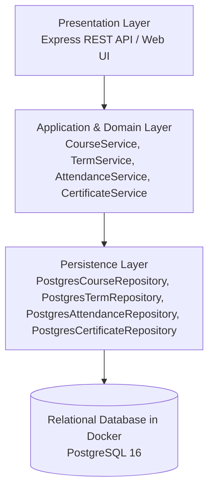
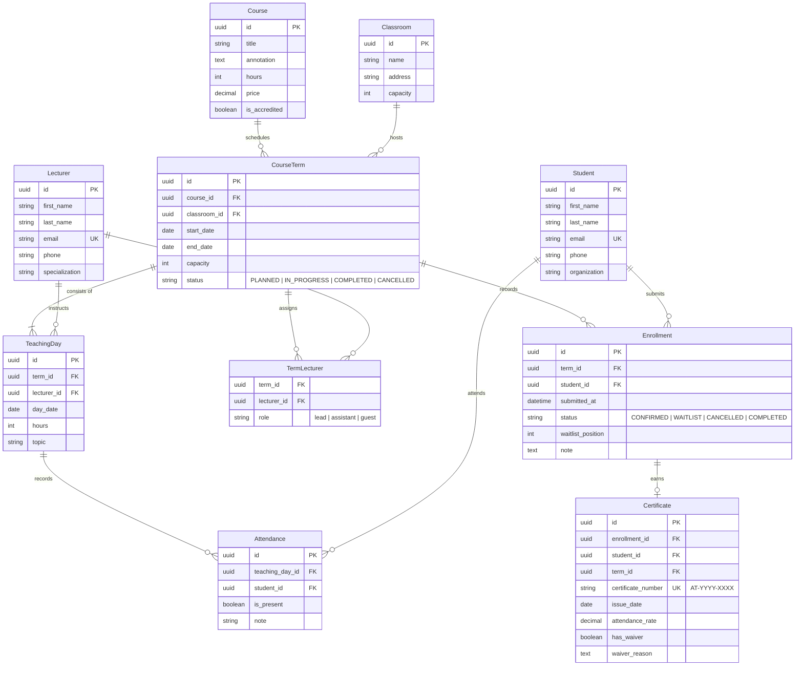

# Informační systém pro vzdělávací centrum (Akademie Trutnov)
> **Předmět:** Pokročilé programování (PPRO), ZS 2026/2027  
> **Semestrální projekt:** Zadání C – Kurzy vzdělávacího centra  
> **Klient:** Ing. Lucie Bartošová, Akademie Trutnov  
> **Status dokumentu:** Jediný zdroj pravdy (Single Source of Truth – technická dokumentace a zadání)

---

## Obsah
1. [Kontext a specifikace klienta](#1-kontext-a-specifikace-klienta)
2. [Otevřené body a Seznam rozhodnutí (ADR)](#2-otevřené-body-a-seznam-rozhodnutí-adr)
3. [Architektura a technický návrh](#3-architektura-a-technický-návrh)
4. [Doménový a datový model (English Model)](#4-doménový-a-datový-model-english-model)
5. [Infrastruktura a spuštění projektu](#5-infrastruktura-a-spuštění-projektu)
6. [Testovací strategie](#6-testovací-strategie)
7. [Stav implementace a Roadmapa](#7-stav-implementace-a-roadmapa)

---

## 1. Kontext a specifikace klienta

### 1.1 Výchozí stav (Jak to v Akademii Trutnov funguje dnes)
Akademie Trutnov pořádá přibližně 40 rekvalifikačních a firemních kurzů ročně za účasti externích lektorů. Aktuální agenda je vedena manuálně:
- Zájemci se hlásí webovým formulářem do e-mailu, odkud jsou přihlášky ručně přepisovány do excelové tabulky (jedna záložka na kurz).
- Kapacity kurzů jsou hlídány pouze od oka. Pořadník náhradníků je řešen poznámkami tužkou na okraji papíru.
- Když účastník na poslední chvíli odřekne, recepce ztrácí čas zjišťováním, kdo je první na řadě.
- Osvědčení o absolvování jsou ručně připravována v MS Wordu. Čísla osvědčení jsou odvozována ručním čítáním, což již v minulosti vedlo k vystavení duplicitních čísel certifikátů.

### 1.2 Funkční požadavky klienta
1. **Evidence kurzů (`courses`):** Název, textová anotace, hodinový rozsah, základní cena, příznak akreditace MŠMT/MPSV.
2. **Termíny kurzů (`course_terms`):** Jeden kurz se opakuje vícekrát ročně. Termín má přesné datum od–do, místo konání (učebnu) a kapacitu odvozenou od parametrů učebny.
3. **Lektoři a jejich přiřazení (`lecturers`, `term_lecturers`):** Evidence externích lektorů. Lektor může vést více termínů, na delších kurzech se mohou střídat dva i více lektorů.
4. **Přihlášky studentů na termín (`enrollments`, `students`):** Student se může zapsat na více kurzů, na daném termínu je zapsáno více studentů.
5. **Kapacita a pořadník (Waiting list):**
   - Po naplnění kapacity termínu jsou další zájemci automaticky zařazeni do pořadníku s přesnou evidencí pořadí.
   - Při uvolnění kapacity (zrušení přihlášky) je ihned garantován posun prvního náhradníka v pořadí.
6. **Evidence docházky (`teaching_days`, `attendance`):** Záznam účasti studentů na jednotlivých výukových dnech vícedenních termínů.
7. **Dokončení kurzu a osvědčení (`certificates`):**
   - Uzavření termínu a vygenerování seznamu absolventů.
   - Vystavení osvědčení s garantovaně unikátním evidenčním číslem (`AT-YYYY-XXXX`) a datem vydání (ADR-01).
8. **Analytické přehledy (`analytics`):**
   - Vytížení a procentuální naplněnost termínů.
   - Sumář odučených hodin za jednotlivé lektory.
   - Přehled studentů přihlášených na více než jeden kurz v daném roce.

### 1.3 Obchodní pravidla (Na čem klient trvá)
- **Striktní strop kapacity:** Kapacitu termínu nelze za žádných okolností překročit (žádný overbooking).
- **Integrita pořadníku:** Pořadí zájemců v pořadníku se nesmí přeskakovat.
- **Unikátnost osvědčení:** Číslo osvědčení musí být v rámci celého systému unikátní. Již vydané osvědčení je neměnné (auditní stopa).
- **Nemažeme historii:** Zrušená přihláška se fyzicky z databáze nemaže; zůstává dohledatelná ve stavu `CANCELLED` včetně časového razítka a důvodu zrušení.

---

## 2. Otevřené body a Seznam rozhodnutí (ADR)

Následující tabulka a rozhodnutí řeší nejasnosti, protichůdné představy zadavatele i architektonická zvážení:

| # | Otevřený bod klienta / Rozhodnutí | Klíčové dilema | Přijaté architektonické rozhodnutí |
|---|---|---|---|
| **ADR-01** | **Kdo rozhoduje o dokončení kurzu** | 70% docházka vs. subjektivní posouzení lektorem | **Hybridní model s pravidlem 70 % + veto/výjimka lektora:** Systém automaticky kvalifikuje studenta při dosažení alespoň 70% účasti. Lektor má možnost udělit výjimku (při 60–69 % s písemným odůvodněním) nebo naopak neudělit zápočet z odborných důvodů. Číslo osvědčení má tvar `AT-YYYY-XXXX`. |
| **ADR-02** | **Posun z pořadníku při uvolnění místa** | Zcela automatický zápis vs. manuální potvrzování | **Okamžitý transakční posun z pořadníku:** Při zrušení potvrzené přihlášky transakce automaticky povýší prvního čekatele v pořadníku (`waitlist_position = 1`) na potvrzenou účast a posune pořadí ostatních čekatelů o 1 dopředu. |
| **ADR-03** | **Souběh termínů téhož kurzu** | Možnost podat přihlášku na dva termíny naráz | **Zákaz souběhu aktivních přihlášek na stejný kurz:** Student smí mít na stejný kurz pouze jednu platnou (potvrzenou) přihlášku. Je však povoleno být zapsán v pořadníku na jiný termín. |
| **ADR-04** | **Přihlášení studenta po zahájení kurzu** | Pravidlo „nejde to“ vs. neformální výjimky | **Řízená výjimka administrátora do 20 % dotace:** Po zahájení kurzu je standardní registrace uzamčena. Dodatečný zápis smí provést pouze recepce/administrátor s označením výjimky, a to maximálně do proběhnutí 20 % hodinové dotace. |
| **ADR-05** | **Jeden lektor vs. více lektorů na termínu** | Střídání lektorů vs. agregace hodin na lektora | **Rozpad termínu na výukové dny (`TeachingDay`) s vazbou M:N:** Termín se skládá z jednotlivých výukových dnů/bloků, z nichž každý má přiřazeného konkrétního lektora. Přehledy agregují skutečně odučené hodiny přes tyto dílčí bloky. |
| **ADR-06** | **Použití Strapi jako administrace** | Použít headless CMS Strapi vs. vlastní modulární administraci | **Zamítnuto – Vlastní modulární SPA administrace:** Zhodnocení Strapi ukázalo, že pro potřeby předmětu PPRO a specifikaci Akademie Trutnov je Strapi nevhodné (viz detailní analýza níže). |

### Detailní analýza ADR-06: Vhodnost použití Strapi jako administrace
Dotaz zadavatele/uživatele: *„Zkus zjistit, zdali je vhodné použít Strapi jako administraci.“*

1. **Akademický kontext a požadavky předmětu PPRO (FIM UHK):**
   - V předmětu PPRO se hodnotí schopnost studenta navrhnout a implementovat **čistou třívrstvou architekturu** (Prezentace -> Doména/Aplikace -> Perzistence), doménové invarianty, unit testy byznys pravidel a transakční integritu.
   - Pokud by byla administrace svěřena Strapi, doménová logika (hlídání kapacit bez overbookingu, kaskádový posun v pořadníku ADR-02, 70% pravidlo ADR-01, sekvenční generování unikátních čísel certifikátů) by se musela lámat do interních hooků/životních cyklů Strapi (lifecycles / controllers). Tím by došlo ke stření čistých hranic třívrstvé architektury.
2. **Databázové schéma a verzované migrace:**
   - Strapi si vynucuje vlastní správu databáze, vytváří desítky systémových tabulek (`strapi_core_store_settings`, `up_users`, `admin_users` apod.) a mění strukturu cizích klíčů a sloupců.
   - Požadavek PPRO striktně stanovuje: *„Řízené verzované migrace (žádné ruční vytváření tabulek mimo migrační skripty)“*. Propojení Strapi s vlastními SQL migracemi by vedlo ke kolizím a nekonzistencím.
3. **Výkon a provozní náročnost:**
   - Strapi vyžaduje vlastní Node.js proces s vysokou spotřebou paměti (300–600 MB RAM jen pro admin), rozsáhlý strom závislostí a zdlouhavý build.
   - V `docker compose up` by to znamenalo buď nahradit celý backend systémem Strapi (což porušuje zadání), nebo provozovat dva nezávislé servery s duplicitním připojením do PostgreSQL.
4. **Závěr a doporučení:**
   - **Použití Strapi pro hlavní administraci NENÍ vhodné.**
   - Jako optimální řešení je implementováno přehledné, responzivní Web UI přímo v prezentační vrstvě aplikace, napojené na čisté REST API. Poskytuje přesně ty funkce, které Akademie Trutnov potřebuje (zápis docházky na jedno kliknutí, okamžitý posun z pořadníku, uzavření kurzu a generování certifikátů).

---

## 3. Architektura a technický návrh

Projekt je navržen v souladu s pravidly předmětu **PPRO** jako modulární třívrstvá aplikace s jednosměrnými závislostmi. Veškeré názvy tříd, metod, rozhraní, databázových entit a tabulek jsou **v anglickém jazyce**.



### 3.1 Vrstvy aplikace
1. **Presentation Layer (`src/presentation/`):**
   - Obsluhuje HTTP požadavky, mapuje DTO a zprostředkovává REST rozhraní i webovou administraci.
   - Neobsahuje žádnou doménovou logiku ani přímé SQL dotazy.
2. **Application & Domain Layer (`src/application/`, `src/domain/`):**
   - Zajišťuje byznys logiku: validace kurzů, atomická správa kapacit termínů, čekací listina (ADR-02), výpočet procenta docházky (ADR-01, ADR-05) a vydávání osvědčení.
   - Entitní modely jsou nezávislé na frameworku Express i databázi.
3. **Persistence Layer (`src/infrastructure/`):**
   - Implementuje repozitáře s přístupem do PostgreSQL přes connection pool.
   - Zajišťuje transakční bezpečnost (`BEGIN / COMMIT / ROLLBACK`) při posunech v pořadníku a vydávání certifikátů.

---

## 4. Doménový a datový model (English Model)

Kompletní doménový model obsahuje 10 entit a tabulek v anglickém jazyce včetně bohatých relací M:N a 1:N:



---

## 5. Infrastruktura a spuštění projektu

### 5.1 Použitý technologický stack
- **Běhové prostředí:** Node.js (TypeScript, ES Modules, `strict` mode)
- **Prezentační vrstva:** Express REST API + responzivní Web UI (Dark/Light režim s perzistencí, záložky pro Kurzy, Termíny, Docházku, Osvědčení, Lektory a Výkazy)
- **Aplikační vrstva:** Doménové služby (`CourseService`, `TermService`, `AttendanceService`, `CertificateService`), DTOs a validace invariantů
- **Perzistentní vrstva:** PostgreSQL 16 (přes `pg` connection pool), verzované SQL migrace (`migrations/`)
- **Kontejnerizace:** Docker & Docker Compose

### 5.2 Lokální spuštění v Dockeru (doporučeno pro obhajobu)
Celý stack (databáze + migrace + webová aplikace) se spouští jediným příkazem:
```bash
docker compose up --build
```
Aplikace bude následně dostupná:
- **Webový informační systém:** [http://localhost:3000](http://localhost:3000)
- **REST API kurzů:** [http://localhost:3000/api/courses](http://localhost:3000/api/courses)
- **REST API termínů:** [http://localhost:3000/api/terms](http://localhost:3000/api/terms)
- **REST API docházky:** [http://localhost:3000/api/attendance](http://localhost:3000/api/attendance)
- **REST API certifikátů:** [http://localhost:3000/api/certificates](http://localhost:3000/api/certificates)
- **Health check:** [http://localhost:3000/health](http://localhost:3000/health)

### 5.3 Lokální vývojové spuštění (bez Dockeru)
1. Spuštění PostgreSQL databáze na portu 5432 (dle konfigurace v `.env`).
2. Instalace závislostí a spuštění:
```bash
npm install
npm run migrate   # aplikuje migrace ze složky migrations/
npm run dev       # spustí aplikaci ve sledovacím režimu
```

### 5.4 REST API rozhraní (Primary English + zpětné české aliasy)
| Metoda | Endpoint | Popis |
|---|---|---|
| `GET` | `/api/courses` | Seznam všech kurzů (volitelné query parametry: `?accredited=true\|false&query=dotaz`) |
| `GET` | `/api/courses/:id` | Detail vybraného kurzu podle UUID |
| `POST` | `/api/courses` | Vytvoření nového kurzu s validací polí |
| `PUT` | `/api/courses/:id` | Aktualizace parametrů kurzu |
| `DELETE` | `/api/courses/:id` | Smazání kurzu |
| `GET` | `/api/terms` | Seznam vypsaných termínů (obsazenost, kapacita, lektoři) |
| `POST` | `/api/terms` | Vypsání nového termínu kurzu s kapacitou a učebnou |
| `GET` | `/api/terms/:id/enrollments` | Seznam studentů na termínu (potvrzení i čekatelé v pořadníku) |
| `POST` | `/api/terms/:id/enrollments` | Přihlášení studenta na termín (alokace místa / pořadník ADR-02, prevence souběhu ADR-03) |
| `POST` | `/api/enrollments/:id/cancel` | Zrušení přihlášky s okamžitým posunem prvního náhradníka z pořadníku (ADR-02) |
| `GET` | `/api/attendance/terms/:termId/days` | Výukové dny vybraného termínu (ADR-05) |
| `POST` | `/api/attendance/terms/:termId/days` | Přidání nového výukového dne s lektorem a tématem |
| `GET` | `/api/attendance/days/:dayId` | Prezenční listina studentů na daném výukovém dni |
| `POST` | `/api/attendance/days/:dayId/mark` | Záznam přítomnosti studenta na výuce |
| `GET` | `/api/attendance/terms/:termId/summary` | Procentuální docházka studentů a kontrola 70% pravidla (ADR-01) |
| `POST` | `/api/terms/:termId/complete` | Uzavření termínu a automatické vystavení osvědčení kvalifikovaným studentům |
| `GET` | `/api/certificates` | Seznam všech vystavených certifikátů (`AT-YYYY-XXXX`) |
| `POST` | `/api/certificates/issue` | Vystavení certifikátu se schválenou výjimkou lektora (ADR-01) |
| `GET` | `/api/lecturers` | Seznam externích lektorů, jejich termíny a odučené hodiny |
| `GET` | `/api/classrooms` | Přehled učeben s jejich maximální kapacitou |
| `GET` | `/api/students` | Přehled studentů a jejich přihlášek |
| `GET` | `/api/analytics` | Analytické manažerské výkazy (vytížení, lektorské hodiny, studenti s více kurzy) |

*(Poznámka: Pro zpětnou kompatibilitu jsou zachovány i původní české endpointy jako `/api/kurzy`, `/api/terminy`, `/api/prihlasky`, `/api/prehledy`.)*

---

## 6. Testovací strategie

Projekt obsahuje ucelenou sadu unit testů spouštěných nativním Node test runnerem (`npm test`).
Testy jsou rozděleny do 3 doménových testovacích sad (20 testů celkem):

1. **`CourseService and Course Entity` (7 testů):**
   - Vytvoření kurzu se správnými parametry.
   - Validace délky názvu (3–150 znaků).
   - Validace kladného rozsahu hodin (> 0).
   - Validace nezáporné ceny.
   - Filtrování podle akreditace a vyhledávacího dotazu.
   - Aktualizace parametrů a smazání kurzu.
2. **`CourseTerm and Enrollment Entities & Waiting List` (5 testů):**
   - Vytvoření platného termínu s kapacitou.
   - Detekce plné kapacity termínu (žádná volná místa).
   - Validace časového intervalu (datum začátku <= datum konce).
   - Validace kladné kapacity míst.
   - Invariant pořadníku: čekatel na waitlistu musí mít kladné pořadové číslo (ADR-02).
3. **`Attendance and Certificate Entities (ADR-01 & ADR-05)` (8 testů):**
   - Vytvoření platného výukového dne s lektorem.
   - Validace minimální délky tématu a kladného počtu hodin dne.
   - Záznam přítomnosti studenta na prezenční listině.
   - Automatická kvalifikace a vystavení osvědčení při docházce >= 70 % (ADR-01).
   - Striktní odmítnutí vystavení certifikátu při docházce < 70 % bez lektorské výjimky.
   - Schválení certifikátu při docházce < 70 % na základě výjimky lektora s odůvodněním.
   - Odmítnutí výjimky lektora, pokud chybí písemné odůvodnění.
   - Validace formátu čísla certifikátu dle masky `AT-YYYY-XXXX`.

Spuštění testů:
```bash
npm test
```

---

## 7. Stav implementace a Roadmapa

- [x] Inicializace Git repozitáře a propojení s GitHub `sifalma1/PPRO2026`
- [x] Vytvoření pravidel vývoje a chování asistenta ([AGENTS.md](file:///c:/Users/skitt/Documents/PPRO/AGENTS.md))
- [x] Zpracování zadání C a definice architektonických rozhodnutí (ADR-01 až ADR-06) v [README.md](file:///c:/Users/skitt/Documents/PPRO/README.md)
- [x] Nastavení Git hooku pro kontrolu dokumentace před commitem
- [x] **Fáze 1 & 2 – Správa entit, anglické pojmenování a třívrstvá architektura:**
  - [x] Třívrstvá architektura (Presentation, Application, Infrastructure/Persistence)
  - [x] Přejmenování všech entit, modelů, tabulek a rozhraní do angličtiny napříč celým projektem
  - [x] Databázové schéma a verzované migrace (`001` až `005`)
  - [x] Dockerfile a `docker-compose.yml` s PostgreSQL kontejnerem
  - [x] Entita `Course` a katalog kurzů
  - [x] Entita `Classroom` a místa konání s kapacitou
  - [x] Entita `CourseTerm` s vazbou na kurz a učebnu
  - [x] Entita `Lecturer` a přiřazení k termínům (vazba M:N `term_lecturers`)
  - [x] Entita `Student` a `Enrollment` s logikou pořadníku (Waiting list, ADR-02)
  - [x] Automatický transakční posun náhradníka z pořadníku při uvolnění místa
  - [x] Prevence souběhu aktivních přihlášek na stejný kurz (ADR-03)
  - [x] Manažerské přehledy a statistiky dle bodu 8 zadání
- [x] **Fáze 3 – Evidence docházky a Osvědčení (Kompletní dokončení zadání):**
  - [x] Entita `TeachingDay` – rozpad termínu na výukové dny s přiřazeným lektorem (ADR-05)
  - [x] Entita `Attendance` – prezenční listina docházky po jednotlivých výukových dnech
  - [x] Kalkulace docházky a kontrola 70% pravidla pro vystavení osvědčení (ADR-01)
  - [x] Entita `Certificate` s garantovaně unikátním evidenčním číslem `AT-YYYY-XXXX`
  - [x] Možnost lektorské výjimky s písemným odůvodněním pro studenty s docházkou pod 70 %
  - [x] Webové uživatelské rozhraní: záložky Kurzy, Termíny & Pořadník, Evidence docházky, Osvědčení & Absolventi, Lektoři & Učebny, Přehledy & Výkazy
  - [x] Komplexní sada 20 unit testů pokrývající všechna obchodní pravidla
- [x] **Zhodnocení a doporučení k administraci Strapi (ADR-06)**
