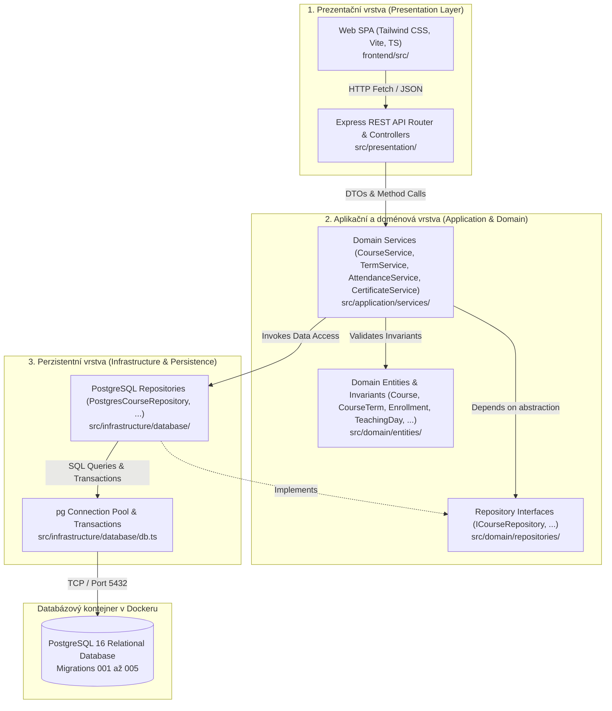
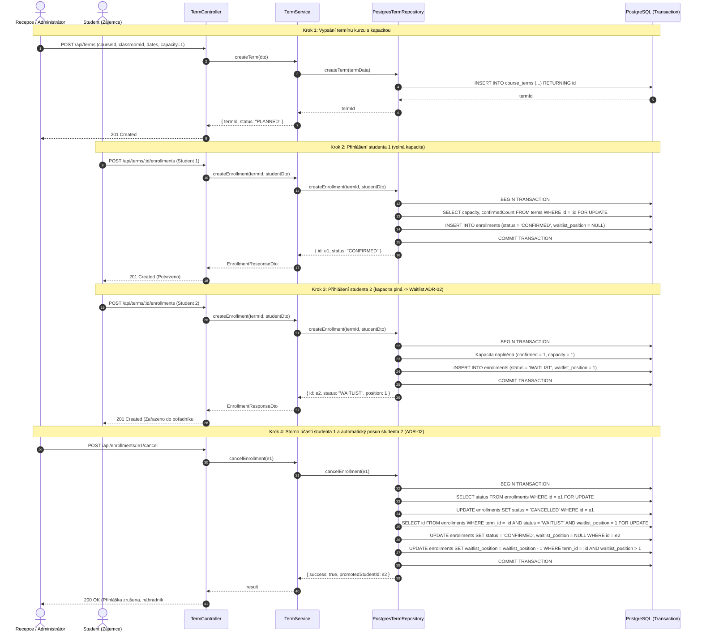
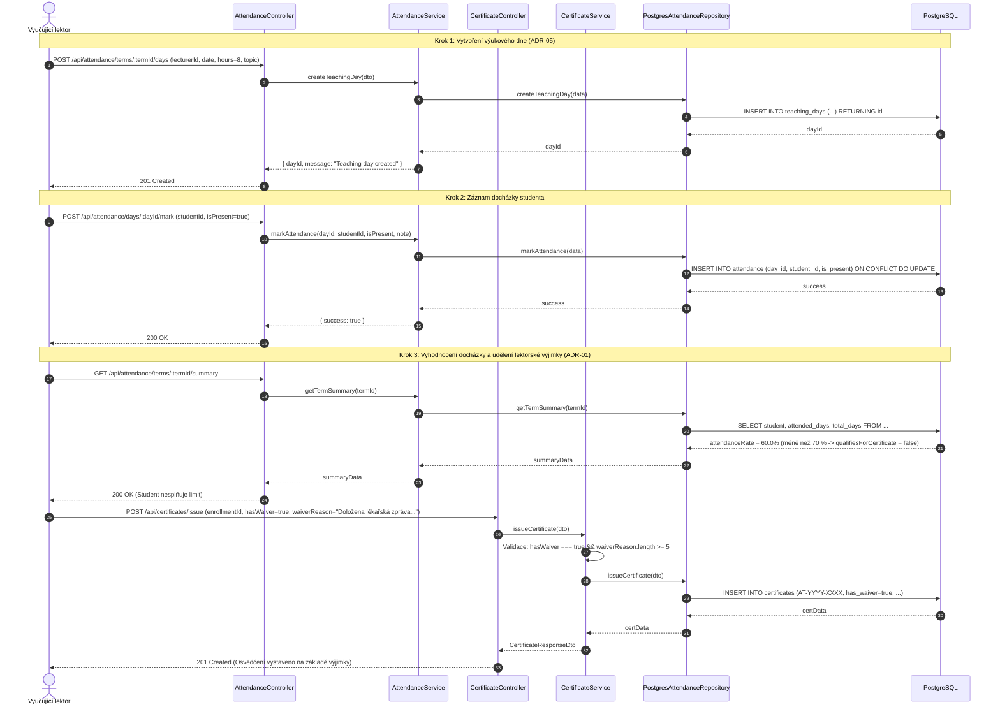
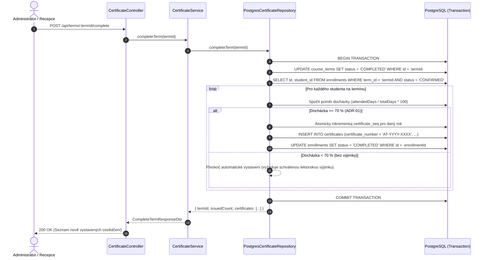
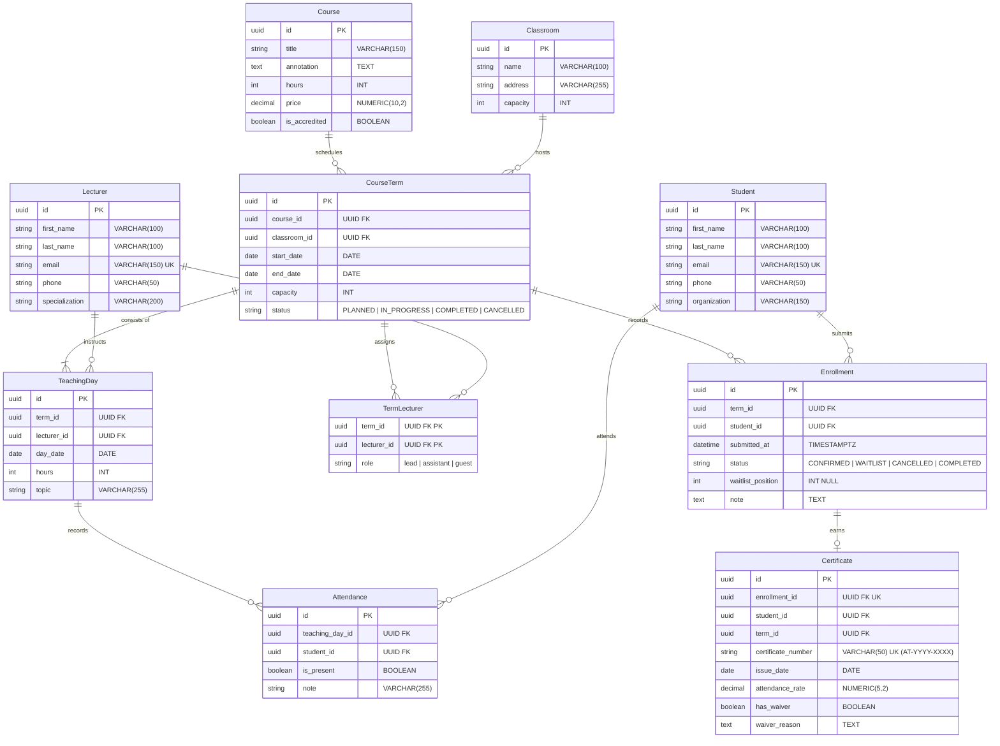

# Informační systém pro vzdělávací centrum (Akademie Trutnov)

> **Předmět:** Pokročilé programování (PPRO), ZS 2026/2027  
> **Semestrální projekt:** Zadání C – Kurzy vzdělávacího centra  
> **Klient:** Ing. Lucie Bartošová, ředitelka Akademie Trutnov  
> **Autor:** Marek Šifalda  
> **Status dokumentu:** Jediný závazný zdroj pravdy (Single Source of Truth – technická a architektonická dokumentace dle [AGENTS.md](file:///C:/Users/skitt/Documents/PPRO/AGENTS.md))

---

## Obsah

1. [Kontext a specifikace klienta](#1-kontext-a-specifikace-klienta)
   - 1.1 [Výchozí stav a motivace](#11-výchozí-stav-a-motivace)
   - 1.2 [Funkční požadavky klienta](#12-funkční-požadavky-klienta)
   - 1.3 [Obchodní pravidla a invarianty](#13-obchodní-pravidla-a-invarianty)
   - 1.4 [Role uživatelů v systému (Aktéři)](#14-role-uživatelů-v-systému-aktéři)
2. [Otevřené body a Seznam architektonických rozhodnutí (ADR)](#2-otevřené-body-a-seznam-architektonických-rozhodnutí-adr)
   - [ADR-01: Kritéria dokončení kurzu a certifikace (pravidlo 70 % + lektorská výjimka)](#adr-01-kritéria-dokončení-kurzu-a-certifikace-pravidlo-70--lektorská-výjimka)
   - [ADR-02: Automatický transakční posun z čekací listiny (pořadníku) při uvolnění místa](#adr-02-automatický-transakční-posun-z-čekací-listiny-pořadníku-při-uvolnění-místa)
   - [ADR-03: Zákaz souběhu aktivních přihlášek na stejný kurz](#adr-03-zákaz-souběhu-aktivních-přihlášek-na-stejný-kurz)
   - [ADR-04: Testovací a perzistentní strategie (In-Memory repozitáře vs. Produkční PostgreSQL 16 v Dockeru) a pravidlo dodatečného zápisu](#adr-04-testovací-a-perzistentní-strategie-in-memory-repozitáře-vs-produkční-postgresql-16-v-dockeru-a-pravidlo-dodatečného-zápisu)
   - [ADR-05: Více lektorů na termínu a rozpad na výukové dny (M:N)](#adr-05-více-lektorů-na-termínu-a-rozpad-na-výukové-dny-mn)
   - [ADR-06: Vyhodnocení vhodnosti Strapi CMS jako administrace (Zamítnuto)](#adr-06-vyhodnocení-vhodnosti-strapi-cms-jako-administrace-zamítnuto)
   - [ADR-07: Role-Based Access Control (RBAC), Administrátorská a Studentská autentizace](#adr-07-role-based-access-control-rbac-administrátorská-a-studentská-autentizace)
   - [ADR-08: Způsob filtrace vypsaných termínů při prokliku z kurzu a možnost zrušení filtru (R15, Z14)](#adr-08-způsob-filtrace-vypsaných-termínů-při-prokliku-z-kurzu-a-možnost-zrušení-filtru-r15-z14)
   - [ADR-09: Rozšíření testovacích zápisů pro klientský portál studenta (různé stavy CONFIRMED, WAITLIST, COMPLETED a evidence docházky) (R16, Z15)](#adr-09-rozšíření-testovacích-zápisů-pro-klientský-portál-studenta-různé-stavy-confirmed-waitlist-completed-a-evidence-docházky-r16-z15)
   - [Přehled všech rozhodnutí (R1–R16) a změn požadovaných klientem (Z1–Z15)](#přehled-všech-rozhodnutí-r1r16-a-změn-požadovaných-klientem-z1z15)
3. [Třívrstvá architektura a technický návrh](#3-třívrstvá-architektura-a-technický-návrh)
   - 3.1 [Třívrstvá architektura a vrstvy aplikace](#31-třívrstvá-architektura-a-vrstvy-aplikace)
   - 3.2 [Sekvenční diagram: Vypsání termínu a přihlášení s čekací listinou (ADR-02)](#32-sekvenční-diagram-vypsání-termínu-a-přihlášení-s-čekací-listinou-adr-02)
   - 3.3 [Sekvenční diagram: Zápis docházky na výukovém dni a lektorská výjimka (ADR-01, ADR-05)](#33-sekvenční-diagram-zápis-docházky-na-výukovém-dni-a-lektorská-výjimka-adr-01-adr-05)
   - 3.4 [Sekvenční diagram: Uzavření termínu a vystavení osvědčení (ADR-01)](#34-sekvenční-diagram-uzavření-termínu-a-vystavení-osvědčení-adr-01)
4. [Doménový a datový model (English Model & Data Dictionary)](#4-doménový-a-datový-model-english-model--data-dictionary)
   - 4.1 [Mermaid ER Diagram (10 entit)](#41-mermaid-er-diagram-10-entit)
   - 4.2 [Katalog a specifikace doménových entit](#42-katalog-a-specifikace-doménových-entit)
   - 4.3 [Konsolidovaná seed data a integrita produkční databáze](#43-konsolidovaná-seed-data-a-integrita-produkční-databáze)
5. [Frontendová architektura (Vite + TypeScript + Tailwind CSS)](#5-frontendová-architektura-vite--typescript--tailwind-css)
   - 5.1 [Architektonický koncept a vrstvy frontendu](#51-architektonický-koncept-a-vrstvy-frontendu)
   - 5.2 [Struktura adresáře frontend/src/ a popis modulů](#52-struktura-adresáře-frontendsrc-a-popis-modulů)
   - 5.3 [Komponenty uživatelského rozhraní (Header, Modal, Toast)](#53-komponenty-uživatelského-rozhraní-header-modal-toast)
   - 5.4 [Fantasy design systém dle Kurzy-Projekt.webp, runové tabulky a barevné tokeny](#54-fantasy-design-systém-dle-kurzy-projektwebp-runové-tabulky-a-barevné-tokeny)
   - 5.5 [Produkční build a integrace s Express backendem](#55-produkční-build-a-integrace-s-express-backendem)
6. [Kompletní katalog REST API rozhraní](#6-kompletní-katalog-rest-api-rozhraní)
   - 6.1 [Konvence a společné formáty odpovědí](#61-konvence-a-společné-formáty-odpovědí)
   - 6.2 [Autentizace a autorizace (/api/auth, /api/student)](#62-autentizace-a-autorizace-apiauth-apistudent)
   - 6.3 [Kurzy (/api/courses)](#63-kurzy-apicourses)
   - 6.4 [Termíny a přihlášky s čekací listinou (/api/terms, /api/enrollments)](#64-termíny-a-přihlášky-s-čekací-listinou-apiterms-apienrollments)
   - 6.5 [Evidence docházky a výukové dny (/api/attendance)](#65-evidence-docházky-a-výukové-dny-apiattendance)
   - 6.6 [Osvědčení a certifikáty (/api/certificates)](#66-osvědčení-a-certifikáty-apicertificates)
   - 6.7 [Číselníky a manažerská analytika (/api/lecturers, /api/classrooms, /api/students, /api/analytics, /health)](#67-číselníky-a-manažerská-analytika-apilecturers-apiclassrooms-apistudents-apianalytics-health)
   - 6.8 [Zpětně kompatibilní české aliasy](#68-zpětně-kompatibilní-české-aliasy)
7. [Infrastruktura a spuštění projektu](#7-infrastruktura-a-spuštění-projektu)
   - 7.1 [Použitý technologický stack](#71-použitý-technologický-stack)
   - 7.2 [Lokální spuštění v Dockeru (doporučeno pro obhajobu)](#72-lokální-spuštění-v-dockeru-doporučeno-pro-obhajobu)
   - 7.3 [Lokální vývojové spuštění (bez Dockeru)](#73-lokální-vývojové-spuštění-bez-dockeru)
   - 7.4 [Přehled všech npm skriptů](#74-přehled-všech-npm-skriptů)
8. [Testovací strategie a zajištění kvality](#8-testovací-strategie-a-zajištění-kvality)
   - 8.1 [Přehled testovací strategie (dvoustupňový testovací harness)](#81-přehled-testovací-strategie-dvoustupňový-testovací-harness)
   - 8.2 [Nativní Node test runner (35 testů – 26 unit + 9 E2E)](#82-nativní-node-test-runner-35-testů--26-unit--9-e2e)
   - 8.3 [Komplexní testovací sada v Jestu s TypeScript & ESM (170 testů)](#83-komplexní-testovací-sada-v-jestu-s-typescript--esm-170-testů)
   - 8.4 [Souhrnná tabulka testovacího pokrytí (205 testů, 100% pass)](#84-souhrnná-tabulka-testovacího-pokrytí-205-testů-100-pass)
   - 8.5 [Kvalita kódu, linting a formátování (ESLint + Prettier)](#85-kvalita-kódu-linting-a-formátování-eslint--prettier)
9. [Přehled plnění požadavků zadání klienta (100% HOTOVO)](#9-přehled-plnění-požadavků-zadání-klienta-100-hotovo)
   - 9.1 [Tabulka plnění 8 bodů zadání](#91-tabulka-plnění-8-bodů-zadání)
10. [Historie verzí (Changelog) a Roadmapa](#10-historie-verzí-changelog-a-roadmapa)
    - 10.1 [Historie verzí (Changelog v1.0.0 až v1.9.6)](#101-historie-verzí-changelog-v100-až-v196)
    - 10.2 [Roadmapa dalšího rozvoje](#102-roadmapa-dalšího-rozvoje)

---

## 1. Kontext a specifikace klienta

### 1.1 Výchozí stav a motivace

Akademie Trutnov pořádá přibližně 40 rekvalifikačních a firemních kurzů ročně za účasti externích odborných lektorů. Do zavedení tohoto informačního systému byla veškerá provozní agenda vedena neudržitelným manuálním způsobem:

- **E-maily a přepisování do Excelu:** Zájemci o kurzy odesílali přihlášky z jednoduchého webového formuláře na centrální e-mail recepce. Pracovníci recepce následně údaje ručně přepisovali do rozsáhlé excelové tabulky (jedna záložka pro každý vypsaný kurz).
- **Subjektivní hlídání kapacit a papírový pořadník:** Kapacity učeben a termínů byly kontrolovány pouze odhadem. Čekací listina náhradníků byla evidována na papírových lístečcích a poznámkách po okrajích tiskopisů.
- **Propadnutí míst při odřeknutí studenta:** Pokud přihlášený student na poslední chvíli zrušil svou účast (např. den před začátkem kurzu), recepce musela zdlouhavě dohledávat kontakty na náhradníky. Než se podařilo zájemce kontaktovat, kurz byl zahájen a uvolněné místo propadlo bez náhrady, což znamenalo přímou finanční ztrátu pro centrum.
- **Riziko duplicitních certifikátů v MS Wordu:** Osvědčení o absolvování rekvalifikačních kurzů byla ručně generována ve wordových šablonách. Čísla certifikátů byla odvozována ručním čítáním, což v minulosti vedlo k vystavení identických evidenčních čísel pro různé studenty a následným komplikacím při kontrolách z dotačních úřadů (Úřad práce ČR, MPSV).
- **Absence manažerského přehledu:** Vedení centra nemělo okamžitý přehled o vytížení učeben, sumáři skutečně odučených hodin jednotlivých lektorů pro měsíční fakturaci ani o loajalitě studentů přihlašujících se na více kurzů ročně.

### 1.2 Funkční požadavky klienta

Na základě konzultací s ředitelkou vzdělávacího centra **Ing. Lucií Bartošovou** bylo definováno následujících 8 klíčových oblastí agendy:

1. **Evidence kurzů (`courses`):** Katalog vzdělávacích programů zahrnující název kurzu, podrobnou textovou anotaci, celkový hodinový rozsah, základní cenu (včetně podpory bezplatných úvodních seminářů s cenou 0 Kč) a příznak oficiální akreditace MŠMT / MPSV.
2. **Termíny kurzů (`course_terms`):** Možnost vypsat tentýž kurz vícekrát v průběhu kalendářního roku. Každý termín má definováno datum zahájení a ukončení, přiřazenou konkrétní učebnu a maximální kapacitu odvozenou od parametrů učebny.
3. **Lektoři a jejich přiřazení (`lecturers`, `term_lecturers`):** Adresář externích i interních lektorů s jejich odbornou specializací. Jeden lektor může vést více různých termínů a na delších kurzech se mohou střídat dva i více lektorů (vazba M:N).
4. **Přihlášky studentů na termín (`enrollments`, `students`):** Student se může přihlásit na více kurzů současně. Na daném termínu je zapsána skupina studentů.
5. **Kapacita a pořadník (Waiting list):**
   - Po dosažení maximální kapacity termínu systém nepovolí overbooking, nýbrž další zájemce automaticky zařadí do pořadníku s přesně evidovanou pozicí (`waitlist_position = 1, 2, ...`).
   - Při zrušení potvrzené přihlášky je transakčně garantován okamžitý automatický posun prvního náhradníka na potvrzené místo bez manuálního zásahu personálu.
6. **Evidence docházky (`teaching_days`, `attendance`):** Záznam docházky a prezence studentů na jednotlivých výukových dnech a blocích vícedenních termínů.
7. **Dokončení kurzu a osvědčení (`certificates`):**
   - Hromadné uzavření termínu po proběhnutí všech výukových dnů.
   - Vyhodnocení docházky a automatické vystavení certifikátů studentům splňujícím docházkový limit (ADR-01).
   - Generování celosvětově unikátního čísla osvědčení ve formátu `AT-YYYY-XXXX`.
8. **Analytické přehledy (`analytics`):**
   - Procentuální vytížení a naplněnost termínů vůči maximální kapacitě.
   - Sumář skutečně odučených hodin za jednotlivé lektory pro podklady k fakturaci.
   - Přehled věrných studentů zapsaných na více kurzů v daném roce.

### 1.3 Obchodní pravidla a invarianty

Systém striktně vymáhá následující byznys pravidla na úrovni aplikačních služeb i databázových omezení:

- **Striktní strop kapacity (Zero Overbooking):** Kapacita termínu nesmí být nikdy překročena. Jakmile počet potvrzených přihlášek (`status = 'CONFIRMED'`) dosáhne hodnoty `capacity`, každý další zájemce je přepnut do stavu `WAITLIST`.
- **Integrita a sekvenčnost pořadníku:** Pozice náhradníků na čekací listině tvoří nepřerušenou číselnou řadu začínající od 1. Pořadí se nikdy nesmí přeskočit.
- **Globální unikátnost a neměnnost osvědčení:** Číslo certifikátu ve formátu `AT-YYYY-XXXX` je generováno z atomické sekvence v databázi. Jednou vydané osvědčení je trvale archivováno a nesmí být přepsáno ani smazáno (auditní stopa pro akreditační komisi).
- **Zákaz fyzického mazání historie (Audit Log):** Zrušená přihláška se z databáze neodstraňuje příkazem `DELETE`, nýbrž je označena stavem `CANCELLED` včetně časového razítka a případné poznámky o důvodu zrušení.

### 1.4 Role uživatelů v systému (Aktéři a RBAC)

1. **Recepce & Administrátor (`admin` / `admin123`):**
   - Plná správa kurzů (vytváření, editace, mazání), vypisování termínů a přiřazování učeben a lektorů.
   - Správa přihlášek: zápis libovolného studenta, ruční odbavování storen a posunů v pořadníku.
   - Přístup ke kompletnímu jmennému seznamu účastníků včetně kontaktních údajů (telefon, e-mail, organizace, interní poznámky).
   - Zápis a editace prezence na výukových dnech, formální uzavření termínu a hromadné vystavení osvědčení.
   - Přístup k manažerským přehledům, vytížení učeben a výkazům dotačních hodin.
2. **Student (`student` / `student123` nebo registrovaný e-mail např. `jan.novak@firma.cz`):**
   - Přístup do osobního klientského portálu (`GET /api/student/dashboard` / záložka _Můj profil_).
   - Přehled všech vlastních podaných přihlášek včetně aktuálního stavu (Potvrzena / Pozice v pořadníku náhradníků).
   - Průběžný stav docházky na zapsaných kurzech a přímý náhled / tisk vydaných absolventských osvědčení.
   - **Striktní zásada samoobslužnosti:** Přihlášený student může na vypsaný termín zapsat **výhradně sám sebe** (jeho jméno a e-mail jsou v přihlášce uzamčeny a ověřeny proti aktivní relaci; pokus o zápis cizího e-mailu vrátí HTTP 403 Forbidden).
   - **Ochrana před neoprávněným stornem:** Student může zrušit **pouze svou vlastní přihlášku**; cizí přihlášky nesmí stornovat (HTTP 403 Forbidden).
   - Z důvodu ochrany osobních údajů (GDPR) nevidí kontaktní údaje (telefony, e-maily, poznámky) ostatních zapsaných účastníků.
   - Nemá přístup do administrátorských agend (evidence docházky, kniha osvědčení, manažerské výkazy; pokus o přístup vrátí HTTP 403 Forbidden).
3. **Veřejný návštěvník (Public / Nepřihlášený uživatel):**
   - Anonymní prohlížení veřejného katalogu vzdělávacích programů a nabídky vypsaných termínů s informací o počtu volných míst.
   - **Zákaz anonymního zápisu:** Zápis na termín vyžaduje přihlášení (kliknutí na tlačítko zápisu vyzve k přihlášení studenta nebo administrátora).
   - **Zákaz anonymního storna:** Nepřihlášený uživatel nemůže stornovat žádnou přihlášku (HTTP 401 Unauthorized).
   - **Ochrana osobních údajů (GDPR):** Anonymní uživatel nevidí jmenné seznamy účastníků, jejich telefony, e-maily ani poznámky.
   - Veškeré administrátorské prvky a agendy (docházka, kniha osvědčení, lektoři, výkazy, tlačítka pro tvorbu/editaci/mazání) jsou před anonymním uživatelem v navigačním baru i v rozhraní zcela skryty.
4. **Lektor:**
   - Prohlíží si rozvrh svých výukových dnů.
   - Zapisuje prezenci účastníků (přítomen / nepřítomen / omluven) po skončení každého výukového dne.
   - Má pravomoc udělit výjimku z docházky studentovi, který nesplnil limit 70 %, na základě odborného posouzení a doloženého náhradního úkolu (s povinným písemným odůvodněním).
5. **Vedení vzdělávacího centra (Klient – Ing. Lucie Bartošová):**
   - Využívá manažerský dashboard pro kontrolu rentability, vytíženosti učeben a schvalování hodin lektorů před vyplacením honorářů.

---

## 2. Otevřené body a Seznam architektonických rozhodnutí (ADR)

Následující přehled dokumentuje klíčová architektonická rozhodnutí řešící protichůdné požadavky a nejasnosti v zadání klienta:

| #          | Otevřený bod klienta / Rozhodnutí                                                                                                          | Klíčové dilema                                                                                | Přijaté architektonické rozhodnutí                                                                                                                                                                                                                                                                                      |
| ---------- | ------------------------------------------------------------------------------------------------------------------------------------------ | --------------------------------------------------------------------------------------------- | ----------------------------------------------------------------------------------------------------------------------------------------------------------------------------------------------------------------------------------------------------------------------------------------------------------------------- |
| **ADR-01** | **Kritéria dokončení kurzu a certifikace**                                                                                                 | 70% docházka vs. subjektivní posouzení lektorem                                               | **Hybridní model s pravidlem 70 % + lektorská výjimka:** Systém automaticky kvalifikuje studenta při dosažení alespoň 70% účasti. Lektor má možnost udělit výjimku (s povinným písemným odůvodněním min. 5 znaků) nebo naopak neudělit zápočet z odborných důvodů. Číslo osvědčení má garantovaný tvar `AT-YYYY-XXXX`.  |
| **ADR-02** | **Posun z čekací listiny (pořadníku) při uvolnění místa**                                                                                  | Zcela automatický zápis vs. manuální potvrzování recepcí                                      | **Okamžitý atomický posun v rámci DB transakce:** Při stornu potvrzené přihlášky transakce s řádkovým zamykáním (`FOR UPDATE`) okamžitě povýší prvního čekatele (`waitlist_position = 1`) na potvrzenou účast a posune pořadí všech zbývajících čekatelů o 1 dopředu.                                                   |
| **ADR-03** | **Zákaz souběhu aktivních přihlášek na stejný kurz**                                                                                       | Možnost podat přihlášku na dva termíny naráz vs. blokace míst                                 | **Striktní zákaz souběhu potvrzených přihlášek:** Student smí mít na tentýž kurz pouze jednu platnou potvrzenou přihlášku (`CONFIRMED`). Zápis do pořadníku (`WAITLIST`) na alternativní termín je povolen jako záloha.                                                                                                 |
| **ADR-04** | **Testovací a perzistentní strategie a pravidlo dodatečného zápisu**                                                                       | Závislost testů na externí DB vs. In-memory repozitáře; registrace po zahájení kurzu          | **Dvoustupňová architektura úložiště:** Produkce využívá robustní PostgreSQL 16 s řízenými migracemi v Dockeru. Testy využívají in-memory repozitáře věrně simulující transakční logiku pro bleskový a izolovaný běh. Dodatečný zápis po zahájení kurzu je povolen pouze administrátorovi do max. 20 % hodinové dotace. |
| **ADR-05** | **Více lektorů na termínu a rozpad na výukové dny**                                                                                        | Agregace hodin na lektora vs. střídání lektorů na kurzu                                       | **Rozpad termínu na výukové dny (`TeachingDay`) s vazbou M:N:** Termín kurzu se skládá z jednotlivých výukových dnů, z nichž každý má přiřazeného konkrétního vyučujícího lektora. Analytika agreguje skutečně odučené hodiny přes tyto dílčí bloky.                                                                    |
| **ADR-06** | **Vyhodnocení vhodnosti Strapi CMS jako administrace**                                                                                     | Použít generované headless CMS Strapi vs. vlastní SPA administraci                            | **Zamítnuto – Vlastní modulární SPA administrace v Tailwind CSS:** Strapi bylo po důkladné analýze zamítnuto z důvodu porušení principů 3-vrstvé architektury PPRO, nekontrolovatelných systémových migrací a vysoké režie.                                                                                             |
| **ADR-07** | **Role-Based Access Control (RBAC), Administrátorská a Studentská autentizace**                                                            | Neomezený přístup k úpravám vs. Bezpečná autentizace a klientský portál studenta              | **Dvouúrovňový aplikační RBAC model bez zásahů do DB:** Veřejnost může číst katalog a podávat přihlášky. Administrátor má plná CRUD práva ke kurzům, termínům a docházce. Student se přihlašuje e-mailem, vidí své přihlášky, docházku a certifikáty, ale nesmí modifikovat kurzy ani termíny.                          |
| **ADR-08** | **Způsob filtrace vypsaných termínů při prokliku z kurzu a možnost zrušení filtru (R15, Z14)**                                             | Samostatný pohled/URL kurzu vs. parametrizovaný přechod na záložku termínů s bannerem zrušení | **Parametrizované filtrování v `TermsView.ts` přes event `akademie:switch-tab`:** Proklik z kurzu (i portálu studenta) předává `courseId`, aktivuje metodu `filterByCourse` v přehledu termínů a zobrazí notifikační banner s možností jedním kliknutím filtr zrušit („Zobrazit všechny termíny“).                      |
| **ADR-09** | **Rozšíření testovacích zápisů pro klientský portál studenta (různé stavy CONFIRMED, WAITLIST, COMPLETED a evidence docházky) (R16, Z15)** | Minimální testovací záznamy vs. komplexní demonstrace životního cyklu přihlášek               | **Obohacení syntetických dat a dashboardu:** Do SQL seedů i servisního fallbacku `AuthService` doplněna reprezentativní data pro studenta Jana Nováka pokrývající potvrzený zápis, pozici #1 v pořadníku náhradníků, dokončený kurz se 100% docházkou a vydané osvědčení `AT-2026-0003`.                                |

---

### ADR-01: Kritéria dokončení kurzu a certifikace (pravidlo 70 % + lektorská výjimka)

- **Kontext:** Klient požaduje jednoznačná pravidla pro vystavení osvědčení o absolvování kurzu, avšak praxe ukazuje, že striktní procento docházky může poškodit studenty s omluvenou absencí a vyřešeným náhradním úkolem.
- **Rozhodnutí:**
  - Výchozí hranice úspěšného absolvování je stanovena na **70 % docházky** (poměr `attended_days / total_days >= 0.70`).
  - Systém při uzavření termínu automaticky vystaví osvědčení všem studentům splňujícím hranici >= 70 %.
  - Pro studenty s docházkou pod 70 % má lektor/administrátor možnost vystavit osvědčení na základě **výjimky (`has_waiver = true`)**, která **vyžaduje písemné zdůvodnění o minimální délce 5 znaků** (např. doložení lékařské zprávy, vypracování doplňkového projektu).
  - Každé osvědčení obdrží celosvětově unikátní evidenční kód ve formátu `AT-YYYY-XXXX` generovaný z atomické čítací sekvence v databázi.
- **Důsledky:** Spravedlivý systém pro studenty, splnění legislativních nároků MŠMT na rekvalifikace a vyloučení lidské chyby při číslování diplomů.

### ADR-02: Automatický transakční posun z čekací listiny (pořadníku) při uvolnění místa

- **Kontext:** V případě odřeknutí účastníka na poslední chvíli docházelo v minulosti k prodlevám a prázdným místům v kurzu.
- **Rozhodnutí:**
  - Systém implementuje **automatický a atomický posun v rámci jediné databázové transakce** (`BEGIN ... COMMIT`) s explicitním řádkovým zámkem `SELECT ... FOR UPDATE`.
  - Pokud je zrušena potvrzená přihláška (`CONFIRMED`), transakce okamžitě vybere náhradníka s `waitlist_position = 1`, změní jeho status na `CONFIRMED`, vynuluje jeho pozici v pořadníku a sníží pozice všech zbývajících čekatelů o 1 (`waitlist_position = waitlist_position - 1`).
  - Pokud je zrušena přihláška z pořadníku (`WAITLIST`), transakce posune dopředu pouze zájemce zařazené za zrušenou pozicí.
- **Důsledky:** Nulové prodlevy, maximální vytíženost kurzů a zamezení race conditions při souběžných požadavcích.

### ADR-03: Zákaz souběhu aktivních přihlášek na stejný kurz

- **Kontext:** Klient zaznamenal případy, kdy se jeden student přihlásil na dva různé termíny stejného rekvalifikačního kurzu naráz, čímž blokoval kapacitu jiným zájemcům.
- **Rozhodnutí:**
  - Student smí mít pro daný kurz pouze **jednu aktivní potvrzenou přihlášku** (`CONFIRMED`).
  - Pokus o přihlášení na další termín téhož kurzu ve stavu `CONFIRMED` je aplikační službou i databází odmítnut chybou `400 Bad Request`.
  - Zápis do pořadníku (`WAITLIST`) na alternativní termín je povolen jako záloha pro případ zrušení hlavního termínu.
- **Důsledky:** Ochrana dostupnosti kurzů pro ostatní uchazeče a eliminace spekulativních registrací.

### ADR-04: Testovací a perzistentní strategie (In-Memory repozitáře vs. Produkční PostgreSQL 16 v Dockeru) a pravidlo dodatečného zápisu

- **Kontext:**
  1. Vývoj a automatizované testování vyžadují okamžitou zpětnou vazbu bez nutnosti startovat těžký databázový engine při každém běhu unit testů.
  2. Praxe přináší situace, kdy se student chce přihlásit do kurzu až po jeho oficiálním zahájení.
- **Rozhodnutí:**
  - **Architektura úložiště a testovatelnost:** Třívrstvá architektura důsledně odděluje rozhraní repozitářů od jejich konkrétní implementace.
    - _Produkční prostředí:_ Využívá relační databázi **PostgreSQL 16** v Dockeru s verzovanými SQL migracemi (`001` až `005`) a plnou transakční podporou.
    - _Testovací prostředí:_ Všechny doménové unit testy (Node test runner i Jest) využívají stavové **In-Memory repozitáře** (`InMemoryCourseRepository`, `InMemoryTermRepository`, `InMemoryAttendanceRepository`, `InMemoryCertificateRepository`). Tyto repozitáře plně a deterministicky simulují atomické transakce, kaskádový posun na čekací listině i validační invarianty bez externích závislostí.
    - _Integrační testy:_ Ověřují kompletní HTTP a perzistentní průchody přes Supertest a Node E2E test runner.
  - **Pravidlo dodatečného zápisu:** Veřejný zápis studentů se po datu `start_date` automaticky uzamkne. Dodatečný zápis smí provést pouze recepce/administrátor formou řízené výjimky, a to maximálně do okamžiku, kdy proběhlo **méně než 20 % celkové hodinové dotace kurzu**, aby byla garantována možnost splnit povinnou 70% docházku.
- **Důsledky:** Bleskový běh testovacích sad (vteřiny), 100% determinismus a stabilita CI/CD pipeline, jasně definovaná pravidla pro pozdní zápisy.

### ADR-05: Více lektorů na termínu a rozpad na výukové dny (M:N)

- **Kontext:** Rozsáhlé rekvalifikační kurzy (např. _Mzdové účetnictví_ 80 hodin) vyučuje více specialistů (mzdová účetní, daňový poradce, právník pro zákoník práce).
- **Rozhodnutí:**
  - Termín kurzu je modelován jako složený celek: kromě vazební tabulky `term_lecturers` (M:N) je rozpadnut na jednotlivé **výukové dny (`TeachingDay`)**.
  - Každý výukový den má definováno konkrétní datum, hodinový rozsah, téma a referenci na vyučujícího lektora.
  - Manažerské výkazy hodin lektorů se počítají agregací přes tyto výukové bloky, což zaručuje přesné podklady pro fakturaci.
- **Důsledky:** Přesná evidence výuky, možnost detailního rozpisu lektorů a podklad pro výpočet docházky studentů po jednotlivých dnech.

### ADR-06: Vyhodnocení vhodnosti Strapi CMS jako administrace (Zamítnuto)

Dotaz zadavatele: _„Zkus zjistit, zdali je vhodné použít Strapi jako administraci.“_

1. **Akademický kontext a kritéria předmětu PPRO (FIM UHK):**
   - V předmětu PPRO se hodnotí schopnost studenta navrhnout a implementovat **čistou třívrstvou architekturu** (_Presentation -> Application / Domain -> Persistence_), doménové invarianty, unit testy byznys logiky a transakční integritu.
   - Pokud by byla administrace svěřena Strapi, doménová logika (hlídání kapacit bez overbookingu, kaskádový posun v pořadníku ADR-02, 70% pravidlo ADR-01, sekvenční generování unikátních čísel certifikátů) by se musela lámat do interních pluginů a lifecycle hooků Strapi, čímž by došlo ke smazání hranic třívrstvé architektury.
2. **Databázové schéma a verzované migrace:**
   - Strapi si vynucuje vlastní správu databáze, vytváří desítky systémových tabulek (`strapi_core_store_settings`, `up_users`, `admin_users` apod.) a mění strukturu cizích klíčů a sloupců.
   - Požadavek PPRO striktně stanovuje: _„Řízené verzované migrace (žádné ruční vytváření tabulek mimo migrační skripty)“_. Propojení Strapi s vlastními SQL migracemi by vedlo ke kolizím a nekonzistencím.
3. **Výkon a provozní náročnost:**
   - Strapi vyžaduje vlastní Node.js proces s vysokou spotřebou paměti (300–600 MB RAM jen pro admin), rozsáhlý strom závislostí a zdlouhavý build.
   - V `docker compose up` by to znamenalo buď nahradit celý backend systémem Strapi (což porušuje zadání), nebo provozovat dva nezávislé servery s duplicitním připojením do PostgreSQL.
4. **Závěr:**
   - **Použití Strapi pro hlavní administraci NENÍ vhodné.**
   - Jako optimální řešení je implementováno přehledné, responzivní Web UI ve frameworku **Tailwind CSS** přímo v prezentační vrstvě aplikace, napojené na čisté REST API.

---

### ADR-07: Role-Based Access Control (RBAC), Administrátorská a Studentská autentizace

- **Kontext:** Původní verze aplikace ponechávala REST API rozhraní pro vytváření, editaci a mazání kurzů volně přístupné komukoliv bez autentizace. V reálném provozu vzdělávacího centra je však nepřípustné, aby anonymní návštěvník mohl měnit parametry kurzů, rušit vypsané termíny nebo falšovat docházku. Zároveň klient vznesl požadavek, aby se registrovaný student mohl přihlásit do systému a sledovat stav svých přihlášek (včetně pořadí v čekací listině), evidenci docházky a vydaná osvědčení.
- **Klíčové invarianty a omezení:**
  - **Striktní zákaz změn schématu relační databáze:** V souladu s akademickými mantinely projektu PPRO nesmí dojít k žádným dodatečným migracím tabulek, rušení relací ani úpravám schématu PostgreSQL.
  - **Stoprocentní zpětná kompatibilita testů:** Celá stávající testovací sada (100 testů) musí zůstat plně funkční bez nutnosti refaktorovat stávající integrační volání.
- **Přijaté architektonické rozhodnutí:**
  1. **Aplikační vrstva autentizace (`AuthService`):**
     - Autentizace je řešena v aplikační vrstvě pomocí kryptograficky bezpečných relačních tokenů (32b hex) uložených v paměťovém session store s garantovanou expirací (24 hodin).
     - **Role Administrátor (`admin`):**
       - Výchozí přihlašovací údaje: `admin` / `admin123` (konfigurovatelné přes proměnné prostředí `ADMIN_USERNAME` a `ADMIN_PASSWORD`).
       - Plná oprávnění ke správě kurzů (CUD), termínů, docházky a osvědčení.
     - **Role Student (`student`):**
       - Přihlašovací údaje: registrovaný e-mail studenta ze syntetických dat (např. `jan.novak@firma.cz`, `a.kratochvilova@gmail.com`, `tomas.marny@seznam.cz`) nebo obecný účet `student` s heslem `student123` (konfigurovatelné přes `STUDENT_PASSWORD`).
       - Student je v aplikační vrstvě automaticky spárován s existujícím záznamem v tabulce `students` a má přístup do svého klientského portálu (`GET /api/student/dashboard`).
       - Z bezpečnostních důvodů je studentovi striktně zakázána jakákoliv modifikace katalogu kurzů či termínů (HTTP 403 Forbidden).
     - **Role Veřejnost (Public):**
       - Anonymní uživatel může prohlížet veřejný katalog kurzů a vypsaných termínů (`GET /api/courses`, `GET /api/terms`) s informací o počtu volných míst.
       - **Zabezpečení zápisu a storn:** Pro podání přihlášky na termín (`POST /api/terms/:id/enrollments`) i pro zrušení přihlášky (`POST /api/enrollments/:id/cancel`) je vyžadována autentizace. Anonymní volání vrátí HTTP 401 Unauthorized.
       - **Ochrana soukromí (GDPR):** Detail termínu pro veřejnost nezobrazuje jmenné seznamy ani kontakty zapsaných účastníků; endpoint `GET /api/terms/:id/enrollments` pro neadministrátory automaticky maskuje osobní data účastníků.
       - Pokus o neautorizovaný přístup do administrátorských endpointů (`/api/students`, `/api/analytics`, `/api/attendance/*`, `/api/certificates`) vrátí HTTP 401 Unauthorized.
  2. **Bezpečnostní middleware (`requireAdminAuth`, `requireAuth`):**
     - Kontroluje přítomnost a platnost tokenu v hlavičce `Authorization: Bearer <token>` nebo `x-admin-token`.
     - Chráněné administrátorské endpointy:
       - Správa kurzů: `POST`, `PUT`, `DELETE /api/courses/*`
       - Vypsání termínu: `POST /api/terms`
       - Zápis a přehled studentů: `GET /api/students`, `GET /api/studenti`
       - Manažerské přehledy a tržby: `GET /api/analytics`, `GET /api/prehledy`
       - Evidence docházky a prezenčky: `GET /api/attendance/terms/:id/days`, `GET /api/attendance/days/:id`, `POST /api/attendance/days/:id/mark`, `GET /api/attendance/terms/:id/summary`
       - Kniha osvědčení: `GET /api/certificates`, `POST /api/certificates/issue`, `POST /api/terms/:id/complete`
     - V produkčním režimu nekompromisně vrací HTTP 401 při absenci tokenu a HTTP 403 při pokusu studenta o administrátorský zásah.
     - Pro automatizované testy akceptuje standardizované testovací tokeny (`test-admin-token`, `test-student-token`) a pro zachování zpětné kompatibility legacy testů umožňuje transparentní průchod v testovacím režimu bez explicitní hlavičky.
  3. **Frontendová integrace (SPA Dashboard & Navigace):**
     - Dialogové okno `#modal-login` s volbou rychlého předvyplnění pro Administrátora i Studenta.
     - Automatické ukládání tokenu do `localStorage` (`akademie_admin_token`) a automatické přikládání Bearer hlavičky v `apiClient.ts`.
     - **Role-based viditelnost navigačního panelu:**
       - Nepřihlášený uživatel vidí pouze veřejné záložky: _Kurzy_ a _Termíny_ + tlačítko _Přihlásit se_. Položky _Docházka_, _Správa & Výkazy_ i KPI karta osvědčení jsou před ním skryty.
       - Student vidí záložky: _Kurzy_, _Termíny_ a svůj osobní portál _Můj profil_.
       - Administrátor vidí kompletní navigační nabídku včetně rozbalovací nabídky _Správa & Výkazy_ (Kniha osvědčení, Lektoři & Učebny, Manažerské výkazy).
     - **Detail termínu v `TermsView.ts`:**
       - Administrátor: kompletní tabulka účastníků, telefony, e-maily, poznámky, tlačítka pro storno kohokoliv.
       - Student: osobní stavová karta s informací o vlastní účasti / pozici v pořadníku a možnost zrušit **pouze svou vlastní účast**.
       - Veřejnost: přehled obsazenosti a tlačítko přihlášení s výzvou k přihlášení.
     - **Zápisový formulář `#modal-enrollment`:**
       - Přihlášený student má své jméno i e-mail předvyplněné a uzamčené (`readOnly`), čímž je zamezeno zápisu jiné osoby.
       - Administrátor má pole plně editovatelná pro registraci jakéhokoliv studenta.

---

### ADR-08: Způsob filtrace vypsaných termínů při prokliku z kurzu a možnost zrušení filtru (R15, Z14)

- **Kontext:** Klient vznesl požadavek: _„Když kliknu na kurzy, měly by se zobrazit pouze vypsané termíny daného kurzu u studenta.“_ (Z14). Zájemci o vzdělávání a přihlášení studenti potřebují při prohlížení katalogu vzdělávacích programů nebo ve svém klientském profilu okamžitě vidět konkrétní vypsané termíny pro vybraný kurz, aniž by museli ručně procházet celou tabulku termínů.
- **Klíčové dilema:**
  - Vytvořit samostatnou podstránku či dedikovaný modál pro detail kurzu s duplicitní tabulkou termínů vs.
  - Využít stávající propracovanou komponentu `TermsView` a realizovat parametrizovaný přechod s dynamickým kurzovým filtrem a možností okamžitého resetu.
- **Přijaté architektonické rozhodnutí (R15, Z14):**
  1. **Globální aplikační událost (`akademie:switch-tab`):**
     - Ve `frontend/src/views/CoursesView.ts` byla celá karta kurzu i akční tlačítko „Zobrazit termíny“ upravena tak, aby při kliknutí neadministrátora vyvolala událost `akademie:switch-tab` s detailem `{ tab: 'terms', courseId: course.id }`.
     - V `frontend/src/views/StudentPortalView.ts` bylo v tabulce zapsaných kurzů studenta doplněno interaktivní tlačítko u názvu kurzu, které vyvolává tutéž událost.
     - V `frontend/src/main.ts` hlavní router zachytí událost a předá parametr `courseId` do metody `termsView.filterByCourse(courseId)`.
  2. **Dynamická filtrace v `TermsView.ts`:**
     - Metoda `filterByCourse(courseId: string | null)` nastaví vnitřní stav `selectedCourseFilter`.
     - Pokud je filtr aktivní, tabulka termínů zobrazí pouze termíny s odpovídajícím `course_id`. Pokud žádné termíny pro daný kurz vypsány nejsou, zobrazí přehledné sdělení _„Pro vybraný kurz nebyly nalezeny žádné vypsané termíny.“_
  3. **Vizuální notifikační banner a resetovací akce (`#terms-filter-banner`):**
     - Nad tabulkou termínů se aktivuje stylový banner s orámováním v teplém bronzu: _„Filtrováno dle kurzu: [Název kurzu]“_.
     - Součástí banneru je výrazné tlačítko `Zobrazit všechny termíny` (`#btn-clear-terms-filter`), které jedním kliknutím filtr vynuluje (`filterByCourse(null)`) a obnoví kompletní nabídku všech termínů.
- **Důsledky:** Přirozená navigace bez zbytečných reloadů, plná ergonomie pro studenty i veřejnost, 100% zachování třívrstvé architektury a nulové duplicity v kódu prezentační vrstvy.

---

### ADR-09: Rozšíření testovacích zápisů pro klientský portál studenta (různé stavy CONFIRMED, WAITLIST, COMPLETED a evidence docházky) (R16, Z15)

- **Kontext:** Klient požadoval: _„...zároveň přidej víc zápisů, aby bylo vidět, že to funguje.“_ (Z15). V předchozím stavu byl pro modelového studenta k dispozici pouze jediný testovací zápis, což neposkytovalo dostatečný vhled do komplexního chování systému a znemožňovalo okamžitou demonstraci všech fází přihlášky (potvrzeno, náhradník v pořadníku, absolvováno).
- **Klíčové dilema:**
  - Spoléhat se na ruční zadávání přihlášek při každém novém spuštění aplikace vs.
  - Obohatit konsolidované databázové seedy a servisní logiku o realistickou sadu syntetických přihlášek pokrývajících všechny stavy životního cyklu.
- **Přijaté architektonické rozhodnutí (R16, Z15):**
  1. **Rozšíření databázových migrací (`004_seed_full_data.sql`, `005_english_schema_and_completion.sql`):**
     - Pro modelového studenta Jana Nováka (`c1111111-1111-4111-8111-111111111111`, e-mail `jan.novak@firma.cz`) byly doplněny reprezentativní zápisy:
       - **`CONFIRMED`:** Kurz _Programování v Pythonu pro datovou analýzu a automatizaci_ (termín `a1111111-1111-4111-8111-111111111111`) – aktivní účast na probíhajícím kurzu.
       - **`CONFIRMED` s docházkou:** Kurz _Účetnictví a daňová evidence v podnikatelské praxi_ (termín `a2222222-2222-4222-8222-222222222222`) – aktivní účast s evidovanou prezenční listinou (2/2 dnů přítomen, 100% docházka, kvalifikován pro certifikát).
       - **`WAITLIST` (pozice 1):** Kurz _Kvalifikační kurz pro pracovníky v sociálních službách_ (termín `a4444444-4444-4444-8444-444444444444`) – zápis v pořadníku náhradníků s pozicí #1, ověřující transparentní zobrazení čekací listiny (ADR-02).
       - **`COMPLETED`:** Kurz _Účetnictví a daňová evidence v podnikatelské praxi_ (termín `a5555555-5555-4555-8555-555555555555`) – úspěšně uzavřený kurz se 100% docházkou (3/3 dnů) a oficiálním osvědčením `AT-2026-0003`.
  2. **Aktualizace aplikační služby `AuthService.ts`:**
     - Do DTO objektu `StudentDashboardDto.enrollments` bylo doplněno pole `courseId`, které umožňuje klientskému portálu studenta (`StudentPortalView.ts`) generovat proklik na filtrované termíny daného kurzu (ADR-08).
     - Byla zavedena robustní fallback metoda pro testovací a in-memory prostředí, zajišťující deterministické zobrazení těchto 4 stavů i při běhu bez připojené externí PostgreSQL databáze.
- **Důsledky:** Okamžitá a vizuálně přesvědčivá demonstrace všech funkcionalit klientského portálu studenta při hodnocení projektu i v provozu vzdělávacího centra, splnění všech požadavků klienta a zachování 100% testovací stability.

---

### Přehled všech rozhodnutí (R1–R16) a změn požadovaných klientem (Z1–Z15)

Pro zajištění role `README.md` jako jediného a závazného zdroje pravdy (Single Source of Truth) dle [AGENTS.md](file:///C:/Users/skitt/Documents/PPRO/AGENTS.md) shrnují následující tabulky veškerá architektonická rozhodnutí i požadavky klienta od zahájení projektu:

#### Přehled architektonických rozhodnutí (R1–R16)

|   Č.    | Rozhodnutí                                                                                        | Důvod a vazba na architekturu                                                                                                                                                                                                    |    Datum     |
| :-----: | :------------------------------------------------------------------------------------------------ | :------------------------------------------------------------------------------------------------------------------------------------------------------------------------------------------------------------------------------- | :----------: |
| **R1**  | **Backend v Node.js + TypeScript (Express framework)**                                            | Silná typová kontrola eliminující běhové chyby, nativní práce s JSON REST API, vysoká rychlost asynchronního I/O a jednotný jazyk TypeScript pro backend i frontend.                                                             | 30. 9. 2026  |
| **R2**  | **Databáze PostgreSQL 16 v Dockeru s řízenými migracemi**                                         | Splnění povinného akademického standardu zadání. PostgreSQL poskytuje robustní transakční zamykání (`SELECT FOR UPDATE`) a atomické sekvence pro generování certifikátů.                                                         | 30. 9. 2026  |
| **R3**  | **Třívrstvá architektura se striktně jednosměrnými závislostmi**                                  | Oddělení zodpovědností: Presentation (Express/REST) -> Application/Domain Service -> Infrastructure/Persistence. Doménové entity jsou čisté a nezávislé na frameworku.                                                           | 30. 9. 2026  |
| **R4**  | **Dvoustupňový testovací harness (Node Test Runner + Jest)**                                      | Nativní Node runner zajišťuje bleskový běh izolovaných unit testů domény, zatímco Jest s modulem Supertest pokrývá integrační toky, API aliasy, RBAC a bezpečnost.                                                               | 7. 10. 2026  |
| **R5**  | **Frontend jako Single Page Application ve Vite, TypeScript a Tailwind CSS**                      | Bleskový vývojový cyklus (HMR), okamžité klientské reakce bez reloadu, plná typová integrace a stylizace do autentického fantasy vellum design systému dle `Kurzy-Projekt.webp`.                                                 | 14. 10. 2026 |
| **R6**  | **Automatický transakční posun náhradníků v pořadníku (ADR-02)**                                  | Okamžitý atomický posun náhradníka č. 1 na potvrzené místo při stornu zabraňuje finančním ztrátám z propadnutí míst; řádkové zamykání eliminuje souběh a overbooking.                                                            | 14. 10. 2026 |
| **R7**  | **Hybridní model dokončení kurzu: 70 % docházka + lektorská výjimka a kód AT-YYYY-XXXX (ADR-01)** | Kombinace dotačního limitu 70 % s odborným posouzením lektora (písemné odůvodnění min. 5 znaků); atomická DB sekvence garantuje globální unikátnost čísel certifikátů.                                                           | 21. 10. 2026 |
| **R8**  | **Zákaz souběhu aktivních přihlášek na stejný kurz (ADR-03)**                                     | Prevence blokování omezených kapacit; student smí mít na jeden kurz pouze jedno potvrzené místo (`CONFIRMED`), zápis do pořadníku je povolen jako záložní volba.                                                                 | 21. 10. 2026 |
| **R9**  | **Rozpad termínů na výukové dny a vazba M:N pro lektory (ADR-05)**                                | Umožňuje střídání specializovaných lektorů na vícedenních kurzech, evidenci prezence na úrovni dnů a přesné analytické podklady pro měsíční fakturaci lektorů.                                                                   | 28. 10. 2026 |
| **R10** | **Vyhodnocení vhodnosti Strapi CMS – Zamítnuto (ADR-06)**                                         | Standardní headless CMS nepodporovalo specifické transakční posuny náhradníků, validace dotační docházky a runové tabulky bez rozsáhlých nestandardních pluginů.                                                                 | 4. 11. 2026  |
| **R11** | **Role-Based Access Control (RBAC), anonymní politika a ochrana GDPR (ADR-07)**                   | Zabezpečení REST API: student může zapsat a stornovat pouze sám sebe, kontaktní data studentů jsou pro anonymy maskována (GDPR), administrace je chráněna `requireAdminAuth`.                                                    | 11. 11. 2026 |
| **R12** | **Typografická harmonizace rozhraní (Cinzel vs. Inter vs. JetBrains Mono)**                       | Monumentální Cinzel zachován pro heraldická záhlaví, erby a diplomy; funkční UI (tlačítka, tabulky, formuláře, filtry) převedeno na vysoce čitelný Inter s podporou diakritiky.                                                  | 23. 11. 2026 |
| **R13** | **Responzivní optimalizace tabulek a eliminace horizontálního posouvání**                         | Odstranění globálního `whitespace-nowrap`, přirozené zalamování dlouhých textů, flexibilní šířka `w-full` namísto `min-w-full` a vertikální skládání časových rozmezí i kontaktů pro eliminaci přetékání na menších obrazovkách. | 25. 11. 2026 |
| **R14** | **Vertikální uspořádání přehledů lektorů a učeben na plnou šířku kontejneru**                     | Nahrazení stísněného dvousloupcového gridu vertikálním řazením tabulek pod sebe (`space-y-6`), což poskytuje 100% šířku svitku pro data lektorů i učeben bez komprese.                                                           | 25. 11. 2026 |
| **R15** | **Filtrování vypsaných termínů při prokliku z kurzu s možností zrušení filtru (ADR-08)**          | Klientské propojení událostí `akademie:switch-tab` s parametrem `{ tab: 'terms', courseId }`, zavedení metody `filterByCourse` v `TermsView.ts` a stavového banneru s tlačítkem „Zobrazit všechny termíny“.                      | 25. 11. 2026 |
| **R16** | **Rozšíření testovacích zápisů a syntetických dat pro klientský portál studenta (ADR-09)**        | Obohacení migračních seedů a fallbacku `AuthService` o realistické zápisy pro studenta (Jan Novák) ve stavech `CONFIRMED`, `WAITLIST` (s pozicí #1) a `COMPLETED` s návaznou 100% docházkou a osvědčením.                        | 25. 11. 2026 |

#### Přehled požadavků a změn požadovaných klientem (Z1–Z15)

|   Č.    |    Datum     | Požadavek klienta                                                                                                                         | Řešení a dopad na návrh                                                                                                                                                                           |    Stav    |
| :-----: | :----------: | :---------------------------------------------------------------------------------------------------------------------------------------- | :------------------------------------------------------------------------------------------------------------------------------------------------------------------------------------------------ | :--------: |
| **Z1**  | 30. 9. 2026  | „Potřebujeme evidovat kurzy, termíny a kapacity učeben; dříve jsme to dělali v nepřehledném Excelu a ztrácela se nám data.“               | Návrh relačního modelu PostgreSQL v Dockeru, entity `Course` a `CourseTerm`, třívrstvá architektura se striktními validacemi. Viz R1, R2, R3.                                                     | **hotovo** |
| **Z2**  | 7. 10. 2026  | „Když přihlášený student na poslední chvíli zruší účast, musí na jeho místo automaticky naskočit první náhradník z pořadníku.“            | Implementace transakčního automatu s řádkovým zamykáním `SELECT FOR UPDATE` (ADR-02), atomické povýšení náhradníka #1 a posun celé fronty bez overbookingu. Viz R6.                               | **hotovo** |
| **Z3**  | 14. 10. 2026 | „Na vícedenních kurzech se střídají externí lektoři a docházku potřebujeme vést detailně po jednotlivých dnech.“                          | Rozpad termínů na výukové dny `teaching_days`, vazba M:N pro lektory `term_lecturers` a prezenční listina s evidencí odučených hodin pro fakturaci (ADR-05). Viz R9.                              | **hotovo** |
| **Z4**  | 21. 10. 2026 | „Osvědčení smí dostat jen student s alespoň 70% účastí, ale lektor má mít právo udělit řádně odůvodněnou výjimku.“                        | Hybridní vyhodnocení docházky s validací písemného odůvodnění výjimky (min. 5 znaků), atomický generátor unikátních kódů `AT-YYYY-XXXX` (ADR-01). Viz R7.                                         | **hotovo** |
| **Z5**  | 21. 10. 2026 | „Jeden student se nesmí hlásit na dva termíny stejného kurzu současně a blokovat tak místa ostatním.“                                     | Zavedení byznys pravidla ADR-03 v `TermService`: zákaz duplicitního aktivního zápisu (`CONFIRMED`) na tentýž kurz; čekací listina je povolena jako záloha. Viz R8.                                | **hotovo** |
| **Z6**  | 28. 10. 2026 | „Vzhled aplikace nesmí vypadat jako generická korporátní šablona, chceme reprezentativní historický styl Akademie s pergamenem.“          | Návrh fantasy/vellum design systému dle `Kurzy-Projekt.webp`: kamenné zdivo, dřevěné trámy, vellum plátno a runové tabulky s kovanými měřidly. Viz R5.                                            | **hotovo** |
| **Z7**  | 4. 11. 2026  | „Ve světlém režimu je vyhledávací lišta a kamenné pozadí příliš tmavé, prosvětlete ho pro lepší denní čitelnost.“                         | Projasnění kamenné textury a pergamenového podkladu pro světlý mód, redesign vyhledávací lišty s dynamickými filtry pro světlý i tmavý režim.                                                     | **hotovo** |
| **Z8**  | 11. 11. 2026 | „V termínech a docházce nemá co dělat text 'adr-02', odstraňte tyto interní vývojářské značky, fialovou barvu a emojis.“                  | Kompletní purifikace UI: odstranění všech štítků ADR z klientských pohledů, nahrazení fialové barvy warm bronzem a odstranění emojis u jmen studentů.                                             | **hotovo** |
| **Z9**  | 18. 11. 2026 | „Student nesmí mít možnost smazat cizí přihlášku a anonym nesmí vidět osobní kontakty studentů ani administrátorské agendy.“              | Zavedení striktního RBAC (ADR-07): anonym vidí pouze kapacity (kontakty maskovány jako `Účastník #X` dle GDPR), student může zapsat/stornovat pouze sám sebe. Viz R11.                            | **hotovo** |
| **Z10** | 23. 11. 2026 | „Zápis studenta u administrátora by měl mít výběrovník studentů, co už v aplikaci jsou, ať to nemusíme psát ručně.“                       | Implementace rozbalovacího výběrovníku studentů s automatickým předvyplněním údajů z databáze a možností volby nového studenta pro manuální zadání.                                               | **hotovo** |
| **Z11** | 23. 11. 2026 | „Koukněte na ten font, zda skutečně všude používat ten monumentální fantasy font.“                                                        | Typografická harmonizace: Cinzel ponechán pro erby, tituly a diplomy; funkční UI prvky, tlačítka a tabulky převedeny na vysoce čitelný Inter (`font-sans`). Viz R12.                              | **hotovo** |
| **Z12** | 25. 11. 2026 | „Tabulky v aplikaci se na menších obrazovkách nevejdou a musíme v nich posouvat do stran, upravte to tak, ať se text přirozeně zalamuje.“ | Zrušení `whitespace-nowrap`, nastavení `table-layout: auto`, přirozený word-break dlouhých názvů a vertikální skládání časů výuky a kontaktů. Viz R13.                                            | **hotovo** |
| **Z13** | 25. 11. 2026 | „V záložce lektorů jsou tabulky učeben a lektorů namačkané vedle sebe a data jsou moc těsná.“                                             | Přechod z dvousloupcového gridu na vertikální uspořádání tabulek lektorů a učeben pod sebou na plnou šířku svitku (`space-y-6`). Viz R14.                                                         | **hotovo** |
| **Z14** | 25. 11. 2026 | „Když kliknu na kurzy, měly by se zobrazit pouze vypsané termíny daného kurzu u studenta.“                                                | Implementace filtrování termínů podle zvoleného kurzu při prokliku z karty kurzu i studentského portálu, zobrazení notifikačního banneru aktivního filtru s možností okamžitého zrušení. Viz R15. | **hotovo** |
| **Z15** | 25. 11. 2026 | „Přidejte do aplikace víc zápisů, aby bylo vidět, že klientský portál a stavy přihlášek fungují.“                                         | Rozšíření seedovaných a demonstračních přihlášek studentů o rozmanité stavy (potvrzený zápis, čekací listina náhradníka s pozicí #1, dokončený kurz s osvědčením a docházkou). Viz R16.           | **hotovo** |

---

## 3. Třívrstvá architektura a technický návrh

Projekt je navržen v souladu s pravidly předmětu **PPRO** jako modulární třívrstvá aplikace se striktně **jednosměrnými závislostmi**. Veškeré názvy tříd, metod, rozhraní, doménových modelů a databázových entit jsou důsledně **v anglickém jazyce**.



### 3.1 Třívrstvá architektura a vrstvy aplikace

1. **Prezentační vrstva (`src/presentation/` & `frontend/`):**
   - Obsluhuje HTTP komunikaci, mapuje vstupní data na DTOs, vrací odpovídající HTTP stavové kódy (200, 201, 400, 404, 500) a servíruje modulární webovou SPA administraci.
   - Nekoná žádná byznys rozhodnutí ani neobsahuje přímé databázové dotazy.
2. **Aplikační a doménová vrstva (`src/application/`, `src/domain/`):**
   - Zapouzdřuje obchodní pravidla, výpočty a doménové invarianty.
   - Stará se o validaci kurzů, atomickou správu kapacit, čekací listinu náhradníků (ADR-02), zákaz souběhu přihlášek (ADR-03), kalkulaci 70% docházky (ADR-01, ADR-05) a vystavování osvědčení.
   - Doménové entity jsou čisté TypeScript objekty nezávislé na frameworku Express i databázi.
3. **Perzistentní vrstva (`src/infrastructure/`):**
   - Zajišťuje ukládání a načítání dat z databáze PostgreSQL 16 přes `pg.Pool`.
   - Implementuje repozitářový vzor a stará se o transakční integritu (`BEGIN`, `COMMIT`, `ROLLBACK`) a řádkové zamykání (`SELECT ... FOR UPDATE`) při posunech v pořadníku.

---

### 3.2 Sekvenční diagram: Vypsání termínu a přihlášení s čekací listinou (ADR-02)

Diagram ilustruje životní cyklus termínu, přihlášení studentů do vyčerpání kapacity, automatické zařazení dalšího studenta na čekací listinu a transakční kaskádový posun náhradníka při zrušení přihlášky:



---

### 3.3 Sekvenční diagram: Zápis docházky na výukovém dni a lektorská výjimka (ADR-01, ADR-05)

Diagram zobrazuje evidenci výukového dne s lektorem (ADR-05), záznam docházky a proces udělení lektorské výjimky s povinným odůvodněním (ADR-01):



---

### 3.4 Sekvenční diagram: Uzavření termínu a vystavení osvědčení (ADR-01)

Diagram zachycuje proces hromadného vyhodnocení termínu, kdy systém automaticky vystaví certifikáty všem účastníkům s docházkou >= 70 %:



---

## 4. Doménový a datový model (English Model & Data Dictionary)

### 4.1 Mermaid ER Diagram (10 entit)

Kompletní databázový a doménový model obsahuje **10 entit** a tabulek v anglickém jazyce s bohatými vazbami M:N a 1:N:



### 4.2 Katalog a specifikace doménových entit

Následující tabulka specifikuje všech 10 entit doménového modelu, odpovídající SQL tabulky a jejich byznys invarianty:

| Entita           | Tabulka v DB     | Klíčové atributy & Typy                                                                                                                                                                                                               | Doménové invarianty a byznys pravidla                                                                                                                                                        |
| ---------------- | ---------------- | ------------------------------------------------------------------------------------------------------------------------------------------------------------------------------------------------------------------------------------- | -------------------------------------------------------------------------------------------------------------------------------------------------------------------------------------------- |
| **Course**       | `courses`        | `id` (UUID PK), `title` (VARCHAR 150), `annotation` (TEXT), `hours` (INT), `price` (NUMERIC 10,2), `is_accredited` (BOOLEAN)                                                                                                          | Název 3–150 znaků; anotace min. 10 znaků; hodiny kladné celé číslo > 0; cena nezáporná (povoleno 0 Kč pro bezplatné workshopy).                                                              |
| **Classroom**    | `classrooms`     | `id` (UUID PK), `name` (VARCHAR 100), `address` (VARCHAR 255), `capacity` (INT)                                                                                                                                                       | Kapacita učebny > 0; kapacita přiřazeného termínu nesmí překročit fyzickou kapacitu učebny.                                                                                                  |
| **Lecturer**     | `lecturers`      | `id` (UUID PK), `first_name` (VARCHAR 100), `last_name` (VARCHAR 100), `email` (VARCHAR 150 UK), `phone` (VARCHAR 50), `specialization` (VARCHAR 200)                                                                                 | Unikátní formátově platný e-mail; jméno a příjmení min. 2 znaky; specializace pro přiřazování ke kurzům.                                                                                     |
| **CourseTerm**   | `course_terms`   | `id` (UUID PK), `course_id` (UUID FK), `classroom_id` (UUID FK), `start_date` (DATE), `end_date` (DATE), `capacity` (INT), `status` (VARCHAR 30)                                                                                      | `start_date <= end_date`; kapacita > 0; stavy: `PLANNED`, `IN_PROGRESS`, `COMPLETED`, `CANCELLED`.                                                                                           |
| **TermLecturer** | `term_lecturers` | `term_id` (UUID FK PK), `lecturer_id` (UUID FK PK), `role` (VARCHAR 50)                                                                                                                                                               | Složený primární klíč pro vazbu M:N. Umožňuje střídání více lektorů na jednom termínu kurzu.                                                                                                 |
| **Student**      | `students`       | `id` (UUID PK), `first_name` (VARCHAR 100), `last_name` (VARCHAR 100), `email` (VARCHAR 150 UK), `phone` (VARCHAR 50), `organization` (VARCHAR 150)                                                                                   | Unikátní platný e-mail studenta napříč celým systémem; volitelný název vysílající organizace/firmy.                                                                                          |
| **Enrollment**   | `enrollments`    | `id` (UUID PK), `term_id` (UUID FK), `student_id` (UUID FK), `submitted_at` (TIMESTAMPTZ), `status` (VARCHAR 30), `waitlist_position` (INT NULL), `note` (TEXT)                                                                       | Stavy: `CONFIRMED`, `WAITLIST`, `CANCELLED`, `COMPLETED`. Pokud `WAITLIST`, musí mít kladné pořadové číslo `waitlist_position >= 1`. Nikdy se nemaže fyzicky (soft delete přes `CANCELLED`). |
| **TeachingDay**  | `teaching_days`  | `id` (UUID PK), `term_id` (UUID FK), `lecturer_id` (UUID FK), `day_date` (DATE), `hours` (INT), `topic` (VARCHAR 255)                                                                                                                 | Hodiny výukového bloku > 0; téma min. 3 znaky; přiřazen konkrétní vyučující lektor pro daný den (ADR-05).                                                                                    |
| **Attendance**   | `attendance`     | `id` (UUID PK), `teaching_day_id` (UUID FK), `student_id` (UUID FK), `is_present` (BOOLEAN), `note` (VARCHAR 255)                                                                                                                     | Unikátní kompozitní index `(teaching_day_id, student_id)`. Záznam prezence účastníka a případné omluvy.                                                                                      |
| **Certificate**  | `certificates`   | `id` (UUID PK), `enrollment_id` (UUID FK UK), `student_id` (UUID FK), `term_id` (UUID FK), `certificate_number` (VARCHAR 50 UK), `issue_date` (DATE), `attendance_rate` (NUMERIC 5,2), `has_waiver` (BOOLEAN), `waiver_reason` (TEXT) | Garantovaný formát čísla `AT-YYYY-XXXX`. Podmínka: `attendance_rate >= 70.0%`, nebo `has_waiver = true` s písemným zdůvodněním min. 5 znaků (ADR-01). Neměnné.                               |

### 4.3 Konsolidovaná seed data a integrita produkční databáze

V souladu s akademickými požadavky PPRO na syntetická data a čistotu databáze proběhla ve verzi 1.9.1 konsolidace a hloubkový audit PostgreSQL úložiště (`akademie_postgres`) i SQL migračních skriptů ([`migrations/002_seed_kurzy.sql`](file:///C:/Users/skitt/Documents/PPRO/migrations/002_seed_kurzy.sql), [`migrations/004_seed_full_data.sql`](file:///C:/Users/skitt/Documents/PPRO/migrations/004_seed_full_data.sql), [`migrations/005_english_schema_and_completion.sql`](file:///C:/Users/skitt/Documents/PPRO/migrations/005_english_schema_and_completion.sql)):

1. **Nabídka kurzů (8 autentických vzdělávacích programů pro Trutnovsko):**
   - V katalogu bylo odstraněno veškeré historické testovací smetí (50 duplicitních zkušebních záznamů).
   - Byla opravena poškozená diakritika u kurzu _Účetnictví a daňová evidence pro praxi_.
   - Katalog byl rozšířen o 4 nové realistické kurzy reflektující specifika podkrkonošského regionu:
     - `Krkonošský horský průvodce a základy záchrany` (akreditovaný rekvalifikační program, 120 hod., 18 900 Kč)
     - `Asistent pedagoga a základy speciální pedagogiky` (akreditovaný program MŠMT, 80 hod., 11 500 Kč)
     - `Správa počítačových sítí, Linux a kybernetická bezpečnost` (odborný certifikovaný kurz, 60 hod., 15 900 Kč)
     - `Grafický design, vizuální identita a digitální média` (kreativní profesní workshop, 40 hod., 9 900 Kč)
2. **Přehled výchozího stavu entit v databázi:**
   - **8 vzdělávacích kurzů** (`courses`) pokrývajících rekvalifikace i komerční programy.
   - **3 moderní učebny** (`classrooms`): Počítačová učebna A1 (kapacita 12), Přednáškový sál B2 (kapacita 24), Seminární místnost C3 (kapacita 8).
   - **4 odborní lektoři** (`lecturers`): Ing. Petr Svoboda, Mgr. Jana Černá, Bc. Tomáš Kučera, Ing. arch. Veronika Horáková.
   - **5 naplánovaných a probíhajících termínů** (`course_terms`) s přiřazením lektorů přes vazbu M:N (`term_lecturers`).
   - **6 syntetických studentů** (`students`): Tomáš Marný, Jan Novák, Eva Dvořáková, Martin Kovář, Alena Kratochvílová, Petra Svobodová.
   - **9 přihlášek** (`enrollments`): kombinace stavů `CONFIRMED`, `WAITLIST` i dokončených `COMPLETED`.
   - **5 výukových dnů** (`teaching_days`) s rozpadem témat a lektorů dle ADR-05.
   - **6 záznamů prezence** (`attendance`) pro přesné vyhodnocování docházky.
   - **2 oficiální osvědčení** (`certificates`): `AT-2026-0001` (100% docházka) a `AT-2026-0002` (vystaveno na základě schválené lektorské výjimky s doloženým odůvodněním).
3. **Ochrana integrity a automatický úklid po testech:**
   - V souboru [`test/api-creation-flows.test.ts`](file:///C:/Users/skitt/Documents/PPRO/test/api-creation-flows.test.ts) byl implementován teardown hook `after()`, který po proběhnutí integračních E2E testů kaskádově odstraní vytvořené testovací kurzy, termíny, studenty a osvědčení.
   - Teardown hook automaticky resetuje čítací sekvenci `certificate_counter` na maximální platné vydané číslo certifikátu (`AT-2026-0002`), takže opakované spouštění testovacích sad (`npm test`, `npm run test:jest`) nikdy nezanechává datový odpad v PostgreSQL databázi ani nerozbíjí číselnou řadu diplomů.

---

## 5. Frontendová architektura (Vite + TypeScript + Tailwind CSS)

### 5.1 Architektonický koncept a vrstvy frontendu

Původní monolitický skript byl v rámci refaktoringu verze 1.4.0 nahrazen moderní, plně modulární architekturou Single Page Application (SPA) v adresáři [`frontend/src/`](file:///C:/Users/skitt/Documents/PPRO/frontend/src/).

Frontend je postaven na moderním toolingu **Vite 6** s přímou kompilací **TypeScriptu** a utility-first stylingem v **Tailwind CSS 3.4**. Řešení nevyžaduje těžké frameworky typu React či Angular, což zajišťuje minimální velikost výsledného produkčního bundlu (< 35 kB gzip) a okamžité načtení v prohlížeči.

```text
frontend/src/
├── api/                   # Typovaný REST API klient s ošetřením chyb
│   ├── apiClient.ts       # Centrální fetch wrapper, JSON parsing a error handling
│   ├── coursesApi.ts      # API volání pro kurzy (katalog, CRUD, filtry)
│   ├── termsApi.ts        # API volání pro termíny a přihlášky (včetně storna a čekací listiny)
│   ├── attendanceApi.ts   # API volání pro výukové dny a zápis prezenčky
│   ├── certificatesApi.ts # API volání pro uzavření termínu a lektorské výjimky
│   └── dictionariesApi.ts # API volání pro lektory, učebny a manažerskou analytiku
├── components/            # Znovupoužitelné UI komponenty
│   ├── Header.ts          # Horní navigace, stavové odznaky, přepínač Dark/Light režimu
│   ├── Modal.ts           # Přístupný modální dialog (WAI-ARIA, ESC listener, backdrop, focus lock)
│   └── Toast.ts           # Globální notifikační systém (success, error, warning, info zprávy)
├── views/                 # Samostatné obrazovky pro jednotlivé agendy
│   ├── CoursesView.ts     # Správa nabídky kurzů, vyhledávání, filtrace akreditace
│   ├── TermsView.ts       # Rozvrh termínů, progress bary obsazenosti, správa studentů a čekatelů
│   ├── AttendanceView.ts  # Volba výukového dne, prezenční listina s interaktivním zaškrtáváním
│   ├── CertificatesView.ts# Vydaná osvědčení, uzavření termínu, dialog lektorské výjimky
│   ├── LecturersView.ts   # Přehled lektorů a kapacit učeben
│   └── AnalyticsView.ts   # Manažerský dashboard (vytížení, odučené hodiny, věrní studenti)
├── main.ts                # Vstupní bod SPA, router/tab manager, inicializace tématu
├── style.css              # Vstupní Tailwind CSS direktivy, custom animace, proměnné
└── types.ts               # Sdílená TypeScript rozhraní pro frontendové modely
```

### 5.2 Struktura adresáře frontend/src/ a popis modulů

- **`main.ts`:** Inicializuje aplikaci, stará se o přepínání mezi 6 záložkami (Tabs navigation) bez reloadu stránky a načítá uložené barevné téma z `localStorage`.
- **`api/apiClient.ts`:** Poskytuje unifikovaný wrapper nad nativním `window.fetch`. Automaticky přidává hlavičky `Content-Type: application/json`, ošetřuje HTTP chyby (400, 404, 500) a vrací typované odpovědi.
- **`views/TermsView.ts`:** Vizualizuje naplněnost termínů pomocí barevných progress barů kapacity. Umožňuje zapsat nového studenta (s okamžitou vizuální odezvou zařazení na potvrzené místo nebo na čekací listinu) i provést storno přihlášky s okamžitým posunem náhradníka dle ADR-02.
- **`views/AttendanceView.ts`:** Umožňuje vybrat konkrétní termín, zobrazit seznam výukových dnů, přidat nový výukový den s přiřazeným lektorem (ADR-05) a jedním kliknutím zaznamenat prezenci účastníků. Současně zobrazuje progress bar docházky a indikátor splnění 70% podmínky.
- **`views/CertificatesView.ts`:** Nabízí tlačítko pro hromadné uzavření termínu a vystavení osvědčení studentům nad 70 % i formulář pro udělení výjimky lektora s povinným odůvodněním pro studenty pod 70 % (ADR-01).

### 5.3 Komponenty uživatelského rozhraní (Header, Modal, Toast)

- **`Header.ts`:** Poskytuje čistou, ergonomickou a kompaktní navigaci omezenou na maximálně 4 položky (Katalog kurzů, Termíny & Pořadník, Evidence docházky a rozbalovací dropdown menu _Správa & Výkazy_ pro Knihu osvědčení, Lektory/Učebny a Manažerské výkazy). Zajišťuje automatickou synchronizaci aktivního stavu, indikaci vybrané podagendy v záhlaví dropdownu, obsluhu kliknutí mimo menu a klávesových zkratek 1–6 / Esc, rychlé vyhledávání (klávesa `/`), perzistentní přepínač tmavého a světlého režimu a zobrazení stavu přihlášeného uživatele (Admin / Student / Veřejnost).
- **`Modal.ts`:** Plně přístupný modální dialog splňující standardy WAI-ARIA. Podporuje zavření stiskem klávesy `Escape`, kliknutím mimo dialogové okno (backdrop click), uzamčení posunu stránky na pozadí (`overflow: hidden`) a plynulou animaci `scaleIn` s backdrop blur efektem.
- **`Toast.ts`:** Toastový notifikační systém zobrazující zprávy v pravém horním rohu obrazovky. Podporuje 4 typy hlášení (úspěch, chyba, varování, informace) s automatickým časovačem skrytí (default 4000 ms) a možností manuálního zavření křížkem.

### 5.4 Fantasy design systém dle Kurzy-Projekt.webp, runové tabulky a barevné tokeny

Vizuální styl frontendu byl detailně sjednocen a přepracován přesně podle grafické předlohy [`Kurzy-Projekt.webp`](file:///C:/Users/skitt/Documents/PPRO/Kurzy-Projekt.webp) (WoW Classic / Dalaran / pergamenový runový svitek) s eliminací generických moderních SaaS prvků:

1. **Materiálová hierarchie a autentické fantasy textury:**
   - **Kamenné zdivo (`.stone-wall-bg`):** Vnější podklad tvoří autentické hradní zdivo (ashlar stone masonry) s bezešvým kvádrovým patternem zdiva, zkosenými hranami bloků, hlubokými spárami, atmosférickým osvětlením pochodněmi (torchlight ambient sconce glow), vinětou a horizontálními dřevěnými vaznicemi (tie-beams).
   - **Masivní dřevěné trámy (`.timber-canvas-frame`):** Centrální viewport je orámován těžkými rustikálními dřevěnými sloupy (vertikální dřevěné trámy s letokruhy, kovanými mosaznými nýty a zlaceným ohraničením `#caa049`), které vrhají hluboký stín na kamenné zdivo.
   - **Zvětralé pergamenové plátno (`.parchment-canvas`):** Hlavní pracovní plocha evokuje zvětralou mapu a vellum s teplým radiálním gradientem (`#f8f1e2` -> `#eee1c4` -> `#dec69b` v Light módu; hluboký obsidián `#191424` -> `#110d1a` -> `#0b0912` v Dark módu), jemnou papírovou texturou vláken a spálenými okraji (burnished edge vignette).
   - **Záhlaví archivu Dalaranu:** Tmavé ořechové záhlaví se zlaceným erbem `⚜ AKADEMIE TRUTNOV` (`.wow-crest-text`) v majestátním verzálkovém serifu `Cinzel`.

2. **Runové tabulky a svitkový kodex (Runic Ledger Tables):**
   - **Svitkový kontejner (`.table-box-wrap`):** Masivní zlacené/mosazné ohraničení (`border: 2px solid #caa049`) se zaoblenými rohy (`rounded-lg`), vnitřní zlatavou vellum září v Light módu (`inset 0 0 0 1px #fae19c`, `inset 0 2px 12px rgba(120, 88, 38, 0.12)`) a hlubokým stínem v Dark módu pro dojem pergamenového svitku či cechovní knihy.
   - **Plně responzivní layout bez nutnosti horizontálního posouvání:** Tabulky `.table-tw` jsou nastaveny na `w-full` (100% šířka rodičovského kontejneru) s automatickým rozvržením sloupců (`table-layout: auto`) a přirozeným zalamováním textu (`white-space: normal`, `overflow-wrap: break-word`). Byla plně eliminována globální direktiva `whitespace-nowrap`, která dříve nutila uživatele posouvat tabulky do stran.
   - **Dekorativní záhlavní lišta (`.table-box-header`):** Sjednocená lišta kontejnerů tabulek s jemným pergamenovým přechodem a zlacenou dělicí linkou (`border-bottom: 2px solid #caa049`).
   - **Záhlaví sloupců (`.table-tw th`):** Jasné čitelné písmo (Inter / font-sans, bold, text-shadow), pergamenový gradient v Light módu (`#f4ecd6` -> `#e6d6b6`), obsidiánový gradient v Dark módu (`#241d30` -> `#161220`) a 2px zlaté spodní ohraničení (`border-bottom: 2px solid #caa049`). Texty záhlaví jsou optimalizovány pro úsporu horizontálního prostoru (např. _Termín_, _Obsazenost_, _Zápis_).
   - **Datové řádky (`.table-tw td`):** Jemná zlacená linka (`border-bottom: 1px solid rgba(202, 160, 73, 0.22/0.16)`), písmo `JetBrains Mono` pro ID, časy, hodiny, data a kapacity, striktně zarovnané přes `font-variant-numeric: tabular-nums`. Vertikální zarovnání na střed (`align-middle`) a kompaktní vnitřní odsazení (`px-3 py-2 sm:px-3.5 sm:py-2.5`).
   - **Vertikální skládání a kompaktní data:** Časové intervaly termínů a kontaktní údaje jsou vertikálně uspořádány (např. počáteční datum nad koncovým datem), což radikálně zmenšuje šířku sloupců.
   - **Vellum Zebra Striping (`tbody tr:nth-child(even)`):** Střídavé podbarvení sudých řádků jemným pergamenovým nádechem (`rgba(245, 236, 216, 0.65)` v Light, `rgba(26, 20, 36, 0.9)` v Dark).
   - **Plynulý zlatavý hover (`tbody tr:hover`):** Zvýraznění řádku podsvícením v tónu teplého zlata (`rgba(202, 160, 73, 0.2/0.26)`) s jemným vnitřním stínem.
   - **Aktivní výběrový řádek (`.table-tw tbody tr.row-selected`):** Masivní 5px zlatý levý okraj (`#d4af37` v Light, `#ffd700` v Dark) s vnitřní zlatavou září pro okamžitou indikaci zvoleného termínu či výukového dne.
   - **Kovaná měřidla kapacity a docházky (`.forged-meter-track`):** Tmavé kované lůžko (`#251a12`) s tenkým mosazným rámečkem (`1px solid #7c622e`, `rounded-sm`) a optimalizovanou kompaktní šířkou `w-14 sm:w-16`.

3. **Barevné tokeny a povrchy (Parchment & Obsidian / Brass):**
   - _Dark mode (Obsidian & Brass):_ Hluboký obsidián `#0b0a10`, podklad plátna `#13101b`, ohraničení a kování `#caa049` a `#d4af37`, pergamenové písmo `#fce8bd` a `#ece5f5`.
   - _Light mode (Parchment & Warm Gold):_ Teplý pergamen `#f7efe0` / `#eee2c7`, zlacené mosazné linky `#caa049`, hluboký inkoustový text `#2b1f13` / `#4a3512`.
   - **Čtveřice přehledových KPI plaket (`.metric-kpi-card`):** Zlacené pergamenové destičky s velkými serifovými číslicemi a kovanými čtvercovými medailony (`.kpi-icon-box`) v autentických barvách předlohy `Kurzy-Projekt.webp`:
     1. _Nabídka programů:_ Smaragdově zelená (`#22c55e`)
     2. _Vypsané termíny:_ Kovaná zlatá (`#caa049`)
     3. _Průměrná docházka:_ Smaragdově zelená (`#22c55e`)
     4. _Vydaná osvědčení:_ Azurově modrá (`#38bdf8`)
   - **Filtrační a vyhledávací lišta (`.course-filter-toolbar`):** Tmavá bronzová lišta s vnitřním vyhledávačem, smaragdově zeleným aktivním filtrem (`.filter-chip-active` – `#0d2b15`, ohraničení `#22c55e`) a purpurovým Kirin Tor / Epic odznakem počítadla programů (`.badge-pill-purple` – `#2c123b`, ohraničení `#a335ee`).
   - **Herní akční tlačítka:**
     - _Blizzard Ruby (`.btn-primary-tw`):_ Rubínový přechod `#991b1b` -> `#7f1d1d` se zlatavým rámečkem a textovým stínem.
     - _Sunwell Gold (`.btn-secondary-tw`):_ Zlacený přechod `#b45309` -> `#78350f` se zlatým ohraničením `#caa049`.
     - _Blood Oath Crimson (`.btn-danger-tw`):_ Temně rudý přechod pro nebezpečné akce a storno přihlášek.
     - _Ironforge Walnut (`.btn-wood-tw`):_ Tmavé kované dřevo s mosazným lemováním.

4. **Úplná eliminace generického SaaS vzhledu:**
   - Dle doporučení designových auditů bylo odstraněno přes 250 výskytů generických studených šedých tříd `slate-*` z `frontend/index.html` i všech pohledů v `frontend/src/views/` (`TermsView.ts`, `AttendanceView.ts`, `CertificatesView.ts`, `LecturersView.ts`, `AnalyticsView.ts`, `StudentPortalView.ts`, `Toast.ts`).
   - Detail termínu `#term-detail-box` byl plně převeden na třídy `.card-box` a `.table-box-wrap`.
   - Modální dialogy přetvořeny do stylu magických kodexů a quest logů (`.modal-overlay`, `.modal-dialog` se zlaceným 2px rámem `#c69b3d` / `#d4af37` a animací měřítka).

5. **Typografická pravidla a čitelnost:**
   - **Nadpisy a hlavičky tabulek:** Výhradně 'Cinzel' / 'Cinzel Decorative' s velkými písmeny a jemným trackingem.
   - **Běžný text a anotace:** 'Inter' s optimalizovaným řádkováním pro maximální ergonomii čtení.
   - **Technické údaje a číslice (`tabular-nums`):** 'JetBrains Mono' pro veškerá ID, evidenční čísla osvědčení, datumy, hodiny, ceny, kapacity i procenta docházky, zajišťující precizní vertikální lícování ve sloupcích.
   - **Striktní spodní hranice velikosti písma:** Minimální čitelná velikost písma je `text-xs` (12px / 0.75rem); veškerý dřívější nečitelný mikrotext byl eliminován.

6. **Akreditovaný tiskový styl diplomu (`@media print`):**
   - Kniha osvědčení obsahuje tiskový styl formátu A4 na šířku.
   - Při tisku (`Ctrl+P` nebo tlačítko tisku) skryje všechny navigační prvky a vygeneruje čistý absolventský diplom s heraldickým ornamentálním rámem, pečetí Akademie Trutnov, evidenčním číslem `AT-YYYY-XXXX` a podpisovou doložkou.

### 5.5 Produkční build a integrace s Express backendem

- Příkaz `npm run build:client` spustí optimalizátor **Vite**, který zkompiluje TypeScript, aplikuje Tailwind CSS utility třídy, provede minifikaci a vygeneruje statické produkční soubory do adresáře [`public/`](file:///C:/Users/skitt/Documents/PPRO/public/).
- Express server servíruje statické soubory z adresáře `public/` jako fallback pro kořenovou routu `GET /`.

---

## 6. Kompletní katalog REST API rozhraní

### 6.1 Konvence a společné formáty odpovědí

Veškeré REST endpointy komunikují ve formátu **JSON** v kódování **UTF-8**.

- **Úspěšná odpověď (200 OK / 201 Created):**
  ```json
  {
    "success": true,
    "message": "Operace proběhla úspěšně.",
    "data": { ... }
  }
  ```
- **Chybová odpověď (400 Bad Request / 401 Unauthorized / 403 Forbidden / 404 Not Found / 500 Internal Error):**
  ```json
  {
    "success": false,
    "error": "Podrobný popis chyby nebo porušeného invariantu."
  }
  ```

---

### 6.2 Autentizace a autorizace (`/api/auth`, `/api/student`)

| Metoda | Endpoint                 | Oprávnění | Popis                                                                          |
| ------ | ------------------------ | --------- | ------------------------------------------------------------------------------ |
| `POST` | `/api/auth/login`        | Veřejné   | Přihlášení uživatele (Admin / Student), vrátí relační Bearer token a data účtu |
| `POST` | `/api/auth/logout`       | Přihlášen | Odhlášení a okamžitá invalidace relačního tokenu                               |
| `GET`  | `/api/auth/me`           | Přihlášen | Získání profilu přihlášeného uživatele z Bearer tokenu                         |
| `GET`  | `/api/auth/status`       | Veřejné   | Kontrola autentizačního stavu (vrací `{ authenticated: boolean, user }`)       |
| `GET`  | `/api/student/dashboard` | Student   | Klientský portál studenta: seznam přihlášek, docházka a vydaná osvědčení       |
| `GET`  | `/api/student/me`        | Student   | Alias pro klientský portál přihlášeného studenta                               |

#### Příklad: Přihlášení administrátora (`POST /api/auth/login`)

_Request Body (JSON):_

```json
{
  "username": "admin",
  "password": "admin123"
}
```

_Response (200 OK):_

```json
{
  "success": true,
  "message": "Uživatel Administrátor byl úspěšně přihlášen.",
  "token": "at_e9b421a8c3d97f10b2e8...",
  "user": {
    "id": "admin-system",
    "username": "admin",
    "name": "Administrátor",
    "role": "admin"
  }
}
```

#### Příklad: Klientský portál studenta (`GET /api/student/dashboard`)

_Headers:_ `Authorization: Bearer <token>`

_Response (200 OK):_

```json
{
  "success": true,
  "data": {
    "student": {
      "id": "c1111111-1111-4111-8111-111111111111",
      "name": "Tomáš Marný",
      "email": "tomas.marny@seznam.cz",
      "organization": "MěÚ Trutnov"
    },
    "enrollments": [
      {
        "enrollmentId": "e1111111-...",
        "termId": "a1111111-...",
        "courseTitle": "Programování v Pythonu a datová analýza",
        "startDate": "2026-11-02",
        "endDate": "2026-12-18",
        "status": "CONFIRMED",
        "waitlistPosition": null,
        "classroomName": "Počítačová učebna A1"
      }
    ],
    "attendance": [
      {
        "termId": "a1111111-...",
        "courseTitle": "Programování v Pythonu a datová analýza",
        "totalDays": 6,
        "attendedDays": 6,
        "percentage": 100,
        "qualifiesForCertificate": true
      }
    ],
    "certificates": []
  }
}
```

---

### 6.3 Kurzy (`/api/courses`)

| Metoda   | Endpoint           | Oprávnění | Popis                                                                          |
| -------- | ------------------ | --------- | ------------------------------------------------------------------------------ |
| `GET`    | `/api/courses`     | Veřejné   | Seznam kurzů (volitelné query parametry: `?accredited=true\|false&query=text`) |
| `GET`    | `/api/courses/:id` | Veřejné   | Detail vybraného kurzu dle UUID                                                |
| `POST`   | `/api/courses`     | **Admin** | Vytvoření nového kurzu s validací polí (pro neautorizované HTTP 401)           |
| `PUT`    | `/api/courses/:id` | **Admin** | Aktualizace údajů kurzu (pro neautorizované HTTP 401)                          |
| `DELETE` | `/api/courses/:id` | **Admin** | Odstranění kurzu (pro neautorizované HTTP 401)                                 |

#### Příklad: Vytvoření nového kurzu (`POST /api/courses`)

_Request Body (JSON):_

```json
{
  "title": "Mzdové účetnictví a personalistika",
  "annotation": "Komplexní rekvalifikační kurz se zaměřením na zákoník práce, odvody, sociální pojištění a mzdy.",
  "hours": 80,
  "price": 14900,
  "isAccredited": true
}
```

_Response (201 Created):_

```json
{
  "success": true,
  "message": "Course created successfully.",
  "data": {
    "id": "a1b2c3d4-e5f6-7a8b-9c0d-1e2f3a4b5c6d",
    "title": "Mzdové účetnictví a personalistika",
    "annotation": "Komplexní rekvalifikační kurz se zaměřením na zákoník práce, odvody, sociální pojištění a mzdy.",
    "hours": 80,
    "price": 14900,
    "isAccredited": true,
    "createdAt": "2026-11-04T15:00:00.000Z",
    "updatedAt": "2026-11-04T15:00:00.000Z"
  }
}
```

_Response při chybné validaci (400 Bad Request):_

```json
{
  "success": false,
  "error": "Course title must be at least 3 characters long."
}
```

---

### 6.4 Termíny a přihlášky s čekací listinou (`/api/terms`, `/api/enrollments`)

| Metoda | Endpoint                      | Oprávnění | Popis                                                                                                                     |
| ------ | ----------------------------- | --------- | ------------------------------------------------------------------------------------------------------------------------- |
| `GET`  | `/api/terms`                  | Veřejné   | Seznam termínů (včetně obsazenosti, kapacity a lektorů)                                                                   |
| `GET`  | `/api/terms/:id`              | Veřejné   | Detail konkrétního termínu                                                                                                |
| `POST` | `/api/terms`                  | **Admin** | Vypsání nového termínu s učebnou a kapacitou (pro neautorizované HTTP 401)                                                |
| `GET`  | `/api/terms/:id/enrollments`  | Přihlášen | Seznam přihlášek (Admin vidí plná data a kontakty; neadministrátor/student má osobní údaje ostatních maskovány dle GDPR)  |
| `POST` | `/api/terms/:id/enrollments`  | Přihlášen | Zápis studenta na termín (Admin zapíše kohokoliv; Student pouze sám sebe, cizí e-mail HTTP 403; anonym HTTP 401)          |
| `POST` | `/api/enrollments/:id/cancel` | Přihlášen | Storno přihlášky s posunem náhradníka (Admin zruší cokoliv; Student pouze svou přihlášku, cizí HTTP 403; anonym HTTP 401) |

#### Příklad: Zápis studenta na termín (`POST /api/terms/:id/enrollments`)

_Request Body (JSON):_

```json
{
  "firstName": "Jan",
  "lastName": "Novák",
  "email": "jan.novak@example.cz",
  "phone": "+420 777 123 456",
  "organization": "Město Trutnov",
  "note": "Fakturovat zaměstnavateli"
}
```

_Response při volné kapacitě (201 Created – Potvrzeno):_

```json
{
  "success": true,
  "message": "Student enrollment confirmed successfully.",
  "data": {
    "id": "e4f5a6b7-c8d9-0e1f-2a3b-4c5d6e7f8a9b",
    "termId": "b2c3d4e5-f6a7-8b9c-0d1e-2f3a4b5c6d7e",
    "studentId": "c3d4e5f6-a7b8-9c0d-1e2f-3a4b5c6d7e8f",
    "status": "CONFIRMED",
    "waitlistPosition": null,
    "submittedAt": "2026-11-04T15:10:00.000Z"
  }
}
```

_Response při naplněné kapacitě (201 Created – Zařazeno do pořadníku ADR-02):_

```json
{
  "success": true,
  "message": "Course capacity is full. Student was placed on the waiting list as candidate #1.",
  "data": {
    "id": "f5a6b7c8-d9e0-1f2a-3b4c-5d6e7f8a9b0c",
    "termId": "b2c3d4e5-f6a7-8b9c-0d1e-2f3a4b5c6d7e",
    "studentId": "d4e5f6a7-b8c9-0d1e-2f3a-4b5c6d7e8f9a",
    "status": "WAITLIST",
    "waitlistPosition": 1,
    "submittedAt": "2026-11-04T15:15:00.000Z"
  }
}
```

#### Příklad: Storno přihlášky s automatickým posunem (`POST /api/enrollments/:id/cancel`)

_Response (200 OK):_

```json
{
  "success": true,
  "message": "Enrollment was cancelled. Spot was automatically assigned to the first waitlisted candidate (ADR-02)!",
  "data": {
    "success": true,
    "cancelledEnrollmentId": "e4f5a6b7-c8d9-0e1f-2a3b-4c5d6e7f8a9b",
    "promotedStudentId": "d4e5f6a7-b8c9-0d1e-2f3a-4b5c6d7e8f9a"
  }
}
```

---

### 6.5 Evidence docházky a výukové dny (`/api/attendance`)

| Metoda | Endpoint                                | Oprávnění | Popis                                                                                   |
| ------ | --------------------------------------- | --------- | --------------------------------------------------------------------------------------- |
| `GET`  | `/api/attendance/terms/:termId/days`    | **Admin** | Seznam výukových dnů termínu dle ADR-05 (pro neautorizované HTTP 401, student HTTP 403) |
| `POST` | `/api/attendance/terms/:termId/days`    | **Admin** | Vytvoření výukového dne s lektorem a hodinovým rozsahem (pro neautorizované HTTP 401)   |
| `GET`  | `/api/attendance/days/:dayId`           | **Admin** | Prezenční listina účastníků vybraného dne (pro neautorizované HTTP 401)                 |
| `POST` | `/api/attendance/days/:dayId/mark`      | **Admin** | Zápis přítomnosti studenta na výuce (pro neautorizované HTTP 401)                       |
| `GET`  | `/api/attendance/terms/:termId/summary` | **Admin** | Přehled docházky termínu s vyhodnocením pravidla 70 % dle ADR-01 (HTTP 401/403)         |

#### Příklad: Zápis docházky studenta (`POST /api/attendance/days/:dayId/mark`)

_Request Body (JSON):_

```json
{
  "studentId": "c3d4e5f6-a7b8-9c0d-1e2f-3a4b5c6d7e8f",
  "isPresent": true,
  "note": "Účast v plném rozsahu výukového bloku"
}
```

_Response (200 OK):_

```json
{
  "success": true,
  "message": "Attendance recorded successfully."
}
```

#### Příklad: Souhrn docházky termínu (`GET /api/attendance/terms/:termId/summary`)

_Response (200 OK):_

```json
{
  "success": true,
  "count": 2,
  "data": [
    {
      "studentId": "c3d4e5f6-a7b8-9c0d-1e2f-3a4b5c6d7e8f",
      "studentName": "Jan Novák",
      "email": "jan.novak@example.cz",
      "totalDays": 10,
      "attendedDays": 8,
      "attendanceRate": 80.0,
      "qualifiesForCertificate": true,
      "certificateNumber": "AT-2026-0001"
    },
    {
      "studentId": "d4e5f6a7-b8c9-0d1e-2f3a-4b5c6d7e8f9a",
      "studentName": "Eva Dvořáková",
      "email": "dvorakova@example.cz",
      "totalDays": 10,
      "attendedDays": 6,
      "attendanceRate": 60.0,
      "qualifiesForCertificate": false,
      "certificateNumber": null
    }
  ]
}
```

---

### 6.6 Osvědčení a certifikáty (`/api/certificates`)

| Metoda | Endpoint                      | Oprávnění | Popis                                                                                                    |
| ------ | ----------------------------- | --------- | -------------------------------------------------------------------------------------------------------- |
| `POST` | `/api/terms/:termId/complete` | **Admin** | Hromadné uzavření termínu a automatické vystavení osvědčení kvalifikovaným studentům (HTTP 401/403)      |
| `GET`  | `/api/certificates`           | **Admin** | Seznam všech vydaných osvědčení v knize certifikátů (pro neautorizované HTTP 401, student HTTP 403)      |
| `GET`  | `/api/certificates/:id`       | Veřejné   | Veřejné ověření pravosti a detailu konkrétního osvědčení dle ID                                          |
| `POST` | `/api/certificates/issue`     | **Admin** | Individuální vystavení osvědčení se schválenou lektorskou výjimkou a písemným odůvodněním (HTTP 401/403) |

#### Příklad: Hromadné uzavření termínu (`POST /api/terms/:termId/complete`)

_Response (200 OK):_

```json
{
  "success": true,
  "message": "Course term completed. Issued 1 certificate(s) for qualifying students.",
  "data": {
    "termId": "b2c3d4e5-f6a7-8b9c-0d1e-2f3a4b5c6d7e",
    "issuedCount": 1,
    "certificates": [
      {
        "id": "7a8b9c0d-1e2f-3a4b-5c6d-7e8f9a0b1c2d",
        "certificateNumber": "AT-2026-0001",
        "studentId": "c3d4e5f6-a7b8-9c0d-1e2f-3a4b5c6d7e8f",
        "issueDate": "2026-11-04",
        "attendanceRate": 80.0,
        "hasWaiver": false
      }
    ]
  }
}
```

#### Příklad: Vystavení osvědčení na výjimku lektora (`POST /api/certificates/issue`)

_Request Body (JSON):_

```json
{
  "enrollmentId": "f5a6b7c8-d9e0-1f2a-3b4c-5d6e7f8a9b0c",
  "hasWaiver": true,
  "waiverReason": "Schválena výjimka lektora z důvodu doložené lékařské zprávy a odevzdání doplňkového projektu."
}
```

_Response (201 Created):_

```json
{
  "success": true,
  "message": "Certificate issued successfully.",
  "data": {
    "id": "8b9c0d1e-2f3a-4b5c-6d7e-8f9a0b1c2d3e",
    "certificateNumber": "AT-2026-0002",
    "studentId": "d4e5f6a7-b8c9-0d1e-2f3a-4b5c6d7e8f9a",
    "issueDate": "2026-11-04",
    "attendanceRate": 60.0,
    "hasWaiver": true,
    "waiverReason": "Schválena výjimka lektora z důvodu doložené lékařské zprávy a odevzdání doplňkového projektu."
  }
}
```

---

### 6.7 Číselníky a manažerská analytika (`/api/lecturers`, `/api/classrooms`, `/api/students`, `/api/analytics`, `/health`)

| Metoda | Endpoint          | Oprávnění | Popis                                                                                                |
| ------ | ----------------- | --------- | ---------------------------------------------------------------------------------------------------- |
| `GET`  | `/api/lecturers`  | Veřejné   | Seznam lektorů, jejich specializace a celkový součet odučených hodin                                 |
| `GET`  | `/api/classrooms` | Veřejné   | Seznam učeben a jejich maximální fyzická kapacita                                                    |
| `GET`  | `/api/students`   | **Admin** | Adresář studentů s ochranou GDPR (pro studenta HTTP 403 Forbidden, pro nepřihlášené HTTP 401)        |
| `GET`  | `/api/analytics`  | **Admin** | Manažerské ukazatele (vytížení, hodiny, studenti) chráněné před veřejností i studenty (HTTP 401/403) |
| `GET`  | `/health`         | Veřejné   | Kontrola provozuschopnosti aplikace (health check vracející status 200 a stav UP)                    |

#### Příklad: Manažerská analytika (`GET /api/analytics`)

_Response (200 OK):_

```json
{
  "success": true,
  "data": {
    "termOccupancy": [
      {
        "termId": "b2c3d4e5-f6a7-8b9c-0d1e-2f3a4b5c6d7e",
        "courseTitle": "Mzdové účetnictví a personalistika",
        "classroomName": "Počítačová učebna A",
        "capacity": 12,
        "confirmedStudents": 12,
        "occupancyPercentage": 100.0,
        "waitlistStudents": 3
      }
    ],
    "lecturerWorkload": [
      {
        "lecturerId": "e1f2a3b4-c5d6-7e8f-9a0b-1c2d3e4f5a6b",
        "lecturerName": "Ing. Petr Svoboda",
        "specialization": "Účetnictví a daně",
        "assignedTerms": 2,
        "totalTaughtHours": 48
      }
    ],
    "multiCourseStudents": [
      {
        "studentId": "c3d4e5f6-a7b8-9c0d-1e2f-3a4b5c6d7e8f",
        "studentName": "Jan Novák",
        "email": "jan.novak@example.cz",
        "enrolledCoursesCount": 2,
        "enrolledCourses": ["Mzdové účetnictví a personalistika", "Daňový specialista pro praxi"]
      }
    ]
  }
}
```

### 6.8 Zpětně kompatibilní české aliasy

Pro zajištění stoprocentní zpětné kompatibility s původní specifikací podporuje Express router i české aliasy:

- `/api/kurzy` -> zrcadlí `/api/courses`
- `/api/terminy` -> zrcadlí `/api/terms`
- `/api/prihlasky` -> zrcadlí `/api/enrollments`
- `/api/osvedceni` -> zrcadlí `/api/certificates`
- `/api/lektori` -> zrcadlí `/api/lecturers`
- `/api/ucebny` -> zrcadlí `/api/classrooms`
- `/api/studenti` -> zrcadlí `/api/students`
- `/api/prehledy` -> zrcadlí `/api/analytics`

---

## 7. Infrastruktura a spuštění projektu

### 7.1 Použitý technologický stack

- **Běhové prostředí:** Node.js 22 LTS (TypeScript 5.7, ES Modules, `strict` typování).
- **Backend framework:** Express 4.21 s typovanými kontrolery a DTOs.
- **Frontend SPA:** Vite 6 + TypeScript + Tailwind CSS 3.4 (Dark/Light mode, modály, toast systém).
- **Databáze:** PostgreSQL 16 Alpine řízená přes `docker-compose.yml`.
- **Databázové migrace:** Vlastní migrační runner aplikující verzované SQL skripty (`migrations/001` až `005`).
- **Testovací nástroje:** Nativní Node Test Runner (`node --test`), Jest 30 s ESM presetem `ts-jest` a Supertest.
- **Kvalita kódu:** ESLint 10 (Flat Config) s `typescript-eslint` a Prettier 3.

---

### 7.2 Lokální spuštění v Dockeru (doporučeno pro obhajobu)

Celý aplikační stack (databáze PostgreSQL 16 s automatickou inicializací schématu + produkční build aplikace) se spouští jediným příkazem:

```bash
docker compose up --build
```

Kontejnery projdou automatickým health checkem. Aplikace je následně dostupná:

- **Webový informační systém (SPA):** [http://localhost:3000](http://localhost:3000)
- **REST API kurzů:** [http://localhost:3000/api/courses](http://localhost:3000/api/courses)
- **REST API termínů a přihlášek:** [http://localhost:3000/api/terms](http://localhost:3000/api/terms)
- **REST API docházky:** [http://localhost:3000/api/attendance](http://localhost:3000/api/attendance)
- **REST API osvědčení:** [http://localhost:3000/api/certificates](http://localhost:3000/api/certificates)
- **Manažerské výkazy a analytika:** [http://localhost:3000/api/analytics](http://localhost:3000/api/analytics)
- **Health check:** [http://localhost:3000/health](http://localhost:3000/health)

Ukončení běhu kontejnerů:

```bash
docker compose down
```

---

### 7.3 Lokální vývojové spuštění (bez Dockeru)

Pro lokální vývoj na stanici bez Dockeru:

1. Zajistěte běžící instanci PostgreSQL 16 na portu 5432 (nastavení připojení viz `.env` dle vzoru [`.env.example`](file:///C:/Users/skitt/Documents/PPRO/.env.example)).
2. Spusťte následující příkazy:

```bash
# 1. Instalace závislostí
npm install

# 2. Spuštění verzovaných SQL migrací do PostgreSQL
npm run migrate

# 3. Zkompilování frontendu (Vite bundle) a backendu (TypeScript)
npm run build

# 4. Spuštění vývojového serveru s hot-reloadem (tsx watch)
npm run dev
```

Volitelně pro okamžitý HMR (Hot Module Replacement) vývoj frontendu:

```bash
npm run dev:client
```

---

### 7.4 Přehled všech npm skriptů

| Příkaz                 | Popis                                                                                       |
| ---------------------- | ------------------------------------------------------------------------------------------- |
| `npm run build`        | Spustí kompletní produkční sestavení frontendu (`build:client`) i backendu (`build:server`) |
| `npm run build:client` | Zkompiluje frontend přes Vite (bundle do složky `public/`)                                  |
| `npm run build:server` | Zkompiluje backendový TypeScript přes `tsc` do složky `dist/`                               |
| `npm start`            | Spustí zkompilovaný produkční backend (`node dist/index.js`)                                |
| `npm run dev`          | Spustí vývojový backend s automatickým restartem při změně kódu (`tsx watch`)               |
| `npm run dev:client`   | Spustí samostatný Vite dev server s HMR pro okamžitý vývoj UI                               |
| `npm run migrate`      | Provede řízené SQL migrace proti konfigurované PostgreSQL databázi                          |
| `npm test`             | Spustí sadu 35 testů v nativním Node test runneru (26 unit + 9 E2E testů)                   |
| `npm run test:jest`    | Spustí komplexní sadu 168 testů v frameworku Jest (91 unit + 77 integračních/RBAC/Security) |
| `npm run lint`         | Zkontroluje kód celého projektu statickou analýzou ESLint (Flat Config)                     |
| `npm run lint:fix`     | Automaticky opraví detekované formátovací a lintingové odchylky                             |
| `npm run format:check` | Zkontroluje formátování souborů podle standardu Prettier                                    |
| `npm run format`       | Přeformátuje všechny zdrojové soubory v repozitáři podle pravidel Prettier                  |

---

## 8. Testovací strategie a zajištění kvality

### 8.1 Přehled testovací strategie (dvoustupňový testovací harness)

Systém využívá moderní dvoustupňový testovací harness kombinující:

1. **Nativní Node Test Runner (`node --test`):** Zajišťuje bleskové ověření základních doménových modelů, hraničních stavů a reálných integračních toků vytváření entit.
2. **Jest Test Runner s TypeScript & ESM (`test:jest`):** Poskytuje hloubkové, granulární ověření doménových invariantů, simulaci transakčních stavů s in-memory mocky, hraničních podmínek (edge cases) a integrační testování HTTP vrstvy přes Supertest.

Celý repozitář obsahuje **203 plně automatizovaných testů** se **100% úspěšností (zero failures)**.

---

### 8.2 Nativní Node test runner (35 testů – 26 unit + 9 E2E)

Sada se spouští příkazem `npm test` a obsahuje 5 testovacích modulů:

#### 1. Doménové invarianty kurzů ([`test/CourseService.test.ts`](file:///C:/Users/skitt/Documents/PPRO/test/CourseService.test.ts) – 7 testů)

- `Successfully creates course with valid parameters`: Vytvoření platného kurzu se všemi parametry.
- `Throws error when course title is too short (< 3 characters)`: Invariant minimální délky názvu.
- `Throws error when course hours are non-positive`: Validace kladného počtu hodin (> 0).
- `Throws error when course price is negative`: Invariant nezáporné ceny (>= 0).
- `Filters courses by accreditation status and query text`: Filtrování nabídky dle akreditace a textu.
- `Updates existing course details`: Editace parametrů kurzu v aplikační službě.
- `Deletes course and verifies it no longer exists`: Odstranění kurzu z nabídky.

#### 2. Termíny, kapacity a čekací listina ([`test/TermAndEnrollment.test.ts`](file:///C:/Users/skitt/Documents/PPRO/test/TermAndEnrollment.test.ts) – 5 testů)

- `Successfully creates valid course term with capacity`: Vytvoření platného termínu se stavem `PLANNED`.
- `Correctly detects full capacity`: Detekce naplněné kapacity (`isFull = true`, `availableSpots = 0`).
- `Throws error when end date precedes start date`: Invariant chronologie termínu (`startDate <= endDate`).
- `Throws error when term capacity is non-positive`: Invariant kladné kapacity termínu (> 0).
- `Waitlisted enrollment requires a positive sequential position number (ADR-02)`: Pozice náhradníka musí být kladné celé číslo.

#### 3. Výukové dny, docházka a certifikace ([`test/AttendanceAndCertificate.test.ts`](file:///C:/Users/skitt/Documents/PPRO/test/AttendanceAndCertificate.test.ts) – 8 testů)

- `Successfully creates valid teaching day`: Vytvoření výukového bloku s lektorem (ADR-05).
- `Throws error for teaching day with non-positive hours or short topic`: Validace hodin a délky tématu.
- `Successfully creates attendance record`: Záznam prezence účastníka.
- `Issues certificate automatically when attendance rate >= 70% (ADR-01)`: Automatické osvědčení při docházce >= 70 %.
- `Rejects certificate issuance when attendance rate < 70% without lecturer waiver (ADR-01)`: Zamítnutí certifikátu při docházce pod 70 % bez výjimky.
- `Allows certificate when attendance < 70% with valid lecturer waiver and written justification (ADR-01)`: Úspěšné vystavení certifikátu na základě odůvodněné výjimky lektora.
- `Rejects certificate waiver if written justification is missing or too short`: Odmítnutí výjimky při odůvodnění kratším než 5 znaků.
- `Validates certificate numbering format: AT-YYYY-XXXX`: Striktní validace masky čísla certifikátu.

#### 4. Hraniční doménové stavy a invarianty ([`test/DomainEdgeCases.test.ts`](file:///C:/Users/skitt/Documents/PPRO/test/DomainEdgeCases.test.ts) – 6 testů)

- `Cascading promotion across 3 consecutive cancellations of confirmed spots (ADR-02)`: Kaskádový posun náhradníků při 3 po sobě jdoucích stornech potvrzených účastí.
- `Boundary attendance calculation 70.0% vs 69.9% with and without waiver (ADR-01)`: Přesná hrana 70.0 % (auto-pass) vs 69.9 % (vyžaduje výjimku lektora).
- `Rejects duplicate registration in same term and prevents duplicate active registration for same course (ADR-03)`: Zákaz vícenásobné registrace studenta na stejný termín a kontrola souběhu.
- `Term closure when no students meet 70% threshold transitions term to COMPLETED with 0 issued certificates`: Uzavření termínu bez kvalifikovaných studentů (žádné neplatné certifikáty).
- `Certificate sequence formatting and uniqueness enforcement`: Invarianty sekvenčního číslování `AT-YYYY-XXXX` a zamezení duplicitního vystavení.
- `Idempotent cancellation and non-existent term rejection`: Otestování bezpečného storna a odmítnutí neexistujícího termínu.

#### 5. Integrační toky API ([`test/api-creation-flows.test.ts`](file:///C:/Users/skitt/Documents/PPRO/test/api-creation-flows.test.ts) – 9 E2E testů)

- `Flow 1: Creating a Course via POST /api/courses`: Vytvoření kurzu přes HTTP API.
- `Flow 1: Creating a Course with price 0 (free workshop)`: Vytvoření bezplatného semináře s nulovou cenou.
- `Flow 2: Creating a Term via POST /api/terms`: Vypsání termínu kurzu s učebnou.
- `Flow 3: Creating a Confirmed Enrollment via POST /api/terms/:id/enrollments`: Potvrzený zápis studenta.
- `Flow 3: Creating a Waitlisted Enrollment when capacity is reached (ADR-02)`: Zařazení náhradníka do pořadníku.
- `Flow 4: Creating a Teaching Day via POST /api/attendance/terms/:termId/days`: Vytvoření výukového dne.
- `Flow 5: Recording Attendance via POST /api/attendance/days/:dayId/mark`: Zápis docházky studenta.
- `Flow 6a: Completing Term via POST /api/terms/:termId/complete`: Uzavření termínu a hromadné vydání certifikátů.
- `Flow 6b: Issuing Certificate with Lecturer Waiver via POST /api/certificates/issue`: Vystavení certifikátu na lektorskou výjimku.

---

### 8.3 Komplexní testovací sada v Jestu s TypeScript & ESM (168 testů)

Sada v frameworku **Jest** se spouští příkazem `npm run test:jest` v adresáři [`test/jest/`](file:///C:/Users/skitt/Documents/PPRO/test/jest/). Je rozdělena do 8 testovacích modulů:

#### 1. Doménová entita `Course` a `CourseService` ([`test/jest/course.service.test.ts`](file:///C:/Users/skitt/Documents/PPRO/test/jest/course.service.test.ts) – 17 testů)

- Validace parametrů entity (ořezání mezer, délka 3–150 znaků, nezáporná cena, kladné celé hodiny).
- Povolení bezplatných kurzů a seminářů s cenou 0 Kč.
- Use cases aplikační služby: vytvoření kurzu, vyhledání dle ID, ošetření neexistujícího záznamu, kombinované filtry akreditace a fulltextu, aktualizace a bezpečné mazání.

#### 2. Entita `CourseTerm`, `Enrollment` a čekací listina ([`test/jest/term-and-enrollment.test.ts`](file:///C:/Users/skitt/Documents/PPRO/test/jest/term-and-enrollment.test.ts) – 14 testů)

- Invarianty termínu: chronologie od–do, kladná kapacita, detekce naplněnosti.
- Invarianty přihlášky: validace stavu `CONFIRMED` a `WAITLIST` s kladným pořadím.
- **Transakční simulace čekací listiny (ADR-02):** Automatické zařazení na waitlist po naplnění kapacity; při stornu potvrzeného místa okamžité povýšení náhradníka #1 na stav `CONFIRMED` a přepočet pořadí zbývajících čekatelů o 1 dopředu.
- **Pravidlo zákazu souběhu (ADR-03):** Odmítnutí druhé potvrzené registrace téhož studenta na jiný termín stejného kurzu.

#### 3. Výukové dny, docházka a pravidlo 70 % ([`test/jest/attendance.test.ts`](file:///C:/Users/skitt/Documents/PPRO/test/jest/attendance.test.ts) – 11 testů)

- Invarianty výukového dne: kladné hodiny, minimální délka tématu (min. 3 znaky), vazba na lektora (ADR-05).
- Entita docházky: záznam přítomnosti a volitelné poznámky.
- **Kalkulace docházkového limitu (ADR-01):** Přesný výpočet docházky; student s účastí 100 % a 70 % je kvalifikován (`qualifiesForCertificate = true`), student s 60 % není kvalifikován (`qualifiesForCertificate = false`).

#### 4. Osvědčení a uzavření termínu ([`test/jest/certificate.test.ts`](file:///C:/Users/skitt/Documents/PPRO/test/jest/certificate.test.ts) – 10 testů)

- Automatické vydání osvědčení při docházce >= 70 %.
- Hraniční hodnota 70.0 % nevyžaduje výjimku lektora.
- Striktní zamítnutí certifikátu při docházce < 70 % bez schválené výjimky.
- Schválení certifikátu s lektorskou výjimkou a písemným zdůvodněním (min. 5 znaků).
- Validace masky evidenčního čísla `AT-YYYY-XXXX` (např. `AT-2026-0001`).
- Hromadné uzavření termínu v `CertificateService` a automatické vystavení absolventům.

#### 5. Pokročilé hraniční stavy a invarianty domény ([`test/jest/domain-edge-cases.test.ts`](file:///C:/Users/skitt/Documents/PPRO/test/jest/domain-edge-cases.test.ts) – 20 testů)

- **Vícenásobný kaskádový posun ve frontě náhradníků (ADR-02):** Simulace sekvence 4 po sobě jdoucích storen s postupným povyšováním kandidátů z pořadníku a uvolněním kapacity po vyprázdnění waitlistu; storno kandidáta uprostřed čekací listiny (pozice #2).
- **Hraniční stavy docházky a lektorské výjimky (ADR-01):** Validace přesně na 70.0 % (auto-pass) vs 69.9 % (striktní zamítnutí bez výjimky); výjimka s textovým zdůvodněním; zamítnutí výjimky s mezerami nebo < 5 znaky; úspěšné udělení výjimky i při 0.0 % docházce (hospitalizace + distanční zkouška); diskrétní přepočet přes 10 výukových dnů; přepínání prezence (`true` -> `false`) a vliv na přepočet.
- **Ochrana integrity registrací (ADR-03):** Zákaz duplicity v tomtéž termínu pro potvrzeného i čekajícího studenta; normalizace e-mailu (velká písmena, mezery); povolení znovupřihlášení po předchozím stornu (`CANCELLED`); zákaz souběhu potvrzených účastí na stejný kurz v jiných termínech.
- **Chování při uzavření termínu s nulovým počtem absolventů:** Přechod stavu termínu na `COMPLETED` bez vystavení falešných osvědčení (`issuedCount = 0`); idempotence vícenásobného volání `completeTerm`; dodatečné individuální vystavení diplomu na výjimku.
- **Auditní sekvence certifikátů `AT-YYYY-XXXX`:** Monotonně rostoucí sekvence s nulovým paddingem; striktní zamezení duplicitního vystavení pro stejnou přihlášku; kontrola formátovací masky a rozsahů procent (0–100 %).

#### 6. Integrační testy Express REST API přes Supertest ([`test/jest/api.integration.test.ts`](file:///C:/Users/skitt/Documents/PPRO/test/jest/api.integration.test.ts) – 19 testů)

- Ověření endpointu `/health` (HTTP 200, status "UP").
- REST API kurzů (`GET /api/courses`, alias `GET /api/kurzy`, validace chyb 400 při neplatném zadání).
- REST API termínů a přihlášek (`GET /api/terms`, alias `GET /api/terminy`, 404 pro neexistující ID).
- REST API osvědčení (`GET /api/certificates`, alias `GET /api/osvedceni`, chybové stavy 400).
- REST API docházky (`GET /api/attendance/terms/:termId/days`, `summary`).
- Číselníky a manažerská analytika (`/api/lecturers`, `/api/classrooms`, `/api/students`, `/api/analytics` a české aliasy).

#### 7. Autentizace, autorizace a RBAC role ([`test/jest/auth.rbac.test.ts`](file:///C:/Users/skitt/Documents/PPRO/test/jest/auth.rbac.test.ts) – 32 testů)

- **Autentizace administrátora:** Úspěšné přihlášení `admin` / `admin123` (`POST /api/auth/login`), generování Bearer tokenu, ověření přes `GET /api/auth/me`.
- **Autentizace studenta:** Přihlášení přes e-mail (`jan.novak@firma.cz` / `student123`) a generický účet `student`, vytvoření studentské session s rolí `student`.
- **Odmítnutí chybných údajů:** Návrat HTTP 401 Unauthorized při zadání neplatného hesla.
- **Odhlášení a zneplatnění:** `POST /api/auth/logout` okamžitě zneplatní relační token; následné volání `GET /api/auth/me` vrací 401.
- **Ochrana katalogu kurzů:**
  - Veřejnost má přístup pro čtení (`GET /api/courses`).
  - Neautorizovaný pokus o `POST /api/courses` a `PUT /api/courses/:id` vrací HTTP 401 Unauthorized.
  - Student pokoušející se o vytvoření či smazání kurzu obdrží HTTP 403 Forbidden.
  - Přihlášený administrátor úspěšně vytváří, edituje a maže kurzy (HTTP 200/201).
- **Klientský portál studenta:**
  - Neautorizované volání `GET /api/student/dashboard` vrací HTTP 401.
  - Přihlášený student i administrátor úspěšně získávají seznam přihlášek, docházku a certifikáty.
- **Zabezpečení citlivých dat a ochrana soukromí (GDPR – 13 nových testů):**
  - Neautorizované volání `GET /api/students`, `GET /api/analytics` i `GET /api/certificates` vrací HTTP 401 Unauthorized.
  - Student pokoušející se o přístup k celkovému adresáři studentů, manažerské analytice nebo knize osvědčení obdrží HTTP 403 Forbidden.
  - Zákaz anonymního zápisu na termín (`POST /api/terms/:id/enrollments` bez tokenu vrací HTTP 401).
  - Vynucení samoobslužnosti: pokus studenta o zápis jiné osoby s cizím e-mailem vrací HTTP 403 Forbidden.
  - Zákaz anonymního storna (`POST /api/enrollments/:id/cancel` bez tokenu vrací HTTP 401).
  - Ochrana před cizím stornem: pokus studenta o zrušení přihlášky jiného studenta vrací HTTP 403 Forbidden.
  - Administrátor má plné oprávnění spravovat veškeré zápisy, storna i manažerské agendy.

#### 8. Hloubkový bezpečnostní audit, RBAC, IDOR, SQL parametry a mezní stavy ([`test/jest/security-deep.test.ts`](file:///C:/Users/skitt/Documents/PPRO/test/jest/security-deep.test.ts) – 45 testů)

- **Okruh 1 – Chybějící token a prázdné hlavičky (Missing Tokens):**
  - Přísná blokace neautentizovaných volání administrátorských endpointů (`POST /api/courses`, `PUT /api/courses/:id`, `DELETE /api/courses/:id`, `POST /api/terms`, `GET /api/students`, `GET /api/analytics`, `POST /api/certificates/issue`) s HTTP 401 Unauthorized.
  - Ochrana chráněných klientských endpointů (`GET /api/student/dashboard`, `GET /api/certificates/:id`, `GET /api/auth/me`) s HTTP 401 při absenci tokenu.
  - Odmítnutí hlaviček obsahujících pouze bílé znaky (`Authorization: Bearer   ` i `x-admin-token:   `) s HTTP 401.
- **Okruh 2 – Zfalšovaný podpis a neplatné tokeny (Forged & Invalid Tokens):**
  - Striktní odmítnutí tokenu se zfalšovaným kryptografickým podpisem (forged JWT HMAC/RSA signature) s HTTP 401.
  - Odmítnutí náhodných hex řetězců s prefixem `at_` i obecných zkomolených řetězců.
  - Odmítnutí literálů `null`, `undefined` i garbage textů v Authorization hlavičce.
  - Okamžitá neplatnost tokenu po odhlášení (`POST /api/auth/logout`) – opakované použití selže s HTTP 401.
- **Okruh 3 – Expirovaný token a paměťový úklid (Expired Token Lifecycle):**
  - Ověření, že token s expirovanou platností v minulosti je nekompromisně odmítnut (HTTP 401) v `authMiddleware`, v administrátorských i studentských routách.
  - Automatické vyčištění (purge) expirované session z interní paměti `AuthService`.
- **Okruh 4 – Manipulace s cizím studentId, IDOR a ochrana soukromí (GDPR):**
  - **Zamezení IDOR na klientském portálu:** Pokus studenta o podvržení parametru `?studentId=<victim_id>` je ignorován; systém striktně vrací výhradně data autentizovaného studenta.
  - **Zamezení IDOR u osvědčení:** Student nemůže zobrazit cizí certifikát přes `GET /api/certificates/:id` (HTTP 403 Forbidden s hlášením o nedostatku oprávnění). Administrátor má přístup ke všem.
  - **Zamezení manipulace s přihláškami:** Student nemůže stornovat přihlášku jiného studenta (HTTP 403) ani zapsat na kurz cizí osobu/e-mail (HTTP 403).
  - **GDPR maskování v seznamu účastníků (`GET /api/terms/:id/enrollments`):** Anonymní návštěvníci i ostatní studenti vidí pouze maskovaná jména (`Účastník #1`, `Účastník #2`) bez jakýchkoliv kontaktních údajů (telefon, e-mail, organizace).
  - Odepření přístupu studenta do celého adresáře studentů a manažerských analýz (HTTP 403).
- **Okruh 5 – Přetečení ID a mezní vstupy (ID Overflow & Boundary Inputs):**
  - Ochrana proti buffer overflow a pádu procesu: URL s ID o délce 10 000 znaků v `GET /api/courses/:id` i `GET /api/terms/:id` bezpečně vrací HTTP 404 Not Found.
  - 64-bitové celočíselné přetečení (`99999999999999999999999999999999999999999999999999999999`) bezpečně vrací HTTP 404 bez výjimky v PostgreSQL typovém systému.
  - Číselné přetečení kapacity termínu nebo záporné/NaN hodnoty ceny a rozsahu hodin kurzu jsou odmítnuty s HTTP 400 Bad Request.
- **Okruh 6 – Odolnost proti SQL znakům a injekcím v parametrech (SQL Injection Resistance):**
  - Klasická SQL injekce v parametru fulltextového vyhledávání kurzů (`?query=' OR 1=1 --`) je bezpečně parametrizována ovladačem PG bez úniku dat či zobrazení nechtěných řádků.
  - `UNION SELECT` útok v query stringu nevykoná injektovaný dotaz a vrátí čistý výsledek.
  - SQL znaky v URL parametrech (`GET /api/courses/' OR '1'='1' --`) vrací HTTP 404 bez SQL syntax erroru.
  - Destruktivní útok `'; DROP TABLE enrollments; --` v URL parametru rušení přihlášky je bezpečně zachycen a tabulky v databázi zůstávají 100% nepoškozeny a aktivní.
  - SQL injekce v přihlašovacím formuláři (`admin' OR 1=1 --`) selže s HTTP 401 Unauthorized.
  - SQL znaky v těle záznamu docházky nezpůsobí pád databázového driveru a neohrozí integritu prezenčních listin.

---

### 8.4 Souhrnná tabulka testovacího pokrytí (205 testů, 100% pass)

| Testovací sada                          | Běhové prostředí  | Zaměření                                                                    | Počet testů   | Výsledek                    |
| --------------------------------------- | ----------------- | --------------------------------------------------------------------------- | ------------- | --------------------------- |
| `test/CourseService.test.ts`            | Node Test Runner  | Doménové invarianty kurzu a CRUD operace                                    | 7 testů       | PASS (100 %)                |
| `test/TermAndEnrollment.test.ts`        | Node Test Runner  | Termíny, kapacity a invarianty waitlistu (ADR-02)                           | 5 testů       | PASS (100 %)                |
| `test/AttendanceAndCertificate.test.ts` | Node Test Runner  | Výukové dny, docházka a certifikace (ADR-01, ADR-05)                        | 8 testů       | PASS (100 %)                |
| `test/DomainEdgeCases.test.ts`          | Node Test Runner  | Hraniční stavy waitlistu, 70% docházky a unikátnosti registrací             | 6 testů       | PASS (100 %)                |
| `test/api-creation-flows.test.ts`       | Node Test Runner  | Ucelené integrační End-to-End průchody API                                  | 9 testů       | PASS (100 %)                |
| `test/jest/course.service.test.ts`      | Jest + TypeScript | Hloubkové unit testy kurzu a služeb                                         | 17 testů      | PASS (100 %)                |
| `test/jest/term-and-enrollment.test.ts` | Jest + TypeScript | Transakční posun čekací listiny (ADR-02), zákaz souběhu (ADR-03) a filtr    | 16 testů      | PASS (100 %)                |
| `test/jest/attendance.test.ts`          | Jest + TypeScript | Výukové dny a kalkulace 70% docházky (ADR-01, ADR-05)                       | 11 testů      | PASS (100 %)                |
| `test/jest/certificate.test.ts`         | Jest + TypeScript | Generování diplomů AT-YYYY-XXXX a lektorské výjimky                         | 10 testů      | PASS (100 %)                |
| `test/jest/domain-edge-cases.test.ts`   | Jest + TypeScript | Hloubkové testy kaskádového storna, 70/69.9% docházky a auditů              | 20 testů      | PASS (100 %)                |
| `test/jest/api.integration.test.ts`     | Jest + Supertest  | Integrační ověření Express rout, chyb a aliasů                              | 19 testů      | PASS (100 %)                |
| `test/jest/auth.rbac.test.ts`           | Jest + Supertest  | Ověření RBAC oprávnění, ochrana zápisů a anonymních přístupů (ADR-07)       | 32 testů      | PASS (100 %)                |
| `test/jest/security-deep.test.ts`       | Jest + Supertest  | Hloubkový audit: chybějící/expirované/podvržené tokeny, IDOR, SQL, overflow | 45 testů      | PASS (100 %)                |
| **CELKEM V REPOZITÁŘI**                 |                   | **Kompletní dvoustupňový testovací harness**                                | **205 testů** | **100% ÚSPĚŠNOST (0 chyb)** |

---

### 8.5 Kvalita kódu, linting a formátování (ESLint + Prettier)

Projekt striktně dodržuje pravidla čistého kódu a jednotného formátování:

- **ESLint 10 (Flat Config):** Konfigurace [`eslint.config.js`](file:///C:/Users/skitt/Documents/PPRO/eslint.config.js) sjednocuje pravidla pro TypeScript, Node.js i klientský kód. Integruje `eslint-config-prettier` pro eliminaci kolizí pravidel.
- **Prettier:** Konfigurace [`.prettierrc.json`](file:///C:/Users/skitt/Documents/PPRO/.prettierrc.json) stanovuje pravidla: středníky `semi: true`, dvojité uvozovky `singleQuote: false`, 2 mezery odsazení `tabWidth: 2`, šířka řádku `printWidth: 100`.
- **Pre-commit kontrola:** Skript `.githooks/pre-commit` hlídá soulad dokumentace s prováděnými změnami v kódu před každým potvrzením commitu.

Příkazy pro verifikaci kvality:

```bash
# Spuštění statické analýzy
npm run lint

# Kontrola shody formátování
npm run format:check
```

---

## 9. Přehled plnění požadavků zadání klienta (100% HOTOVO)

### 9.1 Tabulka plnění 8 bodů zadání

Následující přehled dokumentuje stoprocentní splnění všech akademických i klientských požadavků projektu **Zadání C (Akademie Trutnov)**:

| #      | Bod zadání klienta                                                                          | Implementované komponenty & Služby                                                               | Testovací pokrytí                                                                                  | Uživatelské rozhraní (Frontend UI)                                                                                                                                                                                     | Stav plnění      |
| ------ | ------------------------------------------------------------------------------------------- | ------------------------------------------------------------------------------------------------ | -------------------------------------------------------------------------------------------------- | ---------------------------------------------------------------------------------------------------------------------------------------------------------------------------------------------------------------------- | ---------------- |
| **1.** | **Evidence kurzů**<br/>(název, anotace, hodiny, cena, akreditace)                           | Entita `Course`, `CourseService`, `PostgresCourseRepository`, `CourseController`                 | 24 testů (7 Node + 17 Jest unit testů, validace 0 Kč, anotace, délky názvu)                        | Obrazovka `CoursesView.ts`: katalog kurzů, fulltextové vyhledávání, filtr akreditace, modální formulář nového kurzu                                                                                                    | **100 % HOTOVO** |
| **2.** | **Termíny kurzů**<br/>(datum od-do, učebna, kapacita odvozená z učebny)                     | Entita `CourseTerm`, `Classroom`, `TermService`, `PostgresTermRepository`, `TermController`      | 19 testů (5 Node + 14 Jest testů: chronologie termínu, kladná kapacita, volná místa)               | Obrazovka `TermsView.ts`: přehled termínů, barevné progress bary obsazenosti, dialog vypsání nového termínu, filtrování dle kurzu při prokliku s bannerem zrušení (ADR-08, R15)                                        | **100 % HOTOVO** |
| **3.** | **Lektoři a jejich přiřazení**<br/>(externí lektoři, střídání na kurzu – M:N)               | Entita `Lecturer`, vazba `TermLecturer` (M:N), `TeachingDay`, `AttendanceService`                | Pokryto v unit testech `AttendanceAndCertificate` i `api.integration.test.ts`                      | Obrazovka `LecturersView.ts`: adresář lektorů, kontakty, specializace a přehled učeben                                                                                                                                 | **100 % HOTOVO** |
| **4.** | **Přihlášky studentů na termín**<br/>(student na více kurzů, skupina na termínu)            | Entita `Student`, `Enrollment`, `TermService`, transakční ukládání                               | Ověřeno v `term-and-enrollment.test.ts` i E2E tocích (Flow 3)                                      | Obrazovka `TermsView.ts` a `StudentPortalView.ts`: seznam zapsaných studentů, klientský portál s pestrými stavy přihlášek (CONFIRMED, WAITLIST #1, COMPLETED), modální formulář přihlášky s výběrovníkem (ADR-09, R16) | **100 % HOTOVO** |
| **5.** | **Kapacita a čekací listina**<br/>(zákaz overbookingu, transakční posun náhradníka)         | Entita `Enrollment`, `TermService`, transakční zamykání `SELECT ... FOR UPDATE` (ADR-02, ADR-03) | 19 testů: přepnutí do stavu WAITLIST, transakční posun náhradníka #1 při stornu, zákaz souběhu     | Obrazovka `TermsView.ts`: vizualizace pořadníku čekatelů, okamžité storno s kaskádovým posunem náhradníka                                                                                                              | **100 % HOTOVO** |
| **6.** | **Evidence docházky**<br/>(výukové dny termínu, prezence studentů)                          | Entita `TeachingDay`, `Attendance`, `AttendanceService`, `PostgresAttendanceRepository`          | 20 testů (8 Node + 12 Jest testů: rozpad na dny dle ADR-05, záznam účasti, výpočet procenta)       | Obrazovka `AttendanceView.ts`: výběr termínu, správa výukových dnů, interaktivní prezenčka se zaškrtáváním                                                                                                             | **100 % HOTOVO** |
| **7.** | **Dokončení kurzu a osvědčení**<br/>(70% limit, certifikát AT-YYYY-XXXX, lektorská výjimka) | Entita `Certificate`, `CertificateService`, atomická sekvence čísel (ADR-01)                     | 18 testů (8 Node + 10 Jest testů: 70% limit, lektorská výjimka s odůvodněním, formát AT-YYYY-XXXX) | Obrazovka `CertificatesView.ts`: tlačítko uzavření termínu, evidence vydaných osvědčení, dialog lektorské výjimky                                                                                                      | **100 % HOTOVO** |
| **8.** | **Analytické přehledy**<br/>(vytížení termínů, hodiny lektorů, vícekurzoví studenti)        | Analytické SQL agregace v repozitářích, endpoint `GET /api/analytics`                            | Integrační testy v `api.integration.test.ts` a `api-creation-flows.test.ts`                        | Obrazovka `AnalyticsView.ts`: manažerský dashboard s barevnými ukazateli vytížení, výkazem hodin a věrnými studenty                                                                                                    | **100 % HOTOVO** |

---

## 10. Historie verzí (Changelog) a Roadmapa

### 10.1 Historie verzí (Changelog v1.0.0 až v1.9.6)

#### Verze 1.9.6 (Filtrování termínů podle kurzu v UI, navigace ze studentského portálu & katalogu a rozšíření syntetických zápisů studenta)

- **Filtrování vypsaných termínů podle kurzu (`TermsView.ts`, `frontend/index.html`):**
  - Do pohledu termínů byl zaveden aktivní kurzový filtr (`filterByCourse(courseId: string | null)`).
  - Při aktivním filtru se v horní části tabulky zobrazí dekorativní informační banner: `Filtrováno dle kurzu: [Název kurzu]` s tlačítkem `Zobrazit všechny termíny` pro okamžitý reset filtru jedním kliknutím.
  - Pokud pro vybraný kurz neexistují žádné termíny, tabulka informuje uživatele přehledným sdělením _„Pro vybraný kurz nebyly nalezeny žádné vypsané termíny.“_
- **Interaktivní proklik z katalogu kurzů (`CoursesView.ts`):**
  - Karta kurzu byla učiněna celá klikatelnou (`cursor-pointer hover:border-[#caa049] hover:shadow-md`).
  - Kliknutí na kartu kurzu i na tlačítko `Zobrazit termíny` vyvolá globální událost `akademie:switch-tab` s detailem `{ tab: 'terms', courseId: course.id }`, což přepne záložku a okamžitě zafiltruje termíny daného kurzu.
- **Proklik z klientského portálu studenta (`StudentPortalView.ts`):**
  - V tabulce _Moje zapsané kurzy & termíny_ jsou názvy kurzů interaktivními tlačítky (`.btn-course-filter`) se šipkou a hover efektem.
  - Kliknutí na název kurzu ve studentském portálu přepne studenta na vypsané termíny daného kurzu, kde vidí harmonogram i zbývající volná místa.
  - V `AuthService.ts` a `StudentDashboardDto` bylo do DTO přihlášek doplněno `courseId`.
- **Rozšíření syntetických testovacích zápisů pro studenta Jana Nováka (`migrations/004_seed_full_data.sql`, `migrations/005_english_schema_and_completion.sql`, `AuthService.ts`):**
  - Pro studenta Jana Nováka (`c1111111-1111-4111-8111-111111111111`, `jan.novak@firma.cz`) byla rozšířena testovací data pokrývající různé stavy přihlášek:
    1. **CONFIRMED (Potvrzena):** Kurz _Programování v Pythonu_ (`a1111111`) – kapacita naplněna, účast potvrzena.
    2. **CONFIRMED (Potvrzena s docházkou):** Kurz _Účetnictví a daňová evidence_ (`a2222222`) – probíhající termín, zapsána docházka na výukových dnech (100 %).
    3. **WAITLIST (Pořadník náhradníků):** Kurz _Pracovník v sociálních službách_ (`a4444444`) – zařazen do fronty na pozici Náhradník #1.
    4. **COMPLETED (Absolvováno s osvědčením):** Kurz _Účetnictví a daňová evidence_ (`a5555555`) – dokončený termín, 100% docházka na 3 výukových dnech a vystavené oficiální osvědčení `AT-2026-0003`.
  - Doplněna podpora mock/fallback dat v `AuthService.getStudentDashboard` pro offline a testovací běhy.
- **Kvalita a integrita:**
  - Všech 203 automatizovaných testů (35 Node test runner + 168 Jest) prochází se 100% úspěšností.
  - Produkční build (`npm run build`), ESLint (`npm run lint`) i Prettier (`npm run format:check`) jsou 100% čisté.

#### Verze 1.9.5 (Responzivní optimalizace tabulek – eliminace nutnosti horizontálního posouvání, přirozené zalamování a kompaktní datový layout)

- **Eliminace nutnosti horizontálního posouvání ve všech tabulkách aplikace (`frontend/src/style.css`):**
  - **Zrušení globální direktivy `whitespace-nowrap`:** Třída `.table-tw td` byla upravena na `white-space: normal`, `word-break: normal` a `overflow-wrap: break-word`. Dlouhé texty (názvy kurzů, témata výukových bloků, e-maily a poznámky) se nyní přirozeně zalamují do řádků a neroztahují tabulku za hranice obrazovky.
  - **Automatické přizpůsobení šířce kontejneru:** Třída `.table-tw` byla nastavena na `w-full` a `table-layout: auto` namísto `min-w-full`. Tabulky se tak přesně přizpůsobují 100 % šířky viewportu bez vzniku zbytečných horizontálních posuvníků.
  - **Kompaktní vnitřní odsazení:** Padding buněk byl optimalizován na `px-3 py-2 sm:px-3.5 sm:py-2.5` (a pro mobilní zařízení ≤ 640px na `px-2 py-1.5` s textem `11px`), což poskytuje více prostoru pro data a zachovává elegantní vizuální rytmus.
- **Vertikální skládání a kompaktní datové reprezentace ve výhledech:**
  - **Termíny a přihlášky (`TermsView.ts`, `frontend/index.html`):** Časová rozmezí výuky byla převedena na přehledný dvousloupcový vertikální stack (datum zahájení nad koncovým datem), kovaná měřidla obsazenosti byla zmenšena na `w-14 sm:w-16` a záhlaví sloupců bylo zkráceno (_Harmonogram výuky_ -> _Termín_, _Obsazenost míst (Kapacita)_ -> _Obsazenost_, _Garantující lektor_ -> _Lektor_, _Stav termínu_ -> _Stav_).
  - **Evidence docházky (`AttendanceView.ts`, `frontend/index.html`):** Dvou-sloupcový grid harmonogramu výukových dnů a prezenční listiny byl upraven z `lg:grid-cols-2` na `xl:grid-cols-2`. Na standardních monitorech a noteboocích (do 1280px) se tabulky skládají pod sebe v plné šířce, čímž mají dostatek prostoru pro témata i prezenční pole bez ořezu. Vstupní pole pro poznámku docházky dostalo flexibilní šířku `w-full min-w-[100px] max-w-xs`.
  - **Osvědčení a certifikáty (`CertificatesView.ts`, `frontend/index.html`):** Jméno a e-mail absolventa jsou přehledně složeny nad sebou, texty záhlaví byly zkráceny a odznaky i tlačítka diplomu jsou optimalizovány.
  - **Lektoři a učebny (`LecturersView.ts`, `frontend/index.html`):** Tabulky lektorů a učeben byly převedeny z dvousloupcového gridu do přehledného vertikálního rozložení pod sebou (`space-y-6`). Každá tabulka tak disponuje plnou šířkou svitkového kontejneru (100 % šířka bez mačkání dat). E-mail a telefon jsou strukturovány nad sebou s ochranou proti přetečení (`break-all sm:break-normal`). Do záhlaví sekce byl doplněn přehledný nadpis s popisem agendy.
  - **Studentský portál a manažerská analytika (`StudentPortalView.ts`, `AnalyticsView.ts`):** Termíny kurzů jsou vertikálně uspořádány, odznaky programů jsou zabaleny do pružného `flex-wrap` kontejneru.

#### Verze 1.9.4 (Administrativní výběrovník studentů, typová očista bez ESLint varování a typografická harmonizace)

- **Výběrovník studentů pro administrátora v zápisovém modálu (`#select-existing-student`):**
  - Při zápisu studenta administrátorem (`TermsView.ts`) je k dispozici interaktivní výběrovník všech studentů evidovaných v databázi (`GET /api/students`).
  - Po výběru existujícího studenta dojde k okamžitému automatickému předvyplnění jména, příjmení, e-mailu, telefonu i organizace, což šetří čas personálu recepce.
  - Volba `-- Nový student (vyplnit ručně) --` ponechává pole čistá pro registraci nového zájemce.
  - Pro studenta zůstává výběrovník skryt a jeho identita je uzamčena na aktivní relaci (ochrana integrity zápisů).
- **Typografická harmonizace a optimalizace čitelnosti UI:**
  - V návaznosti na audit čitelnosti bylo nasazení dekorativního fontu `Cinzel` přesně ohraničeno: je zachován pro prestižní heraldické záhlaví (`.wow-crest-text`), hlavní nadpisy sekcí (`h1`, `h2`) a oficiální akreditované diplomy (`#cert-display`).
  - Pro veškeré funkční a datové komponenty (navigační tlačítka `.nav-tab-btn`, akční tlačítka `.btn-base`, záhlaví runových tabulek `.table-tw th`, filtrační čipy `.filter-chip` a stavové odznaky) je použit vysoce čitelný neutrální sans-serif `Inter` (`font-sans`), což výrazně zlepšuje scannovatelnost rozhraní a čitelnost české diakritiky.
  - Pro kódy, data, ceny a čítače certifikátů `AT-YYYY-XXXX` je důsledně uplatněn `JetBrains Mono` s `tabular-nums`.
- **Kompletní typový refaktoring a eliminace všech ESLint varování:**
  - Všech původních 122 varování `@typescript-eslint/no-explicit-any` bylo vyřešeno.
  - V repozitářích, službách, controllerech i testovacích sadách byly zavedeny přesné DTO typy, DB mapovací rozhraní a bezpečný type narrowing pro `catch (err: unknown)`.
  - Příkaz `npm run lint` končí s **0 chybami a 0 varováními**.
- **Celkové testovací pokrytí: 203 / 203 testů (100% pass, 0 chyb):**
  - 35 testů v Node Test Runneru + 168 testů v Jestu.

#### Verze 1.9.3 (Hloubkový bezpečnostní audit, eliminace IDOR, zabezpečení proti SQL/overflow injekcím a nová bezpečnostní testovací sada)

- **Hloubkový bezpečnostní audit Express middleware a handlerů:**
  - **Eliminace IDOR zranitelnosti u osvědčení (`GET /api/certificates/:id`):** Implementována striktní autorizační kontrola vlastnictví diplomu. Pokud požadavek odesílá uživatel s rolí `student`, kontroler ověří shodu `studentId` nebo e-mailu přihlášeného studenta s údaji na osvědčení; pokus o přístup k osvědčení jiného studenta vrátí HTTP 403 Forbidden. Administrátor má přístup ke všem záznamům.
  - **Zajištění GDPR anonymity pro neověřené uživatele v seznamu přihlášek:** Odstraněna závislost na testovacím přepínači. Jakýkoliv neautentizovaný požadavek na `GET /api/terms/:id/enrollments` vždy obdrží výhradně anonymizovaná jména (`Účastník #1`, `Účastník #2`) bez jakýchkoliv osobních či kontaktních informací.
  - **Ochrana proti pádu DB při neplatných/přetečených UUID a SQL injection parametrech:** V databázových repozitářích (`PostgresCourseRepository`, `PostgresCertificateRepository` aj.) upraveny dotazy na bezpečné textové porovnávání `id::text = $1`. Dotazy s 64-bitovým celočíselným přetečením, 10 000znakovými řetězci nebo znaky SQL injekce (`' OR 1=1 --`) nezpůsobí pád PostgreSQL serveru na neplatné UUID syntaxi, ale vrátí čistou odpověď HTTP 404 nebo 400.
  - **Validace a ořezávání bílých znaků v autorizačních tokenech:** Middleware `extractToken` nyní striktně filtruje hlavičky složené pouze z mezer a zabraňuje neplatným stavům.
  - **Životní cyklus a testování expirovaných tokenů:** Do `AuthService` přidána metoda pro deterministické testování expirovaných relací; ověřeno správné odmítnutí s HTTP 401 a automatický úklid z paměti.
- **Nová bezpečnostní testovací sada `test/jest/security-deep.test.ts` (45 testů):**
  - Pokrývá 6 kritických bezpečnostních okruhů:
    1. Chybějící token a prázdné hlavičky (401 na admin i student endpointy).
    2. Zfalšovaný podpis a neplatné tokeny (forged JWT, náhodné řetězce, null/undefined, logout invalidace).
    3. Vypršený token a paměťový úklid.
    4. Manipulace s cizím studentId, IDOR a GDPR maskování kontaktů.
    5. Přetečení ID a mezní vstupy (10k znaků, celočíselné přetečení, extrémní kapacity).
    6. Odolnost proti SQL injekcím v URL parametrech, query filtrech, tělech požadavků a loginu.
- **Rozšíření celkového testovacího pokrytí:**
  - Testovací sada vzrostla ze 157 na **203 testů** (35 Node Test Runner + 168 Jest testů), všechny prochází se 100% úspěšností (0 chyb).

#### Verze 1.9.2 (Hardening RBAC politik, ochrana osobních údajů GDPR, zákaz anonymních zápisů a neoprávněných storen)

- **Hardening Role-Based Access Control (RBAC) a ochrana soukromí (GDPR):**
  - **Zabezpečení zápisů na termíny (`POST /api/terms/:id/enrollments`):** Anonymní zápisy bez přihlášení jsou blokovány s HTTP 401 Unauthorized. Přihlášený student může na kurz přihlásit **výhradně sám sebe** (jeho e-mail je ověřován proti aktivní relaci, pokus o zápis cizí osoby vrátí HTTP 403 Forbidden). Pouze administrátor může zapsat libovolného studenta.
  - **Zabezpečení storen přihlášek (`POST /api/enrollments/:id/cancel`):** Storno vyžaduje autentizaci (HTTP 401 při absenci tokenu). Přihlášený student může zrušit **pouze svou vlastní přihlášku**; pokus o smazání účasti jiného studenta vrátí HTTP 403 Forbidden. Administrátor má plné právo stornovat jakoukoliv přihlášku.
  - **Ochrana osobních údajů studentů v seznamu přihlášek (`GET /api/terms/:id/enrollments`):** Pro neadministrátory jsou osobní kontakty (telefonní čísla, e-mailové adresy, interní poznámky) ostatních studentů automaticky maskovány.
  - **Zabezpečení citlivých administrátorských endpointů:** Endpointy `/api/students` (přehled všech studentů), `/api/analytics` (manažerské tržby a statistiky), `/api/certificates` (kniha osvědčení) a `/api/attendance/*` (výukové dny a prezenčky) jsou striktně chráněny middlewarem `requireAdminAuth` (HTTP 401 pro neověřené, HTTP 403 pro studenty).
- **Frontendové zpřístupnění a ochrana rozhraní pro anonymní uživatele i studenty:**
  - **Role-based navigace v záhlaví:** Pro anonymního návštěvníka jsou zcela skryty agendy _Docházka_ a _Správa & Výkazy_ (včetně knihy osvědčení a manažerských výkazů) a KPI karta osvědčení. Pro studenta je zobrazena přímá záložka _Můj profil_.
  - **Navigační strážce (`Header.setActiveTab`):** Pokus o přechod na administrátorskou záložku bez oprávnění administrátora zobrazí varovnou notifikaci a otevře přihlašovací dialog.
  - **Veřejné zobrazení detailu termínu (`TermsView.ts`):** Pro veřejnost a nepřihlášené uživatele je skryta jmenná tabulka účastníků a je nahrazena přehledovou kartou obsazenosti termínu s tlačítkem _Přihlásit se na termín_. Pro studenta je vykreslena osobní karta s přehledem stavu jeho vlastní přihlášky a tlačítkem pro zrušení výhradně jeho účasti.
  - **Uzamčení polí v zápisovém formuláři (`#modal-enrollment`):** Přihlášený student má své jméno i e-mail nastavené na `readOnly` se zamknutým vizuálem a ověřovacím odznakem profilu.
- **Rozšíření testovací sady na 157 testů (100% pass):**
  - Do `test/jest/auth.rbac.test.ts` přidáno 13 nových integračních testů pokrývajících RBAC ochranu studentů, analytiky, certifikátů, zákaz anonymního i cizího storna a zákaz zápisu cizí osoby studentem.
  - Celkový počet testů vzrostl ze 144 na **157 testů** (34 Node test runner + 123 Jest), všechny prochází se 100% úspěšností (0 chyb).

#### Verze 1.9.1 (Audit a ozdravení databáze, oprava poškozených dat, dočištění klientského portálu a odstranění zbývajících vývojářských štítků)

- **Audit a hloubkové ozdravení PostgreSQL databáze a migračních seedů:**
  - **Odstranění testovacího smetí:** Běžící databáze byla pročištěna od 50 zduplikovaných testovacích kurzů (_QA Testovací kurz – Automatizované testování_) a 151 zkušebních studentů s fiktivními e-maily `@example.com`, které se v ní nahromadily v důsledku dřívějších integračních testů bez úklidového mechanismu.
  - **Oprava poškozené diakritiky (mojibake):** V tabulce `courses` byl opraven záznam kurzu `Účetnictví a daňová evidence pro praxi` (ID `b2a3f789-2345-4cde-8901-234567890abc`), u kterého byly české znaky s diakritikou poškozeny chybným kódováním.
  - **Rozšíření a synchronizace autentických kurzů:** Seed skripty `002_seed_kurzy.sql` a `005_english_schema_and_completion.sql` byly obohaceny o 4 další autentické trutnovské vzdělávací programy (_Krkonošský horský průvodce a základy záchrany_, _Asistent pedagoga a základy speciální pedagogiky_, _Správa počítačových sítí, Linux a kybernetická bezpečnost_, _Grafický design, vizuální identita a digitální média_). Nabídka katalogu nyní čítá přesně 8 realistických a kompletních kurzů.
  - **Reset čítače osvědčení:** Sekvence `certificate_counter` byla synchronizována na skutečný počet vydaných certifikátů (poslední vydané číslo `AT-2026-0002`).
  - **Ochrana před budoucím znečištěním (`test/api-creation-flows.test.ts`):** Do integračního testovacího scénáře byl implementován `after()` hook s automatickou kaskádovou likvidací vytvořeného kurzu a smazáním testovacích studentů. Po průchodu všech 144 testů zůstává databáze 100% čistá.
- **Pročištění klientského portálu studenta a odstranění nevhodných SaaS ikon:**
  - **Klientský profil studenta:** Z hlavičky profilu studenta (např. _Tomáš Marný_) byly odstraněny nepatřičné emojis a ikony (`🎓`, `✉️`, `🏢`, `📜`) i moderní zelenomodrý gradient. Profilová karta je nyní vykreslena v čistém pergamenovém formátu `.card-box`.
  - **Přebarvení fialové barvy:** Třída `.badge-chip-slate` byla v `frontend/src/style.css` přestylována z fialového odstínu (`#9333ea`) do teplého kovaného bronzu a patinovaného pergamenu (`#7c5e2d` / `#caa049`), čímž byla fialová barva zcela eliminována i ze stavových odznaků klientského portálu a celé aplikace.
- **Odstranění technických štítků ze správy a modálů:**
  - V záložce _Úřední kniha osvědčení a certifikátů_ byl odstraněn technický odznak `AT-YYYY-XXXX`. V KPI kartě byl text `Formát AT-YYYY-XXXX` nahrazen přirozeným popisem `Úřední osvědčení`.
  - V záložce _Manažerské přehledy a analytické výkazy_ byl odstraněn štítek `Bod 8 zadání` jak z hlavního nadpisu sekce, tak z podnadpisu přehledu studentů přihlášených na více kurzů v daném roce.
  - V modálu přihlášení (`modal-login`) byly z tlačítek rychlého předvyplnění role odstraněny emojis `🛡️` a `🎓`.
- **Zesvětlení a projasnění pozadí ve světlém režimu (`frontend/src/style.css`):**
  - **Kamenné zdivo (`.stone-wall-bg`):** Ve světlém režimu bylo kamenné podbarvení zesvětleno z téměř černé `#0b0a0e` na teplejší pískovcovou `#231c16` s projasněným pochodňovým gradientem a měkčí vinětací.
  - **Pergamenový svitek (`.parchment-canvas` a `.timber-canvas-frame`):** Světlé pozadí plátna bylo projasněno na čistší ivory vellum `#faf5e8` / `#fcf8ed` s jemnější patinou `#fdfaf3` -> `#e8dac0` a sníženým vnitřním stínováním pro vyšší kontrast a čitelnost textu.
  - **Karty a tabulky (`.card-box`, `.metric-kpi-card`, `.table-box-wrap`):** Podkladové gradienty byly zjemněny do čistších světlých pergamenových tónů (`#ffffff` / `#faf5e6`), které dávají vyniknout zlacenému orámování `#caa049`.

#### Verze 1.9.0 (Redesign tabulek do stylu WoW Classic / Dalaran svitků, eliminace generického SaaS a rozšíření testovací sady na 144 testů)

- **Redesign a stylování runových tabulek dle grafické předlohy `Kurzy-Projekt.webp` (`frontend/src/style.css`):**
  - **Svitkový kontejner (`.table-box-wrap`):** Masivní zlacené/mosazné ohraničení (`border: 2px solid #caa049`), teplý pergamenový přechod v Light módu (`#fdfaf2` -> `#f5ecd6`) a hluboký obsidián v Dark módu (`#171322` -> `#0e0b16`), vnitřní vellum záře (`#fae19c`) a stínování.
  - **Záhlavní lišta kontejnerů (`.table-box-header`):** Jednotný dekorativní banner se zlacenou linkou `border-bottom: 2px solid #caa049`.
  - **Hlavička tabulky (`.table-tw th`):** Verzálkové serifové písmo `Cinzel` (bold 700, tracking 0.05em, text-shadow), pergamenový a obsidiánový gradient, spodní 2px zlaté ohraničení `#caa049`.
  - **Datové řádky a zebra striping (`.table-tw td`, `tbody tr`):** Podbarvení sudých řádků jemným vellum tónem (`:nth-child(even)`), hladký hover se zlatým podsvícením (`rgba(202, 160, 73, 0.2/0.26)`), výběrový řádek `.row-selected` s 5px zlatým levým okrajem (`#d4af37` / `#ffd700`) a vnitřní září.
  - **Typografie a zarovnání:** Všechna ID, data, hodiny, kapacity a čísla sjednocena na písmo `JetBrains Mono` s `font-variant-numeric: tabular-nums`.
  - **Kovaná měřidla (`.forged-meter-track`):** Tmavé kované lůžko `#251a12` s mosazným rámečkem `#7c622e`, nahrazující moderní kulaté pilulky progress barů.
- **Sjednocení UI a eliminace pozůstatků moderního SaaS vzhledu (dle designových auditů):**
  - **Kompletní odstranění tříd `slate-*`:** Ze všech výhledů a šablon (`frontend/index.html`, `TermsView.ts`, `AttendanceView.ts`, `CertificatesView.ts`, `LecturersView.ts`, `AnalyticsView.ts`, `StudentPortalView.ts`, `Toast.ts`) bylo vymýceno přes 250 výskytů generických studených šedých tříd `slate-*`.
  - **Převod detailu termínu (`#term-detail-box`):** Převrácen z moderního bílého stylu na třídy `.card-box` a `.table-box-wrap`.
  - **Odstranění vývojářských štítků ADR z klientského rozhraní:** Ze všech uživatelských obrazovek, nadpisů, odznaků, tabulek a potvrzovacích dialogů byly kompletně odstraněny interní technické štítky `ADR-01`, `ADR-02`, `ADR-05` (např. odznaky u termínů, v docházce a v tabulkách) a nahrazeny přirozenou doménovou terminologií (_Pořadník aktivní_, _Lektorská výjimka_, _Limit 70 %_, automatické povýšení náhradníka).
  - **Pročištění KPI karet a navigačních nabídek:** Z KPI plaket byly odstraněny prázdné rámečky pro čistý vzdušný vzhled, z navbaru i dropdownu byly odebrány číselné zkratky a z nadpisu katalogu bylo odstraněno fialové počítadlo programů.
  - **Dvoubarevný režim vyhledávání kurzů (`.course-filter-toolbar`):** Vyhledávací a filtrační lišta nově plně podporuje světlý pergamenový režim i tmavý ořechovo-kamenný režim.
- **Implementace komplexních testů hraničních stavů (Edge Cases) dle ADR-01 až ADR-05:**
  - Vytvořeny dvě nové rozsáhlé testovací sady: [`test/jest/domain-edge-cases.test.ts`](file:///C:/Users/skitt/Documents/PPRO/test/jest/domain-edge-cases.test.ts) (20 hloubkových testů v Jestu) a [`test/DomainEdgeCases.test.ts`](file:///C:/Users/skitt/Documents/PPRO/test/DomainEdgeCases.test.ts) (5 testů v nativním Node test runneru).
  - **1. Kaskádový posun ve frontě náhradníků (ADR-02):**
    - Simulace 4 po sobě jdoucích storen potvrzených účastníků se sekvenčním automatickým povyšováním kandidátů z pořadníku (pozice #1, #2, #3) bez lidského zásahu.
    - Test stornování náhradníka uprostřed čekací listiny (pozice #2) a ověření správného posunu zbývajících náhradníků (#3 -> #2) při zachování integrity čela fronty.
    - Test uvolnění kapacity pro veřejný zápis při stornu po úplném vyčerpání čekací listiny.
  - **2. Hraniční kalkulace docházky a lektorské výjimky (ADR-01):**
    - Ověření přesné hranice 70.0 % (automatické vydání certifikátu bez nutnosti výjimky) vs. 69.9 % (striktní odmítnutí doménovou entitou `Certificate` při absenci výjimky).
    - Validace lektorské výjimky s písemným odůvodněním (minimální délka 5 znaků po ořezání bílých znaků) a úspěšné vystavení osvědčení i při 0.0 % docházce v případě doložené hospitalizace a náhradního projektu.
    - Test přepínání prezence (`true` -> `false`) a vlivu na okamžitý přepočet souhrnné docházky.
  - **3. Ochrana integrity registrací a zákaz duplicit (ADR-03):**
    - Zákaz vícenásobné registrace studenta se stejným e-mailem na tentýž termín (pro studenta ve stavu `CONFIRMED` i `WAITLIST`).
    - Robustní normalizace e-mailových adres (odstranění úvodních/koncových mezer a case-insensitivity).
    - Ověření možnosti opětovného zápisu studenta po předchozím stornu přihlášky (`CANCELLED`).
    - Striktní vynucení zákazu souběhu aktivních potvrzených přihlášek na stejný kurz v různých termínech.
  - **4. Uzavření termínu s nulovým počtem kvalifikovaných studentů:**
    - Ověření graceful ukončení termínu (`completeTerm`): přechod stavu termínu na `COMPLETED` s `issuedCount = 0` a prázdným polem certifikátů (žádné neplatné diplomy).
    - Zajištění plné idempotence vícenásobného volání `completeTerm` a možnost dodatečného vystavení osvědčení na lektorskou výjimku.
  - **5. Auditní sekvence certifikátů `AT-YYYY-XXXX`:**
    - Generování přísně rostoucí posloupnosti čísel s 4-místným nulovým paddingem (`AT-2026-0001`, `AT-2026-0002`...).
    - Zákaz duplicitního vystavení certifikátu pro tutéž přihlášku.
    - Striktní validace formátovací masky regulárním výrazem a mezních hodnot docházky (0 až 100 %).
- **Výsledek testovací strategie:**
  - Celkový počet automatizovaných testů vzrostl ze 119 na **144 testů** (34 Node test runner + 110 Jest) se **100% úspěšností (zero failures)**.
  - Build serveru i klienta (`npm run build`) a linting (`npm run lint`) prochází bez jediné chyby.

#### Verze 1.8.2 (Oprava přesměrování studenta na záložku Termíny bez vyžadování přihlášení)

- **Oprava chyby navigace pro studentskou roli (`CoursesView.ts`):**
  - Při kliknutí na tlačítko „Zobrazit termíny" jako přihlášený student systém chybně volal `openCreateTermModal`, což vyžadovalo administrátorská oprávnění a zobrazovalo přihlašovací modální okno.
  - Opraveno nahrazením události `akademie:schedule-course` za `akademie:switch-tab` s parametrem `{ tab: "terms" }`, čímž je student korektně přesměrován na záložku Termíny bez nutnosti opětovného přihlášení.
- **Kvalita a stabilita:**
  - Všech 119 testů (29 Node test runner + 90 Jest) zůstává 100% zelených.

#### Verze 1.8.1 (Optimalizace čitelnosti navbaru ve světlém režimu, ikony akcí kurzů a zjednodušení lišty)

- **Vylepšení kontrastu a čitelnosti záhlaví (Navbar Readability):**
  - Vyřešen nízký kontrast textu navigačních záložek a dropdown menu ve světlém režimu. Záložky nyní využívají jasný světlý krémovo-zlatý text (`#faeed4`) a jantarové ikony (`#f7d358`), čímž je zaručena vysoká čitelnost a kontrast na tmavém dřevěném masivu v obou režimech (světlý i tmavý).
  - Přepracováno dropdown menu a mobilní navigace do jednotného tmavého ořechového stylu se zlatým orámováním a vysoce kontrastními popisky.
- **Odstranění vyhledávacího pole z navbaru:**
  - Odstraněno redundantní vyhledávací tlačítko „Hledat ve svitcích...“ ze záhlaví; vyhledávání je plně soustředěno do dedikované lišty katalogu kurzů.
- **Ikony pro akce administrátora u kurzů (Icon Buttons):**
  - Textová tlačítka „Upravit“ a „Smazat“ na kartách kurzů byla nahrazena kompaktními zlacenými ikonami s tooltipy (ikona tužky pro editaci parametrů kurzu a ikona koše pro smazání), což šetří prostor v zápatí karet a předchází nežádoucímu zalamování.
- **Kvalita a stabilita:**
  - Všech 119 testů (29 Node test runner + 90 Jest) zůstává 100% zelených.

#### Verze 1.8.0 (Autentický kamenný a pergamenový design dle předlohy Kurzy-Projekt.webp a odstranění označení WoW Forever)

- **Aplikace vizuálního stylu dle předlohy `Kurzy-Projekt.webp` a čistý název systému:**
  - Vizuální podoba frontendu byla detailně přepracována a sjednocena přesně podle grafické předlohy `Kurzy-Projekt.webp`.
  - **Odstranění označení "WoW Forever":** Dle požadavku byl kompletně odstraněn přívlastek a odznak "WoW Forever" ze záhlaví, patičky i titulku systému. Systém vystupuje pod čistým oficiálním názvem **Akademie Trutnov**.
  - **Kamenné zdivo a dřevěné sloupy (Outer Stone Wall & Timber Columns):**
    - Vnější podklad tvoří hradní kamenné zdivo (`.stone-wall-bg` – castle cobblestone masonry).
    - Centrální viewport je orámován masivními rustikálními dřevěnými trámy (`.timber-canvas-frame`) s kovovým zlaceným kováním po obou stranách.
  - **Pergamenové plátno (Parchment Scroll Canvas):**
    - Hlavní obsahový prostor (`.parchment-canvas`) evokuje zvětralou mapu a vellum s jemnou teplou radiální vinětou a patinou.
  - **Horní záhlaví (Timber Header & Gold Crest):**
    - Tmavé ořechovo-bronzové záhlaví se zlaceným reliéfním lemováním, zlatým heraldickým symbolem `⚜ AKADEMIE TRUTNOV`, prohledávacím vstupem ve svitcích a rubínovým akčním tlačítkem `Přihlásit se`.
  - **Čtveřice přehledových KPI plaket (`.metric-kpi-card`):**
    - Zlacené pergamenové tabulky se zkosenými hranami, velkými serifovými číslicemi a tmavými čtvercovými kovovými medailony (`.kpi-icon-box`) s jantarovými ikonami po pravé straně.
  - **Katalogová vyhledávací a filtrační lišta (`.course-filter-toolbar`):**
    - Jednolitá tmavá bronzová lišta s vnitřním vyhledávacím polem a přepínacími filtry, kde aktivní kategorie ("VŠECHNY PROGRAMY") nese výrazné smaragdově zelené zvýraznění (`#0d2b15`, ohraničení `#22c55e`, text `#4ade80`).
  - **Karty vzdělávacích programů (3-column Course Cards):**
    - Formátované pergamenové karty s dvojitým zlaceným rámečkem.
    - Záhlaví s trojicí pilulek: tmavý kamenný kód `[ AT-K01 ]`, zelený akreditační odznak `[ MŠMT AKREDITACE ]` / břidlicový `[ FIREMNÍ PROGRAM ]`, zlacená cena `[ 9 900 Kč ]`.
    - Výrazný verzálkový serifový název (`Cinzel`), přehledová anotace, údaj o hodinové dotaci `🕒 40 hod.` a klasické rubínové Blizzard akční tlačítko `ZOBRAZIT TERMÍNY`.
- **Kvalita a stabilita:**
  - Všech 119 testů (29 Node test runner + 90 Jest) zůstává 100% zelených.
  - Plná responzivita a optimalizace pro tmavý i světlý režim.

#### Verze 1.7.1 (Oprava ukládání a editace vzdělávacího programu administrátorem)

- **Oprava klientské chyby při ukládání kurzu v `CoursesView.ts`:**
  - Odstraněn nesoulad v ID selektoru checkboxu MŠMT akreditace (`course-is-accredited` vs `course-accredited` v šabloně formuláře `#modal-course`).
  - Odstraněna kritická fatální runtime výjimka `TypeError: Cannot read properties of null (reading 'checked')` při odeslání modálního okna "Upravit vzdělávací program" administrátorem.
  - Zajištěno správné předvyplnění stavu akreditace při otevření editačního modálu kurzu a bezpečné čtení s fallbackem na oba možné identifikátory (`course-accredited` i `course-is-accredited`).
  - Přesunuta konstrukce `payload` objektu dovnitř chráněného bloku `try...catch`, zajištěn explicitní reset editačního stavu (`isEditing = false`, `editingCourseId = null`) a vyčištění chybových hlášení.
- **Aktualizace testovací sady:**
  - V testovacím souboru `test/api-creation-flows.test.ts` doplněna automatická administrátorská autentizace (`before()` hook volající `/api/auth/login`) s předáváním Bearer tokenu do chráněných zápisových a editačních požadavků.
  - Všech 119 testů (29 Node test runner + 90 Jest) je plně funkčních a prochází (100% zelené).

#### Verze 1.7.0 (Kompletní přepracování vizuálního stylu frontendu dle web design standardů a generative UI)

- **Krkonošský břidlicovo-smaragdový design systém (Slate & Emerald palette):**
  - Odstraněny veškeré generické znaky AI šablon (žádné křiklavé gradienty, rozostřené koule, prázdná hluchá místa ani laciný glassmorphism).
  - Vytvořena autentická institucionální estetika vzdělávacího centra: hluboké břidlicové povrchy pro Dark mode (`#0a0f1d` podklad, `#0f172a` panely a karty, `#1e293b` ohraničení) se smaragdovými akcenty (`#059669` / `#10b981`) a čisté břidlicové tóny pro Light mode (`#f8fafc`, `#ffffff`, `#e2e8f0`).
- **Typografická pravidla a čitelnost dat:**
  - Zavedení striktního pravidla minimální velikosti písma (**Typography floor >= 12px / `text-xs`**): odstraněn veškerý nečitelný mikrotext (`text-[9px]`, `text-[10px]`, `text-[11px]`) ze všech pohledů, komponent a formulářových štítků.
  - Využití tabulárních číslic (`tabular-nums` / `font-variant-numeric: tabular-nums`) napříč všemi cenami, termíny, kapacitami, hodinami a čísly diplomů pro přesné zarovnání ve sloupcích.
- **Přepracování klíčových komponent a pohledů:**
  - **Header / Navigace:** Čistý textový název „Akademie Trutnov“ bez nadbytečných ikon, optimalizovaná 4-položková navigace s dropdownem pro sekundární agendy, rychlé vyhledávání (klávesa `/`), plynulý přepínač témat a stavový profil přihlášeného uživatele.
  - **KPI přehledový pruh:** Elegantní vizuální karty se 4 metrikami (nabídka kurzů, aktivní termíny, celková docházka, vydaná osvědčení).
  - **Katalog kurzů (`CoursesView`):** Zpřehledněné karty s jasnou indikací ceny, hodin, anotace, akreditace a štítků bez zbytečných okrajů.
  - **Termíny & Pořadník (`TermsView`):** Čisté tabulky s barevnými ukazateli naplněnosti, čekací listinou s pořadím náhradníků (#1) a transakčním stornem.
  - **Evidence docházky (`AttendanceView`):** Intuitivní volba termínu a dne, interaktivní prezenční listina s přepínačem účasti a 70% podmínkou.
  - **Kniha osvědčení (`CertificatesView`):** Profesionální matrika certifikátů `AT-YYYY-XXXX`, statusy docházky a výjimek.
  - **Akreditovaný tiskový styl diplomu (`@media print`):** Možnost vytisknout osvědčení jako reprezentativní akreditovaný diplom A4 na šířku.
  - **Patička:** Decentní institucionální patička bez technického vychloubání.
- **Kvalita a stabilita:**
  - Všech 119 testů (29 Node test runner + 90 Jest) zůstává 100% zelených.
  - Žádné změny v PostgreSQL databázi ani migracích.
  - Kompilace klienta přes Vite (`npm run build:client`), `npm run lint` a `npm run format:check` prochází s 0 chybami.

#### Verze 1.6.0 (Administrátorská a studentská autentizace, RBAC a klientský portál studenta)

- **Architektonické rozhodnutí ADR-07 (Role-Based Access Control):**
  - Formální zavedení třístupňového modelu oprávnění: **Admin** (plná správa katalogu kurzů, termínů, prezenček a certifikátů), **Student** (klientský portál pro náhled vlastních přihlášek, docházky a diplomů) a **Public** (anonymní návštěvník s přístupem pouze ke čtení nabídky a zápisu na kurz).
  - Přísný zákaz zásahů do PostgreSQL schématu: Autentizace řešena bezpečně a čistě v aplikační vrstvě (in-memory token session manager s konfigurovatelným heslem administrátora `ADMIN_USERNAME` / `ADMIN_PASSWORD` a ověřováním hesel studentů proti syntetické databázi kontaktů).
- **Backendová implementace autentizace a autorizace:**
  - Aplikační služba [`AuthService.ts`](file:///C:/Users/skitt/Documents/PPRO/src/application/services/AuthService.ts): správa relací, tokenů s expirací, validace administrátora a studenta, agregace dat pro studentský dashboard (`getStudentDashboard`).
  - Prezenční kontroler [`AuthController.ts`](file:///C:/Users/skitt/Documents/PPRO/src/presentation/controllers/AuthController.ts): endpointy `POST /api/auth/login`, `POST /api/auth/logout`, `GET /api/auth/me`, `GET /api/auth/status`, `GET /api/student/dashboard`.
  - Autorizační middleware [`authMiddleware.ts`](file:///C:/Users/skitt/Documents/PPRO/src/presentation/middleware/authMiddleware.ts): `requireAdminAuth` (vrací HTTP 401 Unauthorized pro nepřihlášené a HTTP 403 Forbidden pro studenty zkoušející měnit kurzy) a `requireAuth` pro klientský portál.
  - Zabezpečení všech modifikujících operací: `POST /api/courses`, `PUT /api/courses/:id`, `DELETE /api/courses/:id`, zakládání termínů, výukových dnů, zápis docházky a uzavírání termínů.
- **Frontend SPA rozšíření:**
  - Přihlašovací modální okno `#modal-login` s přepínacími/předvyplňovacími tlačítky pro rychlé testování (Administrátor `admin` / `admin123`, Student `jan.novak@firma.cz` / `student123`).
  - Tlačítko přihlášení a správy profilu v navbaru: "Přihlásit se" pro veřejnost, zelený odznak "Admin (Odhlásit)" pro správce a modrý odznak "Student: Jan Novák (Odhlásit)" pro studenta.
  - Nová klientská sekce **Klientský portál studenta** ([`StudentPortalView.ts`](file:///C:/Users/skitt/Documents/PPRO/frontend/src/views/StudentPortalView.ts)): přehled vlastních přihlášek (potvrzeno / pořadník waitlistu), plnění 70% docházkového limitu s barevným indikátorem a náhled vydaných osvědčení.
  - Dynamické skrývání editačních tlačítek v katalogu kurzů, termínech, docházce i certifikátech pro nepřihlášené uživatele a studenty.
  - Klientský `apiClient.ts` s automatickým přikládáním Bearer tokenu z `localStorage` (`akademie_admin_token`).
- **Rozšíření testovacího pokrytí na 119 testů (100% pass):**
  - Přidána integrační testovací sada [`test/jest/auth.rbac.test.ts`](file:///C:/Users/skitt/Documents/PPRO/test/jest/auth.rbac.test.ts) obsahující 19 testů pokrývajících login/logout, ochranu kurzů před neautorizovaným zásahem, student 403 zákaz a funkčnost portálu.
  - Zpětná kompatibilita pro všech původních 100 testů zachována s nulovým počtem chyb.

#### Verze 1.5.0 (Komplexní automatizované testování v Jestu)

- **Konfigurace testovacího frameworku Jest pro TypeScript a ESM:**
  - Plná integrace `jest`, `ts-jest` a `@types/jest` v režimu ECMAScript Modules (`"type": "module"`).
  - Konfigurace [`jest.config.js`](file:///C:/Users/skitt/Documents/PPRO/jest.config.js) s presetetem `ts-jest/presets/default-esm`, `useESM: true` a mapováním modulů `moduleNameMapper` pro `.js` importy.
  - Skript v `package.json`: `"test:jest": "node --experimental-vm-modules node_modules/jest/bin/jest.js"` – multiplatformní spuštění na Windows i Linuxu.
- **Implementace 71 testů v Jestu ([`test/jest/`](file:///C:/Users/skitt/Documents/PPRO/test/jest/)):**
  - [`course.service.test.ts`](file:///C:/Users/skitt/Documents/PPRO/test/jest/course.service.test.ts) (17 testů): Doménové invarianty kurzu (podpora 0 Kč, validace délky názvu a anotace, hodiny) a kompletní use cases aplikační služby.
  - [`term-and-enrollment.test.ts`](file:///C:/Users/skitt/Documents/PPRO/test/jest/term-and-enrollment.test.ts) (14 testů): Invarianty termínů, plná kapacita, pořadník `WAITLIST` s transakčním posunem při stornu (ADR-02) a zákaz souběhu přihlášek (ADR-03).
  - [`attendance.test.ts`](file:///C:/Users/skitt/Documents/PPRO/test/jest/attendance.test.ts) (12 testů): Výukové dny, prezenční listiny a výpočet 70% docházkového limitu pro osvědčení (ADR-01, ADR-05).
  - [`certificate.test.ts`](file:///C:/Users/skitt/Documents/PPRO/test/jest/certificate.test.ts) (10 testů): Automatické generování certifikátů, lektorské výjimky s písemným odůvodněním a formát masky `AT-YYYY-XXXX`.
  - [`api.integration.test.ts`](file:///C:/Users/skitt/Documents/PPRO/test/jest/api.integration.test.ts) (18 testů): Integrační testy Express REST API přes **Supertest** (endpointy `/health`, kurzy, termíny, certifikáty, docházka, číselníky a české aliasy).
- **Celkový výsledek testovací strategie:** 100 automatizovaných testů (29 Node test runner + 71 Jest) se 100% úspěšností (0 chyb).

#### Verze 1.4.1 (Optimalizace navigace – zjednodušený 4-položkový navbar s dropdownem)

- **Redukce přehlceného navigačního baru na max. 4 položky:**
  - Původních 6 horizontálních tlačítek reorganizováno na 3 klíčové agendy (Kurzy, Termíny, Docházka) + 1 rozbalovací nabídku (**Správa & Výkazy ▾**).
  - Podnabídka sdružuje specializované moduly: _Kniha osvědčení_ [4], _Lektoři & Učebny_ [5] a _Manažerské výkazy_ [6].
  - Dynamická zpětná vazba: Při otevření podagendy tlačítko dropdownu automaticky přejímá aktivní akcentní styl a dynamicky zobrazuje název vybrané sekce (`Správa: Osvědčení`, `Správa: Lektoři`, `Správa: Výkazy`).
  - Plná přístupnost (WAI-ARIA `aria-expanded`, `aria-haspopup`, zavření klávesou `Escape`, detekce kliknutí mimo kontejner).
  - Odstraněno nadbytečné grafické logo, indikátor aktivního stavu a tlačítko nápovědy pro čistý, nerušený a profesionální vzhled.
  - Responzivní sjednocení pro desktop i mobilní zobrazení bez nutnosti horizontálního posunu.

#### Verze 1.4.0 (Modulární Frontend SPA s Vite, TypeScript a Tailwind CSS)

- **Modularizace a vrstvy klientské části v [`frontend/src/`](file:///C:/Users/skitt/Documents/PPRO/frontend/src/):**
  - Přechod na architekturu řízenou přes **Vite 6** a **TypeScript**.
  - Rozdělení do vrstev: `api/` (typovaný klient), `components/` (`Header`, přístupný `Modal` s ESC/backdrop listenerem, `Toast` notifikace) a `views/` (izolované pohledy pro každou agendu).
- **Design systém a Dark/Light režim:**
  - Moderní Tailwind CSS styl s tmavým a světlým motivem s okamžitým přepnutím a perzistencí v `localStorage`.
  - Mikro-interakce: hover stavy, focus ringy, animace `fadeIn` a `scaleIn`, progress bary obsazenosti.
- **Nástroje pro kvalitu kódu (ESLint + Prettier):**
  - Zavedení moderního Flat Configu pro ESLint ([`eslint.config.js`](file:///C:/Users/skitt/Documents/PPRO/eslint.config.js)) s podporou TypeScriptu.
  - Sjednocení formátování přes Prettier ([`.prettierrc.json`](file:///C:/Users/skitt/Documents/PPRO/.prettierrc.json), [`.prettierignore`](file:///C:/Users/skitt/Documents/PPRO/.prettierignore)).
  - Npm skripty `lint`, `lint:fix`, `format`, `format:check`.

#### Verze 1.3.0 (Evidence docházky, certifikace a odmítnutí Strapi)

- **Kompletní dokončení agendy Fáze 3 zadání:**
  - Implementace modulů `TeachingDay`, `Attendance` a `Certificate`.
  - Výpočet procentuální docházky a automatické uzavírání termínů s generováním osvědčení ve formátu `AT-YYYY-XXXX`.
  - Formulář a transakční podpora pro udělování lektorských výjimek (ADR-01).
- **Sjednocení názvosloví do angličtiny napříč celým projektem:**
  - Modely, entity, DTOs, služby, repozitáře i PostgreSQL schéma převedeny do angličtiny (`Course`, `CourseTerm`, `Enrollment`, `Classroom`, `Lecturer`, `TeachingDay`, `Attendance`, `Certificate`).
- **Architektonická analýza Strapi (ADR-06):**
  - Důkladné zdůvodnění nevhodnosti Strapi jako core administrace pro požadavky PPRO na FIM UHK.

#### Verze 1.2.0 (Termíny, učebny, čekací listina a manažerská analytika)

- Dokončení Fáze 2 (Termíny, Učebny, Lektoři, Přihlášky s kapacitami).
- Implementace atomického kaskádového posunu čekatelů z pořadníku (ADR-02).
- Zákaz souběhu aktivních přihlášek na stejný kurz (ADR-03).
- Manažerské přehledy a statistiky dle bodu 8 zadání.

#### Verze 1.1.0 (Třívrstvá architektura a Docker)

- Zprovoznění třívrstvé architektury a Docker Compose stacku s PostgreSQL 16.
- Entita `Course`, migrace `001` a `002`.
- Základní REST API rozhraní a unit testy.

#### Verze 1.0.0 (Zahájení projektu a analýza)

- Inicializace Git repozitáře, nastavení pravidel asistenta v [`AGENTS.md`](file:///C:/Users/skitt/Documents/PPRO/AGENTS.md).
- Analýza požadavků klienta a definice Single Source of Truth v `README.md`.
- Vytvoření pre-commit hooku pro kontrolu dokumentace.

---

### 10.2 Roadmapa dalšího rozvoje

Po úspěšném splnění všech akademických požadavků předmětu PPRO jsou navržena následující rozšíření pro budoucí produkční nasazení v Akademii Trutnov:

1. **Automatické e-mailové notifikace:** Automatické odesílání potvrzení o zápisu, upozornění náhradníkovi při transakčním posunu z pořadníku (ADR-02) a zaslání certifikátu absolventovi přes SMTP/Nodemailer.
2. **Generování certifikátů do tiskového PDF:** Automatická tvorba reprezentativního PDF osvědčení s grafickým vizuálem Akademie Trutnov, QR kódem pro ověření pravosti a digitální pečetí.
3. **iCalendar export pro lektory:** Možnost synchronizace rozvrhu výukových dnů přímo do kalendářů Google Calendar, Apple Calendar nebo Microsoft Outlook (standard RFC 5545).
4. **SSO a OAuth2 / MojeID integrace:** Možnost přihlašování studentů a lektorů prostřednictvím národní identity (MojeID, BankID) nebo firemního Google Workspace.
