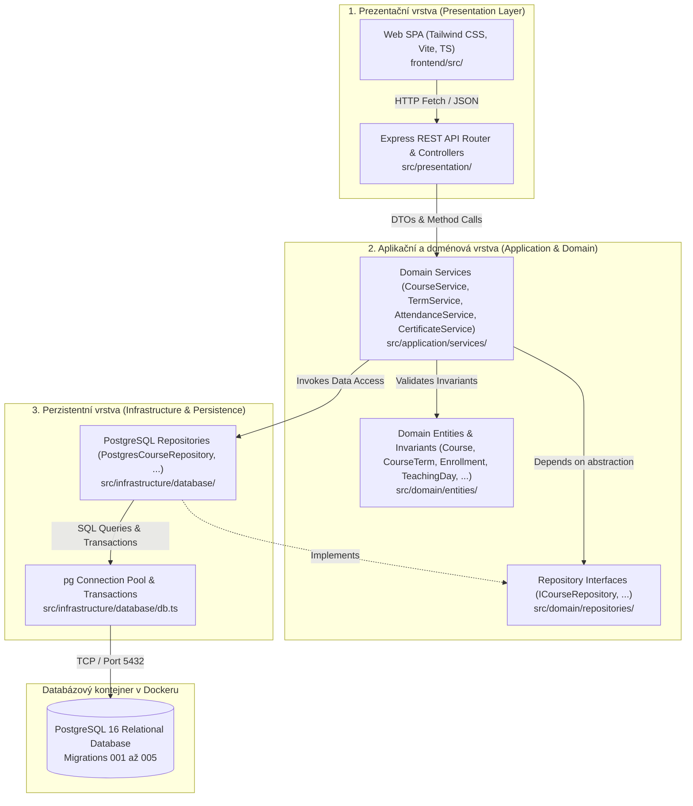
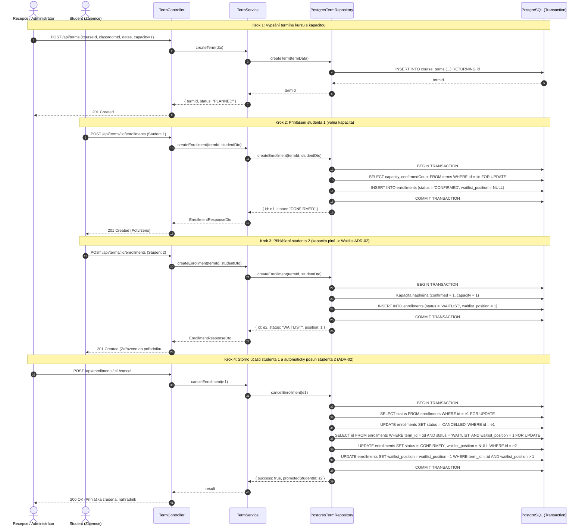
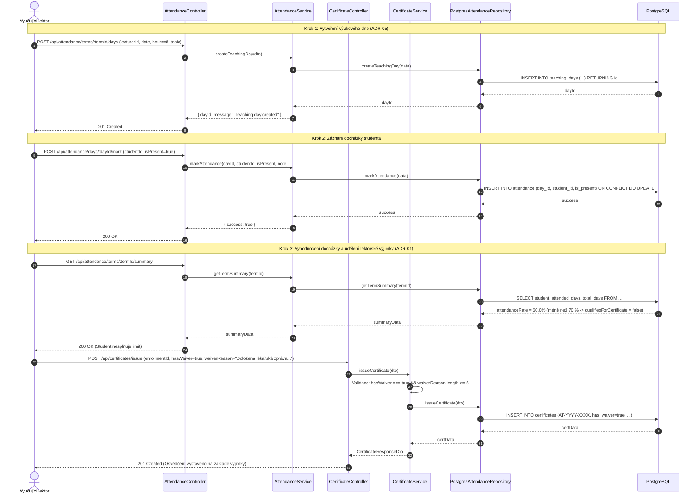
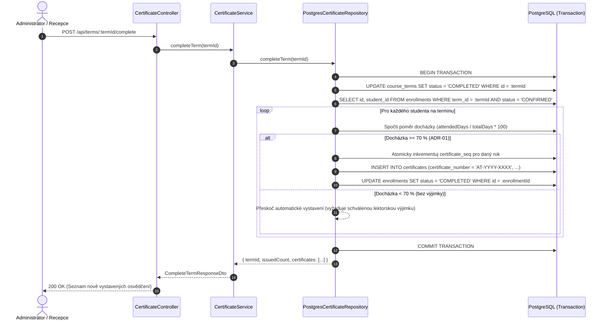
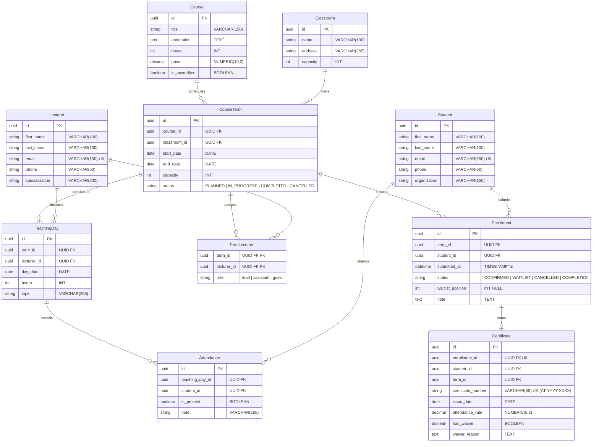

# Informační systém pro vzdělávací centrum (Akademie Trutnov)

> **Předmět:** Pokročilé programování (PPRO), ZS 2026/2027  
> **Semestrální projekt:** Zadání C – Kurzy vzdělávacího centra  
> **Klient:** Ing. Lucie Bartošová, ředitelka Akademie Trutnov  
> **Autor:** Marek Šifalda  
> **Status dokumentu:** Jediný závazný zdroj pravdy (Single Source of Truth – technická a architektonická dokumentace dle [AGENTS.md](file:///C:/Users/skitt/Documents/PPRO/AGENTS.md))

---

## Obsah

1. [Kontext a specifikace klienta](#1-kontext-a-specifikace-klienta)
   - 1.1 [Výchozí stav a motivace](#11-výchozí-stav-a-motivace)
   - 1.2 [Funkční požadavky klienta](#12-funkční-požadavky-klienta)
   - 1.3 [Obchodní pravidla a invarianty](#13-obchodní-pravidla-a-invarianty)
   - 1.4 [Role uživatelů v systému (Aktéři)](#14-role-uživatelů-v-systému-aktéři)
2. [Otevřené body a Seznam architektonických rozhodnutí (ADR)](#2-otevřené-body-a-seznam-architektonických-rozhodnutí-adr)
   - [ADR-01: Kritéria dokončení kurzu a certifikace (pravidlo 70 % + lektorská výjimka)](#adr-01-kritéria-dokončení-kurzu-a-certifikace-pravidlo-70--lektorská-výjimka)
   - [ADR-02: Automatický transakční posun z čekací listiny (pořadníku) při uvolnění místa](#adr-02-automatický-transakční-posun-z-čekací-listiny-pořadníku-při-uvolnění-místa)
   - [ADR-03: Zákaz souběhu aktivních přihlášek na stejný kurz](#adr-03-zákaz-souběhu-aktivních-přihlášek-na-stejný-kurz)
   - [ADR-04: Testovací a perzistentní strategie (In-Memory repozitáře vs. Produkční PostgreSQL 16 v Dockeru) a pravidlo dodatečného zápisu](#adr-04-testovací-a-perzistentní-strategie-in-memory-repozitáře-vs-produkční-postgresql-16-v-dockeru-a-pravidlo-dodatečného-zápisu)
   - [ADR-05: Více lektorů na termínu a rozpad na výukové dny (M:N)](#adr-05-více-lektorů-na-termínu-a-rozpad-na-výukové-dny-mn)
   - [ADR-06: Vyhodnocení vhodnosti Strapi CMS jako administrace (Zamítnuto)](#adr-06-vyhodnocení-vhodnosti-strapi-cms-jako-administrace-zamítnuto)
3. [Třívrstvá architektura a technický návrh](#3-třívrstvá-architektura-a-technický-návrh)
   - 3.1 [Třívrstvá architektura a vrstvy aplikace](#31-třívrstvá-architektura-a-vrstvy-aplikace)
   - 3.2 [Sekvenční diagram: Vypsání termínu a přihlášení s čekací listinou (ADR-02)](#32-sekvenční-diagram-vypsání-termínu-a-přihlášení-s-čekací-listinou-adr-02)
   - 3.3 [Sekvenční diagram: Zápis docházky na výukovém dni a lektorská výjimka (ADR-01, ADR-05)](#33-sekvenční-diagram-zápis-docházky-na-výukovém-dni-a-lektorská-výjimka-adr-01-adr-05)
   - 3.4 [Sekvenční diagram: Uzavření termínu a vystavení osvědčení (ADR-01)](#34-sekvenční-diagram-uzavření-termínu-a-vystavení-osvědčení-adr-01)
4. [Doménový a datový model (English Model & Data Dictionary)](#4-doménový-a-datový-model-english-model--data-dictionary)
   - 4.1 [Mermaid ER Diagram (10 entit)](#41-mermaid-er-diagram-10-entit)
   - 4.2 [Katalog a specifikace doménových entit](#42-katalog-a-specifikace-doménových-entit)
5. [Frontendová architektura (Vite + TypeScript + Tailwind CSS)](#5-frontendová-architektura-vite--typescript--tailwind-css)
   - 5.1 [Architektonický koncept a vrstvy frontendu](#51-architektonický-koncept-a-vrstvy-frontendu)
   - 5.2 [Struktura adresáře frontend/src/ a popis modulů](#52-struktura-adresáře-frontendsrc-a-popis-modulů)
   - 5.3 [Komponenty uživatelského rozhraní (Header, Modal, Toast)](#53-komponenty-uživatelského-rozhraní-header-modal-toast)
   - 5.4 [Design Tokens, Tailwind konfigurace a Dark/Light Mode](#54-design-tokens-tailwind-konfigurace-a-darklight-mode)
   - 5.5 [Produkční build a integrace s Express backendem](#55-produkční-build-a-integrace-s-express-backendem)
6. [Kompletní katalog REST API rozhraní](#6-kompletní-katalog-rest-api-rozhraní)
   - 6.1 [Konvence a společné formáty odpovědí](#61-konvence-a-společné-formáty-odpovědí)
   - 6.2 [Kurzy (/api/courses)](#62-kurzy-apicourses)
   - 6.3 [Termíny a přihlášky s čekací listinou (/api/terms, /api/enrollments)](#63-termíny-a-přihlášky-s-čekací-listinou-apiterms-apienrollments)
   - 6.4 [Evidence docházky a výukové dny (/api/attendance)](#64-evidence-docházky-a-výukové-dny-apiattendance)
   - 6.5 [Osvědčení a certifikáty (/api/certificates)](#65-osvědčení-a-certifikáty-apicertificates)
   - 6.6 [Číselníky a manažerská analytika (/api/lecturers, /api/classrooms, /api/students, /api/analytics, /health)](#66-číselníky-a-manažerská-analytika-apilecturers-apiclassrooms-apistudents-apianalytics-health)
   - 6.7 [Zpětně kompatibilní české aliasy](#67-zpětně-kompatibilní-české-aliasy)
7. [Infrastruktura a spuštění projektu](#7-infrastruktura-a-spuštění-projektu)
   - 7.1 [Použitý technologický stack](#71-použitý-technologický-stack)
   - 7.2 [Lokální spuštění v Dockeru (doporučeno pro obhajobu)](#72-lokální-spuštění-v-dockeru-doporučeno-pro-obhajobu)
   - 7.3 [Lokální vývojové spuštění (bez Dockeru)](#73-lokální-vývojové-spuštění-bez-dockeru)
   - 7.4 [Přehled všech npm skriptů](#74-přehled-všech-npm-skriptů)
8. [Testovací strategie a zajištění kvality](#8-testovací-strategie-a-zajištění-kvality)
   - 8.1 [Přehled testovací strategie (dvoustupňový testovací harness)](#81-přehled-testovací-strategie-dvoustupňový-testovací-harness)
   - 8.2 [Nativní Node test runner (29 testů – 20 unit + 9 E2E)](#82-nativní-node-test-runner-29-testů--20-unit--9-e2e)
   - 8.3 [Komplexní testovací sada v Jestu s TypeScript & ESM (71 testů)](#83-komplexní-testovací-sada-v-jestu-s-typescript--esm-71-testů)
   - 8.4 [Souhrnná tabulka testovacího pokrytí (100 testů, 100% pass)](#84-souhrnná-tabulka-testovacího-pokrytí-100-testů-100-pass)
   - 8.5 [Kvalita kódu, linting a formátování (ESLint + Prettier)](#85-kvalita-kódu-linting-a-formátování-eslint--prettier)
9. [Přehled plnění požadavků zadání klienta (100% HOTOVO)](#9-přehled-plnění-požadavků-zadání-klienta-100-hotovo)
   - 9.1 [Tabulka plnění 8 bodů zadání](#91-tabulka-plnění-8-bodů-zadání)
10. [Historie verzí (Changelog) a Roadmapa](#10-historie-verzí-changelog-a-roadmapa)
    - 10.1 [Historie verzí (Changelog v1.0.0 až v1.5.0)](#101-historie-verzí-changelog-v100-až-v150)
    - 10.2 [Roadmapa dalšího rozvoje](#102-roadmapa-dalšího-rozvoje)

---

## 1. Kontext a specifikace klienta

### 1.1 Výchozí stav a motivace

Akademie Trutnov pořádá přibližně 40 rekvalifikačních a firemních kurzů ročně za účasti externích odborných lektorů. Do zavedení tohoto informačního systému byla veškerá provozní agenda vedena neudržitelným manuálním způsobem:

- **E-maily a přepisování do Excelu:** Zájemci o kurzy odesílali přihlášky z jednoduchého webového formuláře na centrální e-mail recepce. Pracovníci recepce následně údaje ručně přepisovali do rozsáhlé excelové tabulky (jedna záložka pro každý vypsaný kurz).
- **Subjektivní hlídání kapacit a papírový pořadník:** Kapacity učeben a termínů byly kontrolovány pouze odhadem. Čekací listina náhradníků byla evidována na papírových lístečcích a poznámkách po okrajích tiskopisů.
- **Propadnutí míst při odřeknutí studenta:** Pokud přihlášený student na poslední chvíli zrušil svou účast (např. den před začátkem kurzu), recepce musela zdlouhavě dohledávat kontakty na náhradníky. Než se podařilo zájemce kontaktovat, kurz byl zahájen a uvolněné místo propadlo bez náhrady, což znamenalo přímou finanční ztrátu pro centrum.
- **Riziko duplicitních certifikátů v MS Wordu:** Osvědčení o absolvování rekvalifikačních kurzů byla ručně generována ve wordových šablonách. Čísla certifikátů byla odvozována ručním čítáním, což v minulosti vedlo k vystavení identických evidenčních čísel pro různé studenty a následným komplikacím při kontrolách z dotačních úřadů (Úřad práce ČR, MPSV).
- **Absence manažerského přehledu:** Vedení centra nemělo okamžitý přehled o vytížení učeben, sumáři skutečně odučených hodin jednotlivých lektorů pro měsíční fakturaci ani o loajalitě studentů přihlašujících se na více kurzů ročně.

### 1.2 Funkční požadavky klienta

Na základě konzultací s ředitelkou vzdělávacího centra **Ing. Lucií Bartošovou** bylo definováno následujících 8 klíčových oblastí agendy:

1. **Evidence kurzů (`courses`):** Katalog vzdělávacích programů zahrnující název kurzu, podrobnou textovou anotaci, celkový hodinový rozsah, základní cenu (včetně podpory bezplatných úvodních seminářů s cenou 0 Kč) a příznak oficiální akreditace MŠMT / MPSV.
2. **Termíny kurzů (`course_terms`):** Možnost vypsat tentýž kurz vícekrát v průběhu kalendářního roku. Každý termín má definováno datum zahájení a ukončení, přiřazenou konkrétní učebnu a maximální kapacitu odvozenou od parametrů učebny.
3. **Lektoři a jejich přiřazení (`lecturers`, `term_lecturers`):** Adresář externích i interních lektorů s jejich odbornou specializací. Jeden lektor může vést více různých termínů a na delších kurzech se mohou střídat dva i více lektorů (vazba M:N).
4. **Přihlášky studentů na termín (`enrollments`, `students`):** Student se může přihlásit na více kurzů současně. Na daném termínu je zapsána skupina studentů.
5. **Kapacita a pořadník (Waiting list):**
   - Po dosažení maximální kapacity termínu systém nepovolí overbooking, nýbrž další zájemce automaticky zařadí do pořadníku s přesně evidovanou pozicí (`waitlist_position = 1, 2, ...`).
   - Při zrušení potvrzené přihlášky je transakčně garantován okamžitý automatický posun prvního náhradníka na potvrzené místo bez manuálního zásahu personálu.
6. **Evidence docházky (`teaching_days`, `attendance`):** Záznam docházky a prezence studentů na jednotlivých výukových dnech a blocích vícedenních termínů.
7. **Dokončení kurzu a osvědčení (`certificates`):**
   - Hromadné uzavření termínu po proběhnutí všech výukových dnů.
   - Vyhodnocení docházky a automatické vystavení certifikátů studentům splňujícím docházkový limit (ADR-01).
   - Generování celosvětově unikátního čísla osvědčení ve formátu `AT-YYYY-XXXX`.
8. **Analytické přehledy (`analytics`):**
   - Procentuální vytížení a naplněnost termínů vůči maximální kapacitě.
   - Sumář skutečně odučených hodin za jednotlivé lektory pro podklady k fakturaci.
   - Přehled věrných studentů zapsaných na více kurzů v daném roce.

### 1.3 Obchodní pravidla a invarianty

Systém striktně vymáhá následující byznys pravidla na úrovni aplikačních služeb i databázových omezení:

- **Striktní strop kapacity (Zero Overbooking):** Kapacita termínu nesmí být nikdy překročena. Jakmile počet potvrzených přihlášek (`status = 'CONFIRMED'`) dosáhne hodnoty `capacity`, každý další zájemce je přepnut do stavu `WAITLIST`.
- **Integrita a sekvenčnost pořadníku:** Pozice náhradníků na čekací listině tvoří nepřerušenou číselnou řadu začínající od 1. Pořadí se nikdy nesmí přeskočit.
- **Globální unikátnost a neměnnost osvědčení:** Číslo certifikátu ve formátu `AT-YYYY-XXXX` je generováno z atomické sekvence v databázi. Jednou vydané osvědčení je trvale archivováno a nesmí být přepsáno ani smazáno (auditní stopa pro akreditační komisi).
- **Zákaz fyzického mazání historie (Audit Log):** Zrušená přihláška se z databáze neodstraňuje příkazem `DELETE`, nýbrž je označena stavem `CANCELLED` včetně časového razítka a případné poznámky o důvodu zrušení.

### 1.4 Role uživatelů v systému (Aktéři)

1. **Recepce & Administrátor:**
   - Zakládá a edituje kurzy, vypisuje termíny a přiřazuje jim učebny.
   - Provádí registraci studentů na termíny, spravuje čekací listinu a odbavuje případná storna.
   - Provádí formální uzavření termínu a iniciuje vystavení osvědčení.
2. **Lektor:**
   - Prohlíží si rozvrh svých výukových dnů.
   - Zapisuje prezenci účastníků (přítomen / nepřítomen / omluven) po skončení každého výukového dne.
   - Má pravomoc udělit výjimku z docházky studentovi, který nesplnil limit 70 %, na základě odborného posouzení a doloženého náhradního úkolu (s povinným písemným odůvodněním).
3. **Vedení vzdělávacího centra (Klient – Ing. Lucie Bartošová):**
   - Využívá manažerský dashboard pro kontrolu rentability, vytíženosti učeben a schvalování hodin lektorů před vyplacením honorářů.

---

## 2. Otevřené body a Seznam architektonických rozhodnutí (ADR)

Následující přehled dokumentuje klíčová architektonická rozhodnutí řešící protichůdné požadavky a nejasnosti v zadání klienta:

| #          | Otevřený bod klienta / Rozhodnutí                                    | Klíčové dilema                                                                       | Přijaté architektonické rozhodnutí                                                                                                                                                                                                                                                                                      |
| ---------- | -------------------------------------------------------------------- | ------------------------------------------------------------------------------------ | ----------------------------------------------------------------------------------------------------------------------------------------------------------------------------------------------------------------------------------------------------------------------------------------------------------------------- |
| **ADR-01** | **Kritéria dokončení kurzu a certifikace**                           | 70% docházka vs. subjektivní posouzení lektorem                                      | **Hybridní model s pravidlem 70 % + lektorská výjimka:** Systém automaticky kvalifikuje studenta při dosažení alespoň 70% účasti. Lektor má možnost udělit výjimku (s povinným písemným odůvodněním min. 5 znaků) nebo naopak neudělit zápočet z odborných důvodů. Číslo osvědčení má garantovaný tvar `AT-YYYY-XXXX`.  |
| **ADR-02** | **Posun z čekací listiny (pořadníku) při uvolnění místa**            | Zcela automatický zápis vs. manuální potvrzování recepcí                             | **Okamžitý atomický posun v rámci DB transakce:** Při stornu potvrzené přihlášky transakce s řádkovým zamykáním (`FOR UPDATE`) okamžitě povýší prvního čekatele (`waitlist_position = 1`) na potvrzenou účast a posune pořadí všech zbývajících čekatelů o 1 dopředu.                                                   |
| **ADR-03** | **Zákaz souběhu aktivních přihlášek na stejný kurz**                 | Možnost podat přihlášku na dva termíny naráz vs. blokace míst                        | **Striktní zákaz souběhu potvrzených přihlášek:** Student smí mít na tentýž kurz pouze jednu platnou potvrzenou přihlášku (`CONFIRMED`). Zápis do pořadníku (`WAITLIST`) na alternativní termín je povolen jako záloha.                                                                                                 |
| **ADR-04** | **Testovací a perzistentní strategie a pravidlo dodatečného zápisu** | Závislost testů na externí DB vs. In-memory repozitáře; registrace po zahájení kurzu | **Dvoustupňová architektura úložiště:** Produkce využívá robustní PostgreSQL 16 s řízenými migracemi v Dockeru. Testy využívají in-memory repozitáře věrně simulující transakční logiku pro bleskový a izolovaný běh. Dodatečný zápis po zahájení kurzu je povolen pouze administrátorovi do max. 20 % hodinové dotace. |
| **ADR-05** | **Více lektorů na termínu a rozpad na výukové dny**                  | Agregace hodin na lektora vs. střídání lektorů na kurzu                              | **Rozpad termínu na výukové dny (`TeachingDay`) s vazbou M:N:** Termín kurzu se skládá z jednotlivých výukových dnů, z nichž každý má přiřazeného konkrétního vyučujícího lektora. Analytika agreguje skutečně odučené hodiny přes tyto dílčí bloky.                                                                    |
| **ADR-06** | **Vyhodnocení vhodnosti Strapi CMS jako administrace**               | Použít generované headless CMS Strapi vs. vlastní SPA administraci                   | **Zamítnuto – Vlastní modulární SPA administrace v Tailwind CSS:** Strapi bylo po důkladné analýze zamítnuto z důvodu porušení principů 3-vrstvé architektury PPRO, nekontrolovatelných systémových migrací a vysoké režie.                                                                                             |

---

### ADR-01: Kritéria dokončení kurzu a certifikace (pravidlo 70 % + lektorská výjimka)

- **Kontext:** Klient požaduje jednoznačná pravidla pro vystavení osvědčení o absolvování kurzu, avšak praxe ukazuje, že striktní procento docházky může poškodit studenty s omluvenou absencí a vyřešeným náhradním úkolem.
- **Rozhodnutí:**
  - Výchozí hranice úspěšného absolvování je stanovena na **70 % docházky** (poměr `attended_days / total_days >= 0.70`).
  - Systém při uzavření termínu automaticky vystaví osvědčení všem studentům splňujícím hranici >= 70 %.
  - Pro studenty s docházkou pod 70 % má lektor/administrátor možnost vystavit osvědčení na základě **výjimky (`has_waiver = true`)**, která **vyžaduje písemné zdůvodnění o minimální délce 5 znaků** (např. doložení lékařské zprávy, vypracování doplňkového projektu).
  - Každé osvědčení obdrží celosvětově unikátní evidenční kód ve formátu `AT-YYYY-XXXX` generovaný z atomické čítací sekvence v databázi.
- **Důsledky:** Spravedlivý systém pro studenty, splnění legislativních nároků MŠMT na rekvalifikace a vyloučení lidské chyby při číslování diplomů.

### ADR-02: Automatický transakční posun z čekací listiny (pořadníku) při uvolnění místa

- **Kontext:** V případě odřeknutí účastníka na poslední chvíli docházelo v minulosti k prodlevám a prázdným místům v kurzu.
- **Rozhodnutí:**
  - Systém implementuje **automatický a atomický posun v rámci jediné databázové transakce** (`BEGIN ... COMMIT`) s explicitním řádkovým zámkem `SELECT ... FOR UPDATE`.
  - Pokud je zrušena potvrzená přihláška (`CONFIRMED`), transakce okamžitě vybere náhradníka s `waitlist_position = 1`, změní jeho status na `CONFIRMED`, vynuluje jeho pozici v pořadníku a sníží pozice všech zbývajících čekatelů o 1 (`waitlist_position = waitlist_position - 1`).
  - Pokud je zrušena přihláška z pořadníku (`WAITLIST`), transakce posune dopředu pouze zájemce zařazené za zrušenou pozicí.
- **Důsledky:** Nulové prodlevy, maximální vytíženost kurzů a zamezení race conditions při souběžných požadavcích.

### ADR-03: Zákaz souběhu aktivních přihlášek na stejný kurz

- **Kontext:** Klient zaznamenal případy, kdy se jeden student přihlásil na dva různé termíny stejného rekvalifikačního kurzu naráz, čímž blokoval kapacitu jiným zájemcům.
- **Rozhodnutí:**
  - Student smí mít pro daný kurz pouze **jednu aktivní potvrzenou přihlášku** (`CONFIRMED`).
  - Pokus o přihlášení na další termín téhož kurzu ve stavu `CONFIRMED` je aplikační službou i databází odmítnut chybou `400 Bad Request`.
  - Zápis do pořadníku (`WAITLIST`) na alternativní termín je povolen jako záloha pro případ zrušení hlavního termínu.
- **Důsledky:** Ochrana dostupnosti kurzů pro ostatní uchazeče a eliminace spekulativních registrací.

### ADR-04: Testovací a perzistentní strategie (In-Memory repozitáře vs. Produkční PostgreSQL 16 v Dockeru) a pravidlo dodatečného zápisu

- **Kontext:**
  1. Vývoj a automatizované testování vyžadují okamžitou zpětnou vazbu bez nutnosti startovat těžký databázový engine při každém běhu unit testů.
  2. Praxe přináší situace, kdy se student chce přihlásit do kurzu až po jeho oficiálním zahájení.
- **Rozhodnutí:**
  - **Architektura úložiště a testovatelnost:** Třívrstvá architektura důsledně odděluje rozhraní repozitářů od jejich konkrétní implementace.
    - _Produkční prostředí:_ Využívá relační databázi **PostgreSQL 16** v Dockeru s verzovanými SQL migracemi (`001` až `005`) a plnou transakční podporou.
    - _Testovací prostředí:_ Všechny doménové unit testy (Node test runner i Jest) využívají stavové **In-Memory repozitáře** (`InMemoryCourseRepository`, `InMemoryTermRepository`, `InMemoryAttendanceRepository`, `InMemoryCertificateRepository`). Tyto repozitáře plně a deterministicky simulují atomické transakce, kaskádový posun na čekací listině i validační invarianty bez externích závislostí.
    - _Integrační testy:_ Ověřují kompletní HTTP a perzistentní průchody přes Supertest a Node E2E test runner.
  - **Pravidlo dodatečného zápisu:** Veřejný zápis studentů se po datu `start_date` automaticky uzamkne. Dodatečný zápis smí provést pouze recepce/administrátor formou řízené výjimky, a to maximálně do okamžiku, kdy proběhlo **méně než 20 % celkové hodinové dotace kurzu**, aby byla garantována možnost splnit povinnou 70% docházku.
- **Důsledky:** Bleskový běh testovacích sad (vteřiny), 100% determinismus a stabilita CI/CD pipeline, jasně definovaná pravidla pro pozdní zápisy.

### ADR-05: Více lektorů na termínu a rozpad na výukové dny (M:N)

- **Kontext:** Rozsáhlé rekvalifikační kurzy (např. _Mzdové účetnictví_ 80 hodin) vyučuje více specialistů (mzdová účetní, daňový poradce, právník pro zákoník práce).
- **Rozhodnutí:**
  - Termín kurzu je modelován jako složený celek: kromě vazební tabulky `term_lecturers` (M:N) je rozpadnut na jednotlivé **výukové dny (`TeachingDay`)**.
  - Každý výukový den má definováno konkrétní datum, hodinový rozsah, téma a referenci na vyučujícího lektora.
  - Manažerské výkazy hodin lektorů se počítají agregací přes tyto výukové bloky, což zaručuje přesné podklady pro fakturaci.
- **Důsledky:** Přesná evidence výuky, možnost detailního rozpisu lektorů a podklad pro výpočet docházky studentů po jednotlivých dnech.

### ADR-06: Vyhodnocení vhodnosti Strapi CMS jako administrace (Zamítnuto)

Dotaz zadavatele: _„Zkus zjistit, zdali je vhodné použít Strapi jako administraci.“_

1. **Akademický kontext a kritéria předmětu PPRO (FIM UHK):**
   - V předmětu PPRO se hodnotí schopnost studenta navrhnout a implementovat **čistou třívrstvou architekturu** (_Presentation -> Application / Domain -> Persistence_), doménové invarianty, unit testy byznys logiky a transakční integritu.
   - Pokud by byla administrace svěřena Strapi, doménová logika (hlídání kapacit bez overbookingu, kaskádový posun v pořadníku ADR-02, 70% pravidlo ADR-01, sekvenční generování unikátních čísel certifikátů) by se musela lámat do interních pluginů a lifecycle hooků Strapi, čímž by došlo ke smazání hranic třívrstvé architektury.
2. **Databázové schéma a verzované migrace:**
   - Strapi si vynucuje vlastní správu databáze, vytváří desítky systémových tabulek (`strapi_core_store_settings`, `up_users`, `admin_users` apod.) a mění strukturu cizích klíčů a sloupců.
   - Požadavek PPRO striktně stanovuje: _„Řízené verzované migrace (žádné ruční vytváření tabulek mimo migrační skripty)“_. Propojení Strapi s vlastními SQL migracemi by vedlo ke kolizím a nekonzistencím.
3. **Výkon a provozní náročnost:**
   - Strapi vyžaduje vlastní Node.js proces s vysokou spotřebou paměti (300–600 MB RAM jen pro admin), rozsáhlý strom závislostí a zdlouhavý build.
   - V `docker compose up` by to znamenalo buď nahradit celý backend systémem Strapi (což porušuje zadání), nebo provozovat dva nezávislé servery s duplicitním připojením do PostgreSQL.
4. **Závěr:**
   - **Použití Strapi pro hlavní administraci NENÍ vhodné.**
   - Jako optimální řešení je implementováno přehledné, responzivní Web UI ve frameworku **Tailwind CSS** přímo v prezentační vrstvě aplikace, napojené na čisté REST API.

---

## 3. Třívrstvá architektura a technický návrh

Projekt je navržen v souladu s pravidly předmětu **PPRO** jako modulární třívrstvá aplikace se striktně **jednosměrnými závislostmi**. Veškeré názvy tříd, metod, rozhraní, doménových modelů a databázových entit jsou důsledně **v anglickém jazyce**.



### 3.1 Třívrstvá architektura a vrstvy aplikace

1. **Prezentační vrstva (`src/presentation/` & `frontend/`):**
   - Obsluhuje HTTP komunikaci, mapuje vstupní data na DTOs, vrací odpovídající HTTP stavové kódy (200, 201, 400, 404, 500) a servíruje modulární webovou SPA administraci.
   - Nekoná žádná byznys rozhodnutí ani neobsahuje přímé databázové dotazy.
2. **Aplikační a doménová vrstva (`src/application/`, `src/domain/`):**
   - Zapouzdřuje obchodní pravidla, výpočty a doménové invarianty.
   - Stará se o validaci kurzů, atomickou správu kapacit, čekací listinu náhradníků (ADR-02), zákaz souběhu přihlášek (ADR-03), kalkulaci 70% docházky (ADR-01, ADR-05) a vystavování osvědčení.
   - Doménové entity jsou čisté TypeScript objekty nezávislé na frameworku Express i databázi.
3. **Perzistentní vrstva (`src/infrastructure/`):**
   - Zajišťuje ukládání a načítání dat z databáze PostgreSQL 16 přes `pg.Pool`.
   - Implementuje repozitářový vzor a stará se o transakční integritu (`BEGIN`, `COMMIT`, `ROLLBACK`) a řádkové zamykání (`SELECT ... FOR UPDATE`) při posunech v pořadníku.

---

### 3.2 Sekvenční diagram: Vypsání termínu a přihlášení s čekací listinou (ADR-02)

Diagram ilustruje životní cyklus termínu, přihlášení studentů do vyčerpání kapacity, automatické zařazení dalšího studenta na čekací listinu a transakční kaskádový posun náhradníka při zrušení přihlášky:



---

### 3.3 Sekvenční diagram: Zápis docházky na výukovém dni a lektorská výjimka (ADR-01, ADR-05)

Diagram zobrazuje evidenci výukového dne s lektorem (ADR-05), záznam docházky a proces udělení lektorské výjimky s povinným odůvodněním (ADR-01):



---

### 3.4 Sekvenční diagram: Uzavření termínu a vystavení osvědčení (ADR-01)

Diagram zachycuje proces hromadného vyhodnocení termínu, kdy systém automaticky vystaví certifikáty všem účastníkům s docházkou >= 70 %:



---

## 4. Doménový a datový model (English Model & Data Dictionary)

### 4.1 Mermaid ER Diagram (10 entit)

Kompletní databázový a doménový model obsahuje **10 entit** a tabulek v anglickém jazyce s bohatými vazbami M:N a 1:N:



### 4.2 Katalog a specifikace doménových entit

Následující tabulka specifikuje všech 10 entit doménového modelu, odpovídající SQL tabulky a jejich byznys invarianty:

| Entita           | Tabulka v DB     | Klíčové atributy & Typy                                                                                                                                                                                                               | Doménové invarianty a byznys pravidla                                                                                                                                                        |
| ---------------- | ---------------- | ------------------------------------------------------------------------------------------------------------------------------------------------------------------------------------------------------------------------------------- | -------------------------------------------------------------------------------------------------------------------------------------------------------------------------------------------- |
| **Course**       | `courses`        | `id` (UUID PK), `title` (VARCHAR 150), `annotation` (TEXT), `hours` (INT), `price` (NUMERIC 10,2), `is_accredited` (BOOLEAN)                                                                                                          | Název 3–150 znaků; anotace min. 10 znaků; hodiny kladné celé číslo > 0; cena nezáporná (povoleno 0 Kč pro bezplatné workshopy).                                                              |
| **Classroom**    | `classrooms`     | `id` (UUID PK), `name` (VARCHAR 100), `address` (VARCHAR 255), `capacity` (INT)                                                                                                                                                       | Kapacita učebny > 0; kapacita přiřazeného termínu nesmí překročit fyzickou kapacitu učebny.                                                                                                  |
| **Lecturer**     | `lecturers`      | `id` (UUID PK), `first_name` (VARCHAR 100), `last_name` (VARCHAR 100), `email` (VARCHAR 150 UK), `phone` (VARCHAR 50), `specialization` (VARCHAR 200)                                                                                 | Unikátní formátově platný e-mail; jméno a příjmení min. 2 znaky; specializace pro přiřazování ke kurzům.                                                                                     |
| **CourseTerm**   | `course_terms`   | `id` (UUID PK), `course_id` (UUID FK), `classroom_id` (UUID FK), `start_date` (DATE), `end_date` (DATE), `capacity` (INT), `status` (VARCHAR 30)                                                                                      | `start_date <= end_date`; kapacita > 0; stavy: `PLANNED`, `IN_PROGRESS`, `COMPLETED`, `CANCELLED`.                                                                                           |
| **TermLecturer** | `term_lecturers` | `term_id` (UUID FK PK), `lecturer_id` (UUID FK PK), `role` (VARCHAR 50)                                                                                                                                                               | Složený primární klíč pro vazbu M:N. Umožňuje střídání více lektorů na jednom termínu kurzu.                                                                                                 |
| **Student**      | `students`       | `id` (UUID PK), `first_name` (VARCHAR 100), `last_name` (VARCHAR 100), `email` (VARCHAR 150 UK), `phone` (VARCHAR 50), `organization` (VARCHAR 150)                                                                                   | Unikátní platný e-mail studenta napříč celým systémem; volitelný název vysílající organizace/firmy.                                                                                          |
| **Enrollment**   | `enrollments`    | `id` (UUID PK), `term_id` (UUID FK), `student_id` (UUID FK), `submitted_at` (TIMESTAMPTZ), `status` (VARCHAR 30), `waitlist_position` (INT NULL), `note` (TEXT)                                                                       | Stavy: `CONFIRMED`, `WAITLIST`, `CANCELLED`, `COMPLETED`. Pokud `WAITLIST`, musí mít kladné pořadové číslo `waitlist_position >= 1`. Nikdy se nemaže fyzicky (soft delete přes `CANCELLED`). |
| **TeachingDay**  | `teaching_days`  | `id` (UUID PK), `term_id` (UUID FK), `lecturer_id` (UUID FK), `day_date` (DATE), `hours` (INT), `topic` (VARCHAR 255)                                                                                                                 | Hodiny výukového bloku > 0; téma min. 3 znaky; přiřazen konkrétní vyučující lektor pro daný den (ADR-05).                                                                                    |
| **Attendance**   | `attendance`     | `id` (UUID PK), `teaching_day_id` (UUID FK), `student_id` (UUID FK), `is_present` (BOOLEAN), `note` (VARCHAR 255)                                                                                                                     | Unikátní kompozitní index `(teaching_day_id, student_id)`. Záznam prezence účastníka a případné omluvy.                                                                                      |
| **Certificate**  | `certificates`   | `id` (UUID PK), `enrollment_id` (UUID FK UK), `student_id` (UUID FK), `term_id` (UUID FK), `certificate_number` (VARCHAR 50 UK), `issue_date` (DATE), `attendance_rate` (NUMERIC 5,2), `has_waiver` (BOOLEAN), `waiver_reason` (TEXT) | Garantovaný formát čísla `AT-YYYY-XXXX`. Podmínka: `attendance_rate >= 70.0%`, nebo `has_waiver = true` s písemným zdůvodněním min. 5 znaků (ADR-01). Neměnné.                               |

---

## 5. Frontendová architektura (Vite + TypeScript + Tailwind CSS)

### 5.1 Architektonický koncept a vrstvy frontendu

Původní monolitický skript byl v rámci refaktoringu verze 1.4.0 nahrazen moderní, plně modulární architekturou Single Page Application (SPA) v adresáři [`frontend/src/`](file:///C:/Users/skitt/Documents/PPRO/frontend/src/).

Frontend je postaven na moderním toolingu **Vite 6** s přímou kompilací **TypeScriptu** a utility-first stylingem v **Tailwind CSS 3.4**. Řešení nevyžaduje těžké frameworky typu React či Angular, což zajišťuje minimální velikost výsledného produkčního bundlu (< 35 kB gzip) a okamžité načtení v prohlížeči.

```text
frontend/src/
├── api/                   # Typovaný REST API klient s ošetřením chyb
│   ├── apiClient.ts       # Centrální fetch wrapper, JSON parsing a error handling
│   ├── coursesApi.ts      # API volání pro kurzy (katalog, CRUD, filtry)
│   ├── termsApi.ts        # API volání pro termíny a přihlášky (včetně storna a čekací listiny)
│   ├── attendanceApi.ts   # API volání pro výukové dny a zápis prezenčky
│   ├── certificatesApi.ts # API volání pro uzavření termínu a lektorské výjimky
│   └── dictionariesApi.ts # API volání pro lektory, učebny a manažerskou analytiku
├── components/            # Znovupoužitelné UI komponenty
│   ├── Header.ts          # Horní navigace, stavové odznaky, přepínač Dark/Light režimu
│   ├── Modal.ts           # Přístupný modální dialog (WAI-ARIA, ESC listener, backdrop, focus lock)
│   └── Toast.ts           # Globální notifikační systém (success, error, warning, info zprávy)
├── views/                 # Samostatné obrazovky pro jednotlivé agendy
│   ├── CoursesView.ts     # Správa nabídky kurzů, vyhledávání, filtrace akreditace
│   ├── TermsView.ts       # Rozvrh termínů, progress bary obsazenosti, správa studentů a čekatelů
│   ├── AttendanceView.ts  # Volba výukového dne, prezenční listina s interaktivním zaškrtáváním
│   ├── CertificatesView.ts# Vydaná osvědčení, uzavření termínu, dialog lektorské výjimky
│   ├── LecturersView.ts   # Přehled lektorů a kapacit učeben
│   └── AnalyticsView.ts   # Manažerský dashboard (vytížení, odučené hodiny, věrní studenti)
├── main.ts                # Vstupní bod SPA, router/tab manager, inicializace tématu
├── style.css              # Vstupní Tailwind CSS direktivy, custom animace, proměnné
└── types.ts               # Sdílená TypeScript rozhraní pro frontendové modely
```

### 5.2 Struktura adresáře frontend/src/ a popis modulů

- **`main.ts`:** Inicializuje aplikaci, stará se o přepínání mezi 6 záložkami (Tabs navigation) bez reloadu stránky a načítá uložené barevné téma z `localStorage`.
- **`api/apiClient.ts`:** Poskytuje unifikovaný wrapper nad nativním `window.fetch`. Automaticky přidává hlavičky `Content-Type: application/json`, ošetřuje HTTP chyby (400, 404, 500) a vrací typované odpovědi.
- **`views/TermsView.ts`:** Vizualizuje naplněnost termínů pomocí barevných progress barů kapacity. Umožňuje zapsat nového studenta (s okamžitou vizuální odezvou zařazení na potvrzené místo nebo na čekací listinu) i provést storno přihlášky s okamžitým posunem náhradníka dle ADR-02.
- **`views/AttendanceView.ts`:** Umožňuje vybrat konkrétní termín, zobrazit seznam výukových dnů, přidat nový výukový den s přiřazeným lektorem (ADR-05) a jedním kliknutím zaznamenat prezenci účastníků. Současně zobrazuje progress bar docházky a indikátor splnění 70% podmínky.
- **`views/CertificatesView.ts`:** Nabízí tlačítko pro hromadné uzavření termínu a vystavení osvědčení studentům nad 70 % i formulář pro udělení výjimky lektora s povinným odůvodněním pro studenty pod 70 % (ADR-01).

### 5.3 Komponenty uživatelského rozhraní (Header, Modal, Toast)

- **`Header.ts`:** Poskytuje čistou, ergonomickou a kompaktní navigaci omezenou na maximálně 4 položky (Katalog kurzů, Termíny & Pořadník, Evidence docházky a rozbalovací dropdown menu _Správa & Výkazy_ pro Knihu osvědčení, Lektory/Učebny a Manažerské výkazy). Zajišťuje automatickou synchronizaci aktivního stavu, indikaci vybrané podagendy v záhlaví dropdownu, obsluhu kliknutí mimo menu a klávesových zkratek 1–6 / Esc a perzistentní přepínač tmavého a světlého režimu.
- **`Modal.ts`:** Plně přístupný modální dialog. Podporuje zavření stiskem klávesy `Escape`, kliknutím mimo dialogové okno (backdrop click), uzamčení posunu stránky na pozadí (`overflow: hidden`) a plynulou animaci `scaleIn`.
- **`Toast.ts`:** Toastový notifikační systém zobrazující zprávy v pravém horním rohu obrazovky. Podporuje 4 typy hlášení (úspěch, chyba, varování, informace) s automatickým časovačem skrytí (default 4000 ms) a možností manuálního zavření křížkem.

### 5.4 Design Tokens, Tailwind konfigurace a Dark/Light Mode

- **Tailwind CSS konfigurace (`tailwind.config.js`):** Nastaven `darkMode: "class"`, což umožňuje plynulé přepínání stylů třídou `dark` na kořenovém elementu `<html>`.
- **Paleta barev:**
  - _Light mode:_ Neutrální šedá pozadí `bg-slate-50`, karty `bg-white`, texty `text-slate-800`, primární akcenty v indigové a modré barvě `indigo-600` / `blue-600`.
  - _Dark mode:_ Tmavá grafitová pozadí `dark:bg-slate-900`, karty `dark:bg-slate-800`, ohraničení `dark:border-slate-700`, texty `dark:text-slate-100`.
- **Perzistence volby:** Uživatelská volba se okamžitě ukládá do `localStorage.getItem("theme")`. Pokud uživatel téma dosud nenastavil, systém automaticky detekuje systémovou preferenci OS přes `window.matchMedia("(prefers-color-scheme: dark)")`.

### 5.5 Produkční build a integrace s Express backendem

- Příkaz `npm run build:client` spustí optimalizátor **Vite**, který zkompiluje TypeScript, aplikuje Tailwind CSS utility třídy, provede minifikaci a vygeneruje statické produkční soubory do adresáře [`public/`](file:///C:/Users/skitt/Documents/PPRO/public/).
- Express server servíruje statické soubory z adresáře `public/` jako fallback pro kořenovou routu `GET /`.

---

## 6. Kompletní katalog REST API rozhraní

### 6.1 Konvence a společné formáty odpovědí

Veškeré REST endpointy komunikují ve formátu **JSON** v kódování **UTF-8**.

- **Úspěšná odpověď (200 OK / 201 Created):**
  ```json
  {
    "success": true,
    "message": "Operace proběhla úspěšně.",
    "data": { ... }
  }
  ```
- **Chybová odpověď (400 Bad Request / 404 Not Found / 500 Internal Error):**
  ```json
  {
    "success": false,
    "error": "Podrobný popis chyby nebo porušeného invariantu."
  }
  ```

---

### 6.2 Kurzy (`/api/courses`)

| Metoda   | Endpoint           | Popis                                                                          |
| -------- | ------------------ | ------------------------------------------------------------------------------ |
| `GET`    | `/api/courses`     | Seznam kurzů (volitelné query parametry: `?accredited=true\|false&query=text`) |
| `GET`    | `/api/courses/:id` | Detail vybraného kurzu dle UUID                                                |
| `POST`   | `/api/courses`     | Vytvoření nového kurzu s validací polí                                         |
| `PUT`    | `/api/courses/:id` | Aktualizace údajů kurzu                                                        |
| `DELETE` | `/api/courses/:id` | Odstranění kurzu                                                               |

#### Příklad: Vytvoření nového kurzu (`POST /api/courses`)

_Request Body (JSON):_

```json
{
  "title": "Mzdové účetnictví a personalistika",
  "annotation": "Komplexní rekvalifikační kurz se zaměřením na zákoník práce, odvody, sociální pojištění a mzdy.",
  "hours": 80,
  "price": 14900,
  "isAccredited": true
}
```

_Response (201 Created):_

```json
{
  "success": true,
  "message": "Course created successfully.",
  "data": {
    "id": "a1b2c3d4-e5f6-7a8b-9c0d-1e2f3a4b5c6d",
    "title": "Mzdové účetnictví a personalistika",
    "annotation": "Komplexní rekvalifikační kurz se zaměřením na zákoník práce, odvody, sociální pojištění a mzdy.",
    "hours": 80,
    "price": 14900,
    "isAccredited": true,
    "createdAt": "2026-11-04T15:00:00.000Z",
    "updatedAt": "2026-11-04T15:00:00.000Z"
  }
}
```

_Response při chybné validaci (400 Bad Request):_

```json
{
  "success": false,
  "error": "Course title must be at least 3 characters long."
}
```

---

### 6.3 Termíny a přihlášky s čekací listinou (`/api/terms`, `/api/enrollments`)

| Metoda | Endpoint                      | Popis                                                                     |
| ------ | ----------------------------- | ------------------------------------------------------------------------- |
| `GET`  | `/api/terms`                  | Seznam termínů (včetně obsazenosti, kapacity a lektorů)                   |
| `GET`  | `/api/terms/:id`              | Detail konkrétního termínu                                                |
| `POST` | `/api/terms`                  | Vypsání nového termínu s učebnou a kapacitou                              |
| `GET`  | `/api/terms/:id/enrollments`  | Seznam přihlášených studentů a čekatelů v pořadníku                       |
| `POST` | `/api/terms/:id/enrollments`  | Zápis studenta na termín (potvrzení nebo zařazení na Waitlist dle ADR-02) |
| `POST` | `/api/enrollments/:id/cancel` | Zrušení přihlášky s automatickým posunem náhradníka (ADR-02)              |

#### Příklad: Zápis studenta na termín (`POST /api/terms/:id/enrollments`)

_Request Body (JSON):_

```json
{
  "firstName": "Jan",
  "lastName": "Novák",
  "email": "jan.novak@example.cz",
  "phone": "+420 777 123 456",
  "organization": "Město Trutnov",
  "note": "Fakturovat zaměstnavateli"
}
```

_Response při volné kapacitě (201 Created – Potvrzeno):_

```json
{
  "success": true,
  "message": "Student enrollment confirmed successfully.",
  "data": {
    "id": "e4f5a6b7-c8d9-0e1f-2a3b-4c5d6e7f8a9b",
    "termId": "b2c3d4e5-f6a7-8b9c-0d1e-2f3a4b5c6d7e",
    "studentId": "c3d4e5f6-a7b8-9c0d-1e2f-3a4b5c6d7e8f",
    "status": "CONFIRMED",
    "waitlistPosition": null,
    "submittedAt": "2026-11-04T15:10:00.000Z"
  }
}
```

_Response při naplněné kapacitě (201 Created – Zařazeno do pořadníku ADR-02):_

```json
{
  "success": true,
  "message": "Course capacity is full. Student was placed on the waiting list as candidate #1.",
  "data": {
    "id": "f5a6b7c8-d9e0-1f2a-3b4c-5d6e7f8a9b0c",
    "termId": "b2c3d4e5-f6a7-8b9c-0d1e-2f3a4b5c6d7e",
    "studentId": "d4e5f6a7-b8c9-0d1e-2f3a-4b5c6d7e8f9a",
    "status": "WAITLIST",
    "waitlistPosition": 1,
    "submittedAt": "2026-11-04T15:15:00.000Z"
  }
}
```

#### Příklad: Storno přihlášky s automatickým posunem (`POST /api/enrollments/:id/cancel`)

_Response (200 OK):_

```json
{
  "success": true,
  "message": "Enrollment was cancelled. Spot was automatically assigned to the first waitlisted candidate (ADR-02)!",
  "data": {
    "success": true,
    "cancelledEnrollmentId": "e4f5a6b7-c8d9-0e1f-2a3b-4c5d6e7f8a9b",
    "promotedStudentId": "d4e5f6a7-b8c9-0d1e-2f3a-4b5c6d7e8f9a"
  }
}
```

---

### 6.4 Evidence docházky a výukové dny (`/api/attendance`)

| Metoda | Endpoint                                | Popis                                                          |
| ------ | --------------------------------------- | -------------------------------------------------------------- |
| `GET`  | `/api/attendance/terms/:termId/days`    | Seznam výukových dnů termínu (ADR-05)                          |
| `POST` | `/api/attendance/terms/:termId/days`    | Vytvoření výukového dne s lektorem a hodinovým rozsahem        |
| `GET`  | `/api/attendance/days/:dayId`           | Prezenční listina účastníků vybraného dne                      |
| `POST` | `/api/attendance/days/:dayId/mark`      | Zápis přítomnosti studenta na výuce                            |
| `GET`  | `/api/attendance/terms/:termId/summary` | Přehled docházky termínu s vyhodnocením pravidla 70 % (ADR-01) |

#### Příklad: Zápis docházky studenta (`POST /api/attendance/days/:dayId/mark`)

_Request Body (JSON):_

```json
{
  "studentId": "c3d4e5f6-a7b8-9c0d-1e2f-3a4b5c6d7e8f",
  "isPresent": true,
  "note": "Účast v plném rozsahu výukového bloku"
}
```

_Response (200 OK):_

```json
{
  "success": true,
  "message": "Attendance recorded successfully."
}
```

#### Příklad: Souhrn docházky termínu (`GET /api/attendance/terms/:termId/summary`)

_Response (200 OK):_

```json
{
  "success": true,
  "count": 2,
  "data": [
    {
      "studentId": "c3d4e5f6-a7b8-9c0d-1e2f-3a4b5c6d7e8f",
      "studentName": "Jan Novák",
      "email": "jan.novak@example.cz",
      "totalDays": 10,
      "attendedDays": 8,
      "attendanceRate": 80.0,
      "qualifiesForCertificate": true,
      "certificateNumber": "AT-2026-0001"
    },
    {
      "studentId": "d4e5f6a7-b8c9-0d1e-2f3a-4b5c6d7e8f9a",
      "studentName": "Eva Dvořáková",
      "email": "dvorakova@example.cz",
      "totalDays": 10,
      "attendedDays": 6,
      "attendanceRate": 60.0,
      "qualifiesForCertificate": false,
      "certificateNumber": null
    }
  ]
}
```

---

### 6.5 Osvědčení a certifikáty (`/api/certificates`)

| Metoda | Endpoint                      | Popis                                                                              |
| ------ | ----------------------------- | ---------------------------------------------------------------------------------- |
| `POST` | `/api/terms/:termId/complete` | Hromadné uzavření termínu a vystavení osvědčení kvalifikovaným studentům (>= 70 %) |
| `GET`  | `/api/certificates`           | Seznam všech vydaných osvědčení v systému                                          |
| `GET`  | `/api/certificates/:id`       | Detail konkrétního osvědčení                                                       |
| `POST` | `/api/certificates/issue`     | Vystavení osvědčení se schválenou lektorskou výjimkou (ADR-01)                     |

#### Příklad: Hromadné uzavření termínu (`POST /api/terms/:termId/complete`)

_Response (200 OK):_

```json
{
  "success": true,
  "message": "Course term completed. Issued 1 certificate(s) for qualifying students.",
  "data": {
    "termId": "b2c3d4e5-f6a7-8b9c-0d1e-2f3a4b5c6d7e",
    "issuedCount": 1,
    "certificates": [
      {
        "id": "7a8b9c0d-1e2f-3a4b-5c6d-7e8f9a0b1c2d",
        "certificateNumber": "AT-2026-0001",
        "studentId": "c3d4e5f6-a7b8-9c0d-1e2f-3a4b5c6d7e8f",
        "issueDate": "2026-11-04",
        "attendanceRate": 80.0,
        "hasWaiver": false
      }
    ]
  }
}
```

#### Příklad: Vystavení osvědčení na výjimku lektora (`POST /api/certificates/issue`)

_Request Body (JSON):_

```json
{
  "enrollmentId": "f5a6b7c8-d9e0-1f2a-3b4c-5d6e7f8a9b0c",
  "hasWaiver": true,
  "waiverReason": "Schválena výjimka lektora z důvodu doložené lékařské zprávy a odevzdání doplňkového projektu."
}
```

_Response (201 Created):_

```json
{
  "success": true,
  "message": "Certificate issued successfully.",
  "data": {
    "id": "8b9c0d1e-2f3a-4b5c-6d7e-8f9a0b1c2d3e",
    "certificateNumber": "AT-2026-0002",
    "studentId": "d4e5f6a7-b8c9-0d1e-2f3a-4b5c6d7e8f9a",
    "issueDate": "2026-11-04",
    "attendanceRate": 60.0,
    "hasWaiver": true,
    "waiverReason": "Schválena výjimka lektora z důvodu doložené lékařské zprávy a odevzdání doplňkového projektu."
  }
}
```

---

### 6.6 Číselníky a manažerská analytika (`/api/lecturers`, `/api/classrooms`, `/api/students`, `/api/analytics`, `/health`)

| Metoda | Endpoint          | Popis                                                                                           |
| ------ | ----------------- | ----------------------------------------------------------------------------------------------- |
| `GET`  | `/api/lecturers`  | Seznam lektorů, jejich specializace a celkový součet odučených hodin                            |
| `GET`  | `/api/classrooms` | Seznam učeben a jejich maximální fyzická kapacita                                               |
| `GET`  | `/api/students`   | Adresář studentů a počet jejich aktivních přihlášek                                             |
| `GET`  | `/api/analytics`  | Manažerské ukazatele dle bodu 8 zadání (vytížení termínů, hodiny lektorů, vícekurzoví studenti) |
| `GET`  | `/health`         | Kontrola provozuschopnosti aplikace (health check vracející status 200 a stav UP)               |

#### Příklad: Manažerská analytika (`GET /api/analytics`)

_Response (200 OK):_

```json
{
  "success": true,
  "data": {
    "termOccupancy": [
      {
        "termId": "b2c3d4e5-f6a7-8b9c-0d1e-2f3a4b5c6d7e",
        "courseTitle": "Mzdové účetnictví a personalistika",
        "classroomName": "Počítačová učebna A",
        "capacity": 12,
        "confirmedStudents": 12,
        "occupancyPercentage": 100.0,
        "waitlistStudents": 3
      }
    ],
    "lecturerWorkload": [
      {
        "lecturerId": "e1f2a3b4-c5d6-7e8f-9a0b-1c2d3e4f5a6b",
        "lecturerName": "Ing. Petr Svoboda",
        "specialization": "Účetnictví a daně",
        "assignedTerms": 2,
        "totalTaughtHours": 48
      }
    ],
    "multiCourseStudents": [
      {
        "studentId": "c3d4e5f6-a7b8-9c0d-1e2f-3a4b5c6d7e8f",
        "studentName": "Jan Novák",
        "email": "jan.novak@example.cz",
        "enrolledCoursesCount": 2,
        "enrolledCourses": ["Mzdové účetnictví a personalistika", "Daňový specialista pro praxi"]
      }
    ]
  }
}
```

### 6.7 Zpětně kompatibilní české aliasy

Pro zajištění stoprocentní zpětné kompatibility s původní specifikací podporuje Express router i české aliasy:

- `/api/kurzy` -> zrcadlí `/api/courses`
- `/api/terminy` -> zrcadlí `/api/terms`
- `/api/prihlasky` -> zrcadlí `/api/enrollments`
- `/api/osvedceni` -> zrcadlí `/api/certificates`
- `/api/lektori` -> zrcadlí `/api/lecturers`
- `/api/ucebny` -> zrcadlí `/api/classrooms`
- `/api/studenti` -> zrcadlí `/api/students`
- `/api/prehledy` -> zrcadlí `/api/analytics`

---

## 7. Infrastruktura a spuštění projektu

### 7.1 Použitý technologický stack

- **Běhové prostředí:** Node.js 22 LTS (TypeScript 5.7, ES Modules, `strict` typování).
- **Backend framework:** Express 4.21 s typovanými kontrolery a DTOs.
- **Frontend SPA:** Vite 6 + TypeScript + Tailwind CSS 3.4 (Dark/Light mode, modály, toast systém).
- **Databáze:** PostgreSQL 16 Alpine řízená přes `docker-compose.yml`.
- **Databázové migrace:** Vlastní migrační runner aplikující verzované SQL skripty (`migrations/001` až `005`).
- **Testovací nástroje:** Nativní Node Test Runner (`node --test`), Jest 30 s ESM presetem `ts-jest` a Supertest.
- **Kvalita kódu:** ESLint 10 (Flat Config) s `typescript-eslint` a Prettier 3.

---

### 7.2 Lokální spuštění v Dockeru (doporučeno pro obhajobu)

Celý aplikační stack (databáze PostgreSQL 16 s automatickou inicializací schématu + produkční build aplikace) se spouští jediným příkazem:

```bash
docker compose up --build
```

Kontejnery projdou automatickým health checkem. Aplikace je následně dostupná:

- **Webový informační systém (SPA):** [http://localhost:3000](http://localhost:3000)
- **REST API kurzů:** [http://localhost:3000/api/courses](http://localhost:3000/api/courses)
- **REST API termínů a přihlášek:** [http://localhost:3000/api/terms](http://localhost:3000/api/terms)
- **REST API docházky:** [http://localhost:3000/api/attendance](http://localhost:3000/api/attendance)
- **REST API osvědčení:** [http://localhost:3000/api/certificates](http://localhost:3000/api/certificates)
- **Manažerské výkazy a analytika:** [http://localhost:3000/api/analytics](http://localhost:3000/api/analytics)
- **Health check:** [http://localhost:3000/health](http://localhost:3000/health)

Ukončení běhu kontejnerů:

```bash
docker compose down
```

---

### 7.3 Lokální vývojové spuštění (bez Dockeru)

Pro lokální vývoj na stanici bez Dockeru:

1. Zajistěte běžící instanci PostgreSQL 16 na portu 5432 (nastavení připojení viz `.env` dle vzoru [`.env.example`](file:///C:/Users/skitt/Documents/PPRO/.env.example)).
2. Spusťte následující příkazy:

```bash
# 1. Instalace závislostí
npm install

# 2. Spuštění verzovaných SQL migrací do PostgreSQL
npm run migrate

# 3. Zkompilování frontendu (Vite bundle) a backendu (TypeScript)
npm run build

# 4. Spuštění vývojového serveru s hot-reloadem (tsx watch)
npm run dev
```

Volitelně pro okamžitý HMR (Hot Module Replacement) vývoj frontendu:

```bash
npm run dev:client
```

---

### 7.4 Přehled všech npm skriptů

| Příkaz                 | Popis                                                                                       |
| ---------------------- | ------------------------------------------------------------------------------------------- |
| `npm run build`        | Spustí kompletní produkční sestavení frontendu (`build:client`) i backendu (`build:server`) |
| `npm run build:client` | Zkompiluje frontend přes Vite (bundle do složky `public/`)                                  |
| `npm run build:server` | Zkompiluje backendový TypeScript přes `tsc` do složky `dist/`                               |
| `npm start`            | Spustí zkompilovaný produkční backend (`node dist/index.js`)                                |
| `npm run dev`          | Spustí vývojový backend s automatickým restartem při změně kódu (`tsx watch`)               |
| `npm run dev:client`   | Spustí samostatný Vite dev server s HMR pro okamžitý vývoj UI                               |
| `npm run migrate`      | Provede řízené SQL migrace proti konfigurované PostgreSQL databázi                          |
| `npm test`             | Spustí sadu 29 testů v nativním Node test runneru (20 unit + 9 E2E testů)                   |
| `npm run test:jest`    | Spustí komplexní sadu 71 testů v frameworku Jest (53 unit + 18 integračních)                |
| `npm run lint`         | Zkontroluje kód celého projektu statickou analýzou ESLint (Flat Config)                     |
| `npm run lint:fix`     | Automaticky opraví detekované formátovací a lintingové odchylky                             |
| `npm run format:check` | Zkontroluje formátování souborů podle standardu Prettier                                    |
| `npm run format`       | Přeformátuje všechny zdrojové soubory v repozitáři podle pravidel Prettier                  |

---

## 8. Testovací strategie a zajištění kvality

### 8.1 Přehled testovací strategie (dvoustupňový testovací harness)

Systém využívá moderní dvoustupňový testovací harness kombinující:

1. **Nativní Node Test Runner (`node --test`):** Zajišťuje bleskové ověření základních doménových modelů a reálných integračních toků vytváření entit.
2. **Jest Test Runner s TypeScript & ESM (`test:jest`):** Poskytuje hloubkové, granulární ověření doménových invariantů, simulaci transakčních stavů s in-memory mocky a integrační testování HTTP vrstvy přes Supertest.

Celý repozitář obsahuje **100 plně automatizovaných testů** se **100% úspěšností (zero failures)**.

---

### 8.2 Nativní Node test runner (29 testů – 20 unit + 9 E2E)

Sada se spouští příkazem `npm test` a obsahuje 4 testovací moduly:

#### 1. Doménové invarianty kurzů ([`test/CourseService.test.ts`](file:///C:/Users/skitt/Documents/PPRO/test/CourseService.test.ts) – 7 testů)

- `Successfully creates course with valid parameters`: Vytvoření platného kurzu se všemi parametry.
- `Throws error when course title is too short (< 3 characters)`: Invariant minimální délky názvu.
- `Throws error when course hours are non-positive`: Validace kladného počtu hodin (> 0).
- `Throws error when course price is negative`: Invariant nezáporné ceny (>= 0).
- `Filters courses by accreditation status and query text`: Filtrování nabídky dle akreditace a textu.
- `Updates existing course details`: Editace parametrů kurzu v aplikační službě.
- `Deletes course and verifies it no longer exists`: Odstranění kurzu z nabídky.

#### 2. Termíny, kapacity a čekací listina ([`test/TermAndEnrollment.test.ts`](file:///C:/Users/skitt/Documents/PPRO/test/TermAndEnrollment.test.ts) – 5 testů)

- `Successfully creates valid course term with capacity`: Vytvoření platného termínu se stavem `PLANNED`.
- `Correctly detects full capacity`: Detekce naplněné kapacity (`isFull = true`, `availableSpots = 0`).
- `Throws error when end date precedes start date`: Invariant chronologie termínu (`startDate <= endDate`).
- `Throws error when term capacity is non-positive`: Invariant kladné kapacity termínu (> 0).
- `Waitlisted enrollment requires a positive sequential position number (ADR-02)`: Pozice náhradníka musí být kladné celé číslo.

#### 3. Výukové dny, docházka a certifikace ([`test/AttendanceAndCertificate.test.ts`](file:///C:/Users/skitt/Documents/PPRO/test/AttendanceAndCertificate.test.ts) – 8 testů)

- `Successfully creates valid teaching day`: Vytvoření výukového bloku s lektorem (ADR-05).
- `Throws error for teaching day with non-positive hours or short topic`: Validace hodin a délky tématu.
- `Successfully creates attendance record`: Záznam prezence účastníka.
- `Issues certificate automatically when attendance rate >= 70% (ADR-01)`: Automatické osvědčení při docházce >= 70 %.
- `Rejects certificate issuance when attendance rate < 70% without lecturer waiver (ADR-01)`: Zamítnutí certifikátu při docházce pod 70 % bez výjimky.
- `Allows certificate when attendance < 70% with valid lecturer waiver and written justification (ADR-01)`: Úspěšné vystavení certifikátu na základě odůvodněné výjimky lektora.
- `Rejects certificate waiver if written justification is missing or too short`: Odmítnutí výjimky při odůvodnění kratším než 5 znaků.
- `Validates certificate numbering format: AT-YYYY-XXXX`: Striktní validace masky čísla certifikátu.

#### 4. Integrační toky API ([`test/api-creation-flows.test.ts`](file:///C:/Users/skitt/Documents/PPRO/test/api-creation-flows.test.ts) – 9 E2E testů)

- `Flow 1: Creating a Course via POST /api/courses`: Vytvoření kurzu přes HTTP API.
- `Flow 1: Creating a Course with price 0 (free workshop)`: Vytvoření bezplatného semináře s nulovou cenou.
- `Flow 2: Creating a Term via POST /api/terms`: Vypsání termínu kurzu s učebnou.
- `Flow 3: Creating a Confirmed Enrollment via POST /api/terms/:id/enrollments`: Potvrzený zápis studenta.
- `Flow 3: Creating a Waitlisted Enrollment when capacity is reached (ADR-02)`: Zařazení náhradníka do pořadníku.
- `Flow 4: Creating a Teaching Day via POST /api/attendance/terms/:termId/days`: Vytvoření výukového dne.
- `Flow 5: Recording Attendance via POST /api/attendance/days/:dayId/mark`: Zápis docházky studenta.
- `Flow 6a: Completing Term via POST /api/terms/:termId/complete`: Uzavření termínu a hromadné vydání certifikátů.
- `Flow 6b: Issuing Certificate with Lecturer Waiver via POST /api/certificates/issue`: Vystavení certifikátu na lektorskou výjimku.

---

### 8.3 Komplexní testovací sada v Jestu s TypeScript & ESM (71 testů)

Sada v frameworku **Jest** se spouští příkazem `npm run test:jest` v adresáři [`test/jest/`](file:///C:/Users/skitt/Documents/PPRO/test/jest/). Je rozdělena do 5 testovacích modulů:

#### 1. Doménová entita `Course` a `CourseService` ([`test/jest/course.service.test.ts`](file:///C:/Users/skitt/Documents/PPRO/test/jest/course.service.test.ts) – 17 testů)

- Validace parametrů entity (ořezání mezer, délka 3–150 znaků, nezáporná cena, kladné celé hodiny).
- Povolení bezplatných kurzů a seminářů s cenou 0 Kč.
- Use cases aplikační služby: vytvoření kurzu, vyhledání dle ID, ošetření neexistujícího záznamu, kombinované filtry akreditace a fulltextu, aktualizace a bezpečné mazání.

#### 2. Entita `CourseTerm`, `Enrollment` a čekací listina ([`test/jest/term-and-enrollment.test.ts`](file:///C:/Users/skitt/Documents/PPRO/test/jest/term-and-enrollment.test.ts) – 14 testů)

- Invarianty termínu: chronologie od–do, kladná kapacita, detekce naplněnosti.
- Invarianty přihlášky: validace stavu `CONFIRMED` a `WAITLIST` s kladným pořadím.
- **Transakční simulace čekací listiny (ADR-02):** Automatické zařazení na waitlist po naplnění kapacity; při stornu potvrzeného místa okamžité povýšení náhradníka #1 na stav `CONFIRMED` a přepočet pořadí zbývajících čekatelů o 1 dopředu.
- **Pravidlo zákazu souběhu (ADR-03):** Odmítnutí druhé potvrzené registrace téhož studenta na jiný termín stejného kurzu.

#### 3. Výukové dny, docházka a pravidlo 70 % ([`test/jest/attendance.test.ts`](file:///C:/Users/skitt/Documents/PPRO/test/jest/attendance.test.ts) – 12 testů)

- Invarianty výukového dne: kladné hodiny, minimální délka tématu (min. 3 znaky), vazba na lektora (ADR-05).
- Entita docházky: záznam přítomnosti a volitelné poznámky.
- **Kalkulace docházkového limitu (ADR-01):** Přesný výpočet docházky; student s účastí 100 % a 70 % je kvalifikován (`qualifiesForCertificate = true`), student s 60 % není kvalifikován (`qualifiesForCertificate = false`).

#### 4. Osvědčení a uzavření termínu ([`test/jest/certificate.test.ts`](file:///C:/Users/skitt/Documents/PPRO/test/jest/certificate.test.ts) – 10 testů)

- Automatické vydání osvědčení při docházce >= 70 %.
- Hraniční hodnota 70.0 % nevyžaduje výjimku lektora.
- Striktní zamítnutí certifikátu při docházce < 70 % bez schválené výjimky.
- Schválení certifikátu s lektorskou výjimkou a písemným zdůvodněním (min. 5 znaků).
- Validace masky evidenčního čísla `AT-YYYY-XXXX` (např. `AT-2026-0001`).
- Hromadné uzavření termínu v `CertificateService` a automatické vystavení absolventům.

#### 5. Integrační testy Express REST API přes Supertest ([`test/jest/api.integration.test.ts`](file:///C:/Users/skitt/Documents/PPRO/test/jest/api.integration.test.ts) – 18 testů)

- Ověření endpointu `/health` (HTTP 200, status "UP").
- REST API kurzů (`GET /api/courses`, alias `GET /api/kurzy`, validace chyb 400 při neplatném zadání).
- REST API termínů a přihlášek (`GET /api/terms`, alias `GET /api/terminy`, 404 pro neexistující ID).
- REST API osvědčení (`GET /api/certificates`, alias `GET /api/osvedceni`, chybové stavy 400).
- REST API docházky (`GET /api/attendance/terms/:termId/days`, `summary`).
- Číselníky a manažerská analytika (`/api/lecturers`, `/api/classrooms`, `/api/students`, `/api/analytics` a české aliasy).

---

### 8.4 Souhrnná tabulka testovacího pokrytí (100 testů, 100% pass)

| Testovací sada                          | Běhové prostředí  | Zaměření                                                          | Počet testů   | Výsledek                    |
| --------------------------------------- | ----------------- | ----------------------------------------------------------------- | ------------- | --------------------------- |
| `test/CourseService.test.ts`            | Node Test Runner  | Doménové invarianty kurzu a CRUD operace                          | 7 testů       | PASS (100 %)                |
| `test/TermAndEnrollment.test.ts`        | Node Test Runner  | Termíny, kapacity a invarianty waitlistu (ADR-02)                 | 5 testů       | PASS (100 %)                |
| `test/AttendanceAndCertificate.test.ts` | Node Test Runner  | Výukové dny, docházka a certifikace (ADR-01, ADR-05)              | 8 testů       | PASS (100 %)                |
| `test/api-creation-flows.test.ts`       | Node Test Runner  | Ucelené integrační End-to-End průchody API                        | 9 testů       | PASS (100 %)                |
| `test/jest/course.service.test.ts`      | Jest + TypeScript | Hloubkové unit testy kurzu a služeb                               | 17 testů      | PASS (100 %)                |
| `test/jest/term-and-enrollment.test.ts` | Jest + TypeScript | Transakční posun čekací listiny (ADR-02) a zákaz souběhu (ADR-03) | 14 testů      | PASS (100 %)                |
| `test/jest/attendance.test.ts`          | Jest + TypeScript | Výukové dny a kalkulace 70% docházky (ADR-01, ADR-05)             | 12 testů      | PASS (100 %)                |
| `test/jest/certificate.test.ts`         | Jest + TypeScript | Generování diplomů AT-YYYY-XXXX a lektorské výjimky               | 10 testů      | PASS (100 %)                |
| `test/jest/api.integration.test.ts`     | Jest + Supertest  | Integrační ověření Express rout, chyb a aliasů                    | 18 testů      | PASS (100 %)                |
| **CELKEM V REPOZITÁŘI**                 |                   | **Kompletní dvoustupňový testovací harness**                      | **100 testů** | **100% ÚSPĚŠNOST (0 chyb)** |

---

### 8.5 Kvalita kódu, linting a formátování (ESLint + Prettier)

Projekt striktně dodržuje pravidla čistého kódu a jednotného formátování:

- **ESLint 10 (Flat Config):** Konfigurace [`eslint.config.js`](file:///C:/Users/skitt/Documents/PPRO/eslint.config.js) sjednocuje pravidla pro TypeScript, Node.js i klientský kód. Integruje `eslint-config-prettier` pro eliminaci kolizí pravidel.
- **Prettier:** Konfigurace [`.prettierrc.json`](file:///C:/Users/skitt/Documents/PPRO/.prettierrc.json) stanovuje pravidla: středníky `semi: true`, dvojité uvozovky `singleQuote: false`, 2 mezery odsazení `tabWidth: 2`, šířka řádku `printWidth: 100`.
- **Pre-commit kontrola:** Skript `.githooks/pre-commit` hlídá soulad dokumentace s prováděnými změnami v kódu před každým potvrzením commitu.

Příkazy pro verifikaci kvality:

```bash
# Spuštění statické analýzy
npm run lint

# Kontrola shody formátování
npm run format:check
```

---

## 9. Přehled plnění požadavků zadání klienta (100% HOTOVO)

### 9.1 Tabulka plnění 8 bodů zadání

Následující přehled dokumentuje stoprocentní splnění všech akademických i klientských požadavků projektu **Zadání C (Akademie Trutnov)**:

| #      | Bod zadání klienta                                                                          | Implementované komponenty & Služby                                                               | Testovací pokrytí                                                                                  | Uživatelské rozhraní (Frontend UI)                                                                                  | Stav plnění      |
| ------ | ------------------------------------------------------------------------------------------- | ------------------------------------------------------------------------------------------------ | -------------------------------------------------------------------------------------------------- | ------------------------------------------------------------------------------------------------------------------- | ---------------- |
| **1.** | **Evidence kurzů**<br/>(název, anotace, hodiny, cena, akreditace)                           | Entita `Course`, `CourseService`, `PostgresCourseRepository`, `CourseController`                 | 24 testů (7 Node + 17 Jest unit testů, validace 0 Kč, anotace, délky názvu)                        | Obrazovka `CoursesView.ts`: katalog kurzů, fulltextové vyhledávání, filtr akreditace, modální formulář nového kurzu | **100 % HOTOVO** |
| **2.** | **Termíny kurzů**<br/>(datum od-do, učebna, kapacita odvozená z učebny)                     | Entita `CourseTerm`, `Classroom`, `TermService`, `PostgresTermRepository`, `TermController`      | 19 testů (5 Node + 14 Jest testů: chronologie termínu, kladná kapacita, volná místa)               | Obrazovka `TermsView.ts`: přehled termínů, barevné progress bary obsazenosti, dialog vypsání nového termínu         | **100 % HOTOVO** |
| **3.** | **Lektoři a jejich přiřazení**<br/>(externí lektoři, střídání na kurzu – M:N)               | Entita `Lecturer`, vazba `TermLecturer` (M:N), `TeachingDay`, `AttendanceService`                | Pokryto v unit testech `AttendanceAndCertificate` i `api.integration.test.ts`                      | Obrazovka `LecturersView.ts`: adresář lektorů, kontakty, specializace a přehled učeben                              | **100 % HOTOVO** |
| **4.** | **Přihlášky studentů na termín**<br/>(student na více kurzů, skupina na termínu)            | Entita `Student`, `Enrollment`, `TermService`, transakční ukládání                               | Ověřeno v `term-and-enrollment.test.ts` i E2E tocích (Flow 3)                                      | Obrazovka `TermsView.ts`: seznam zapsaných studentů na termínu, modální formulář přihlášky s validací               | **100 % HOTOVO** |
| **5.** | **Kapacita a čekací listina**<br/>(zákaz overbookingu, transakční posun náhradníka)         | Entita `Enrollment`, `TermService`, transakční zamykání `SELECT ... FOR UPDATE` (ADR-02, ADR-03) | 19 testů: přepnutí do stavu WAITLIST, transakční posun náhradníka #1 při stornu, zákaz souběhu     | Obrazovka `TermsView.ts`: vizualizace pořadníku čekatelů, okamžité storno s kaskádovým posunem náhradníka           | **100 % HOTOVO** |
| **6.** | **Evidence docházky**<br/>(výukové dny termínu, prezence studentů)                          | Entita `TeachingDay`, `Attendance`, `AttendanceService`, `PostgresAttendanceRepository`          | 20 testů (8 Node + 12 Jest testů: rozpad na dny dle ADR-05, záznam účasti, výpočet procenta)       | Obrazovka `AttendanceView.ts`: výběr termínu, správa výukových dnů, interaktivní prezenčka se zaškrtáváním          | **100 % HOTOVO** |
| **7.** | **Dokončení kurzu a osvědčení**<br/>(70% limit, certifikát AT-YYYY-XXXX, lektorská výjimka) | Entita `Certificate`, `CertificateService`, atomická sekvence čísel (ADR-01)                     | 18 testů (8 Node + 10 Jest testů: 70% limit, lektorská výjimka s odůvodněním, formát AT-YYYY-XXXX) | Obrazovka `CertificatesView.ts`: tlačítko uzavření termínu, evidence vydaných osvědčení, dialog lektorské výjimky   | **100 % HOTOVO** |
| **8.** | **Analytické přehledy**<br/>(vytížení termínů, hodiny lektorů, vícekurzoví studenti)        | Analytické SQL agregace v repozitářích, endpoint `GET /api/analytics`                            | Integrační testy v `api.integration.test.ts` a `api-creation-flows.test.ts`                        | Obrazovka `AnalyticsView.ts`: manažerský dashboard s barevnými ukazateli vytížení, výkazem hodin a věrnými studenty | **100 % HOTOVO** |

---

## 10. Historie verzí (Changelog) a Roadmapa

### 10.1 Historie verzí (Changelog v1.0.0 až v1.5.0)

#### Verze 1.5.0 (Aktuální verze – Komplexní automatizované testování v Jestu)

- **Konfigurace testovacího frameworku Jest pro TypeScript a ESM:**
  - Plná integrace `jest`, `ts-jest` a `@types/jest` v režimu ECMAScript Modules (`"type": "module"`).
  - Konfigurace [`jest.config.js`](file:///C:/Users/skitt/Documents/PPRO/jest.config.js) s presetetem `ts-jest/presets/default-esm`, `useESM: true` a mapováním modulů `moduleNameMapper` pro `.js` importy.
  - Skript v `package.json`: `"test:jest": "node --experimental-vm-modules node_modules/jest/bin/jest.js"` – multiplatformní spuštění na Windows i Linuxu.
- **Implementace 71 testů v Jestu ([`test/jest/`](file:///C:/Users/skitt/Documents/PPRO/test/jest/)):**
  - [`course.service.test.ts`](file:///C:/Users/skitt/Documents/PPRO/test/jest/course.service.test.ts) (17 testů): Doménové invarianty kurzu (podpora 0 Kč, validace délky názvu a anotace, hodiny) a kompletní use cases aplikační služby.
  - [`term-and-enrollment.test.ts`](file:///C:/Users/skitt/Documents/PPRO/test/jest/term-and-enrollment.test.ts) (14 testů): Invarianty termínů, plná kapacita, pořadník `WAITLIST` s transakčním posunem při stornu (ADR-02) a zákaz souběhu přihlášek (ADR-03).
  - [`attendance.test.ts`](file:///C:/Users/skitt/Documents/PPRO/test/jest/attendance.test.ts) (12 testů): Výukové dny, prezenční listiny a výpočet 70% docházkového limitu pro osvědčení (ADR-01, ADR-05).
  - [`certificate.test.ts`](file:///C:/Users/skitt/Documents/PPRO/test/jest/certificate.test.ts) (10 testů): Automatické generování certifikátů, lektorské výjimky s písemným odůvodněním a formát masky `AT-YYYY-XXXX`.
  - [`api.integration.test.ts`](file:///C:/Users/skitt/Documents/PPRO/test/jest/api.integration.test.ts) (18 testů): Integrační testy Express REST API přes **Supertest** (endpointy `/health`, kurzy, termíny, certifikáty, docházka, číselníky a české aliasy).
- **Celkový výsledek testovací strategie:** 100 automatizovaných testů (29 Node test runner + 71 Jest) se 100% úspěšností (0 chyb).

#### Verze 1.4.1 (Optimalizace navigace – zjednodušený 4-položkový navbar s dropdownem)

- **Redukce přehlceného navigačního baru na max. 4 položky:**
  - Původních 6 horizontálních tlačítek reorganizováno na 3 klíčové agendy (Kurzy, Termíny, Docházka) + 1 rozbalovací nabídku (**Správa & Výkazy ▾**).
  - Podnabídka sdružuje specializované moduly: _Kniha osvědčení_ [4], _Lektoři & Učebny_ [5] a _Manažerské výkazy_ [6].
  - Dynamická zpětná vazba: Při otevření podagendy tlačítko dropdownu automaticky přejímá aktivní akcentní styl a dynamicky zobrazuje název vybrané sekce (`Správa: Osvědčení`, `Správa: Lektoři`, `Správa: Výkazy`).
  - Plná přístupnost (WAI-ARIA `aria-expanded`, `aria-haspopup`, zavření klávesou `Escape`, detekce kliknutí mimo kontejner).
  - Odstraněno nadbytečné grafické logo, indikátor aktivního stavu a tlačítko nápovědy pro čistý, nerušený a profesionální vzhled.
  - Responzivní sjednocení pro desktop i mobilní zobrazení bez nutnosti horizontálního posunu.

#### Verze 1.4.0 (Modulární Frontend SPA s Vite, TypeScript a Tailwind CSS)

- **Modularizace a vrstvy klientské části v [`frontend/src/`](file:///C:/Users/skitt/Documents/PPRO/frontend/src/):**
  - Přechod na architekturu řízenou přes **Vite 6** a **TypeScript**.
  - Rozdělení do vrstev: `api/` (typovaný klient), `components/` (`Header`, přístupný `Modal` s ESC/backdrop listenerem, `Toast` notifikace) a `views/` (izolované pohledy pro každou agendu).
- **Design systém a Dark/Light režim:**
  - Moderní Tailwind CSS styl s tmavým a světlým motivem s okamžitým přepnutím a perzistencí v `localStorage`.
  - Mikro-interakce: hover stavy, focus ringy, animace `fadeIn` a `scaleIn`, progress bary obsazenosti.
- **Nástroje pro kvalitu kódu (ESLint + Prettier):**
  - Zavedení moderního Flat Configu pro ESLint ([`eslint.config.js`](file:///C:/Users/skitt/Documents/PPRO/eslint.config.js)) s podporou TypeScriptu.
  - Sjednocení formátování přes Prettier ([`.prettierrc.json`](file:///C:/Users/skitt/Documents/PPRO/.prettierrc.json), [`.prettierignore`](file:///C:/Users/skitt/Documents/PPRO/.prettierignore)).
  - Npm skripty `lint`, `lint:fix`, `format`, `format:check`.

#### Verze 1.3.0 (Evidence docházky, certifikace a odmítnutí Strapi)

- **Kompletní dokončení agendy Fáze 3 zadání:**
  - Implementace modulů `TeachingDay`, `Attendance` a `Certificate`.
  - Výpočet procentuální docházky a automatické uzavírání termínů s generováním osvědčení ve formátu `AT-YYYY-XXXX`.
  - Formulář a transakční podpora pro udělování lektorských výjimek (ADR-01).
- **Sjednocení názvosloví do angličtiny napříč celým projektem:**
  - Modely, entity, DTOs, služby, repozitáře i PostgreSQL schéma převedeny do angličtiny (`Course`, `CourseTerm`, `Enrollment`, `Classroom`, `Lecturer`, `TeachingDay`, `Attendance`, `Certificate`).
- **Architektonická analýza Strapi (ADR-06):**
  - Důkladné zdůvodnění nevhodnosti Strapi jako core administrace pro požadavky PPRO na FIM UHK.

#### Verze 1.2.0 (Termíny, učebny, čekací listina a manažerská analytika)

- Dokončení Fáze 2 (Termíny, Učebny, Lektoři, Přihlášky s kapacitami).
- Implementace atomického kaskádového posunu čekatelů z pořadníku (ADR-02).
- Zákaz souběhu aktivních přihlášek na stejný kurz (ADR-03).
- Manažerské přehledy a statistiky dle bodu 8 zadání.

#### Verze 1.1.0 (Třívrstvá architektura a Docker)

- Zprovoznění třívrstvé architektury a Docker Compose stacku s PostgreSQL 16.
- Entita `Course`, migrace `001` a `002`.
- Základní REST API rozhraní a unit testy.

#### Verze 1.0.0 (Zahájení projektu a analýza)

- Inicializace Git repozitáře, nastavení pravidel asistenta v [`AGENTS.md`](file:///C:/Users/skitt/Documents/PPRO/AGENTS.md).
- Analýza požadavků klienta a definice Single Source of Truth v `README.md`.
- Vytvoření pre-commit hooku pro kontrolu dokumentace.

---

### 10.2 Roadmapa dalšího rozvoje

Po úspěšném splnění všech akademických požadavků předmětu PPRO jsou navržena následující rozšíření pro budoucí produkční nasazení v Akademii Trutnov:

1. **Automatické e-mailové notifikace:** Automatické odesílání potvrzení o zápisu, upozornění náhradníkovi při transakčním posunu z pořadníku (ADR-02) a zaslání certifikátu absolventovi přes SMTP/Nodemailer.
2. **Generování certifikátů do tiskového PDF:** Automatická tvorba reprezentativního PDF osvědčení s grafickým vizuálem Akademie Trutnov, QR kódem pro ověření pravosti a digitální pečetí.
3. **iCalendar export pro lektory:** Možnost synchronizace rozvrhu výukových dnů přímo do kalendářů Google Calendar, Apple Calendar nebo Microsoft Outlook (standard RFC 5545).
4. **Rozšířená role-based autentizace (RBAC):** Přihlašování přes JWT tokeny s jemně odstupňovanými právy pro recepci, lektory a studenty.
