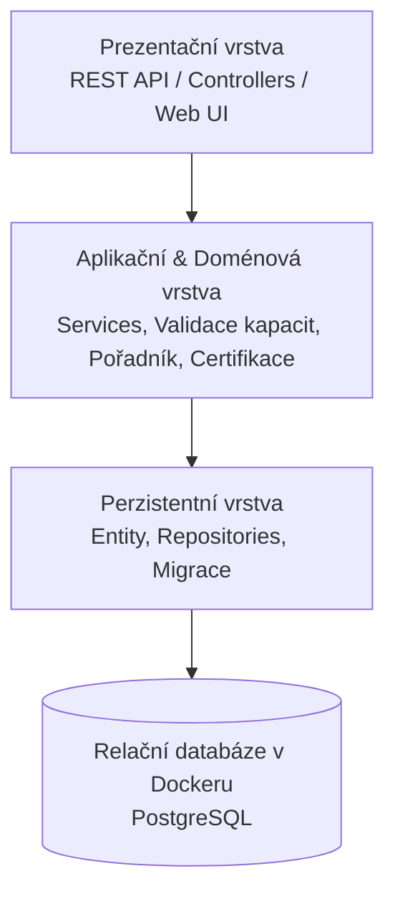
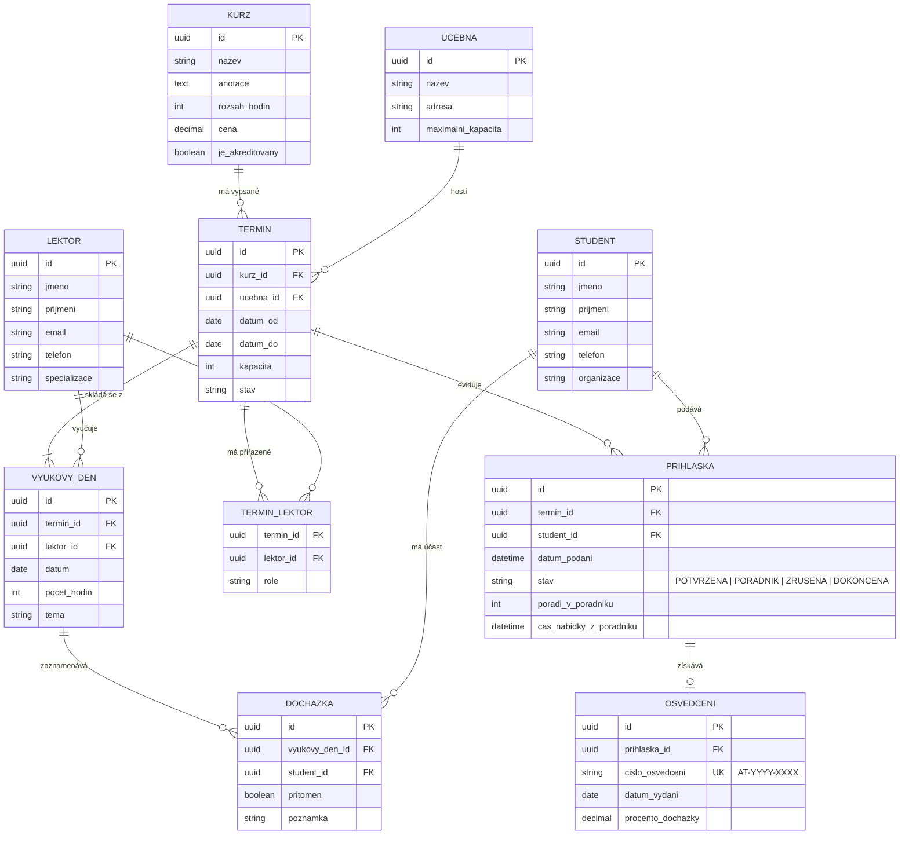

# Informační systém pro vzdělávací centrum (Akademie Trutnov)
> **Předmět:** Pokročilé programování (PPRO), ZS 2026/2027  
> **Semestrální projekt:** Zadání C – Kurzy vzdělávacího centra  
> **Klient:** Ing. Lucie Bartošová, Akademie Trutnov  
> **Status dokumentu:** Jediný zdroj pravdy (Single Source of Truth – technická dokumentace a zadání)

---

## Obsah
1. [Kontext a specifikace klienta](#1-kontext-a-specifikace-klienta)
2. [Otevřené body a Seznam rozhodnutí (ADR)](#2-otevřené-body-a-seznam-rozhodnutí-adr)
3. [Architektura a technický návrh](#3-architektura-a-technický-návrh)
4. [Doménový a datový model](#4-doménový-a-datový-model)
5. [Infrastruktura a spuštění projektu](#5-infrastruktura-a-spuštění-projektu)
6. [Testovací strategie](#6-testovací-strategie)
7. [Stav implementace a Roadmapa](#7-stav-implementace-a-roadmapa)

---

## 1. Kontext a specifikace klienta

### 1.1 Výchozí stav (Jak to v Akademii Trutnov funguje dnes)
Akademie Trutnov pořádá přibližně 40 rekvalifikačních a firemních kurzů ročně za účasti externích lektorů. Aktuální agenda je vedena manuálně:
- Zájemci se hlásí webovým formulářem do e-mailu, odkud jsou přihlášky ručně přepisovány do excelové tabulky (jedna záložka na kurz).
- Kapacity kurzů jsou hlídány pouze od oka. Pořadník náhradníků je řešen poznámkami tužkou na okraji papíru.
- Když účastník na poslední chvíli odřekne, recepce ztrácí čas zjišťováním, kdo je první na řadě.
- Osvědčení o absolvování jsou ručně připravována v MS Wordu. Čísla osvědčení jsou odvozována ručním čítáním, což již v minulosti vedlo k vystavení duplicitních čísel certifikátů.

### 1.2 Funkční požadavky klienta
1. **Evidence kurzů:** Název, textová anotace, hodinový rozsah, základní cena, příznak akreditace MŠMT/MPSV.
2. **Termíny kurzů:** Jeden kurz se opakuje vícekrát ročně. Termín má přesné datum od–do, místo konání (učebnu) a kapacitu odvozenou od parametrů učebny.
3. **Lektoři a jejich přiřazení:** Evidence externích lektorů. Lektor může vést více termínů, na delších kurzech se mohou střídat dva i více lektorů.
4. **Přihlášky studentů na termín:** Student se může zapsat na více kurzů, na daném termínu je zapsáno více studentů.
5. **Kapacita a pořadník (Waiting list):**
   - Po naplnění kapacity termínu jsou další zájemci automaticky zařazeni do pořadníku s přesnou evidencí pořadí.
   - Při uvolnění kapacity (zrušení přihlášky) je ihned jasné, kdo je první na řadě.
6. **Evidence docházky:** Záznam účasti studentů na jednotlivých výukových dnech vícedenních termínů.
7. **Dokončení kurzu a osvědčení:**
   - Uzavření termínu a vygenerování seznamu absolventů.
   - Vystavení osvědčení s garantovaně unikátním evidenčním číslem a datem vydání.
8. **Analytické přehledy:**
   - Vytížení a procentuální naplněnost termínů.
   - Sumář odučených hodin za jednotlivé lektory.
   - Přehled studentů přihlášených na více než jeden kurz v daném roce.

### 1.3 Obchodní pravidla (Na čem klient trvá)
- **Striktní strop kapacity:** Kapacitu termínu nelze za žádných okolností překročit (žádný overbooking).
- **Integrita pořadníku:** Pořadí zájemců v pořadníku se nesmí přeskakovat.
- **Unikátnost osvědčení:** Číslo osvědčení musí být v rámci celého systému unikátní. Již vydané osvědčení je neměnné (auditní stopa).
- **Nemažeme historii:** Zrušená přihláška se fyzicky z databáze nemaže; zůstává dohledatelná ve stavu `ZRUSENA` včetně časového razítka a důvodu zrušení.

### 1.4 Vedlejší požadavky a výhled
- Architektura musí být připravena na budoucí modul fakturace (oddělený kontext).
- Jednoduché a přehledné uživatelské rozhraní vhodné i pro lektory bez vysoké počítačové gramotnosti.
- Příprava pro budoucí automatické e-mailové notifikace.

---

## 2. Otevřené body a Seznam rozhodnutí (ADR)

Následující tabulka a rozhodnutí řeší nejasnosti a protichůdné představy zadavatele:

| # | Otevřený bod klienta | Klíčové dilema | Přijaté architektonické rozhodnutí |
|---|---|---|---|
| **ADR-01** | **Kdo rozhoduje o dokončení kurzu** | 70% docházka vs. subjektivní posouzení lektorem | **Hybridní model s pravidlem 70 % + veto/výjimka lektora:** Systém automaticky kvalifikuje studenta při dosažení alespoň 70% účasti. Lektor má možnost udělit výjimku (při 60–69 % s písemným odůvodněním) nebo naopak neudělit zápočet z odborných důvodů. |
| **ADR-02** | **Posun z pořadníku při uvolnění místa** | Zcela automatický zápis vs. manuální potvrzování | **Notifikační okno 24 hodin s automatickým propadem:** Uvolněné místo je rezervováno prvnímu náhradníkovi po dobu 24 hodin, kdy může potvrdit zájem online nebo telefonicky přes recepci. Pokud nepotvrdí, nabídka přechází na dalšího v pořadí. |
| **ADR-03** | **Souběh termínů téhož kurzu** | Možnost podat přihlášku na dva termíny naráz | **Zákaz souběhu aktivních přihlášek:** Student může mít v jednom okamžiku na stejný kurz pouze jednu platnou (potvrzenou) přihlášku. Je však povoleno být zapsán v pořadníku na jiný termín pro případ, že první termín bude zrušen. |
| **ADR-04** | **Přihlášení studenta po zahájení kurzu** | Pravidlo „nejde to“ vs. neformální výjimky | **Řízená výjimka administrátora do 20 % dotace:** Po zahájení kurzu je standardní registrace uzamčena. Dodatečný zápis smí provést pouze recepce/administrátor s označením výjimky, a to maximálně do proběhnutí 20 % hodinové dotace, aby bylo reálné splnit 70% docházku. |
| **ADR-05** | **Jeden lektor vs. více lektorů na termínu** | Střídání lektorů vs. agregace hodin na lektora | **Rozpad termínu na výukové dny s vazbou M:N:** Termín se skládá z jednotlivých výukových dnů/bloků, z nichž každý má přiřazeného konkrétního lektora. Přehledy pak agregují skutečně odučené hodiny přes tyto dílčí bloky naprosto přesně. |

---

## 3. Architektura a technický návrh

Projekt je navržen v souladu s pravidly předmětu **PPRO** jako modulární třívrstvá aplikace s jednosměrnými závislostmi.



### 3.1 Vrstvy aplikace
1. **Prezentační vrstva:**
   - Obsluhuje HTTP požadavky, validuje vstupní DTO a zprostředkovává REST rozhraní / UI.
   - Neobsahuje žádnou doménovou logiku ani přímé dotazy do databáze.
2. **Aplikační a doménová vrstva:**
   - Zajišťuje byznys procesy: zařazování do pořadníku, atomické rezervace bez překročení kapacity, kalkulaci docházky a generování unikátních čísel certifikátů.
   - Je nezávislá na konkrétním databázovém enginu a prezentačním frameworku.
3. **Perzistentní vrstva:**
   - Implementuje repozitáře pro ukládání entit.
   - Zajišťuje transakční integritu a spouštění verzovaných migrací.

---

## 4. Doménový a datový model

Systém pokrývá minimálně 7 klíčových entit s bohatými relacemi včetně vazeb M:N.



---

## 5. Infrastruktura a spuštění projektu

### 5.1 Požadavky
- [Docker](https://www.docker.com/) a Docker Compose v2+
- Git

### 5.2 Lokální spuštění
Celý stack (databáze + migrace + aplikace) se spouští jediným příkazem:
```bash
docker compose up -d
```

### 5.3 Práce s databází a migracemi
- Migrační skripty jsou verzované a aplikují se automaticky při startu kontejneru.
- Pro testování a demonstraci aplikace se automaticky nahrávají **syntetická testovací data** (žádné reálné osobní údaje).

---

## 6. Testovací strategie

1. **Unit testy:**
   - Ochrana proti překročení kapacity termínu (souběžné registrace).
   - Správnost řazení a posunu ve frontě pořadníku.
   - Matematický výpočet procenta docházky studenta a ověření hranice 70 %.
   - Generování sekvenčních unikátních čísel osvědčení bez duplicit.
2. **Integrační testy:**
   - Zápis a transakční perzistence přihlášek v databázi.
   - Přechody stavového automatu přihlášky (`PORADNIK` -> `POTVRZENA` -> `DOKONCENA` / `ZRUSENA`).
   - Sestavování analytických výkazů za lektory a kurzy.

---

## 7. Stav implementace a Roadmapa

- [x] Inicializace Git repozitáře a propojení s GitHub `sifalma1/PPRO2026`
- [x] Vytvoření pravidel vývoje a chování asistenta ([AGENTS.md](file:///c:/Users/skitt/Documents/PPRO/AGENTS.md))
- [x] Zpracování zadání C a definice architektonických rozhodnutí (ADR) v [README.md](file:///c:/Users/skitt/Documents/PPRO/README.md)
- [x] Nastavení Git hooku pro kontrolu dokumentace před commitem
- [ ] Návrh a založení struktury projektu (technologický stack, Dockerfile, docker-compose)
- [ ] Implementace datových migrací a doménových entit
- [ ] Implementace aplikačních služeb a byznys pravidel (kapacity, pořadník, docházka)
- [ ] Implementace API / kontrolerů a prezentační vrstvy
- [ ] Komplexní testovací sada (unitní i integrační testy)
- [ ] Syntetický seed data generátor pro předvedení klientovi
