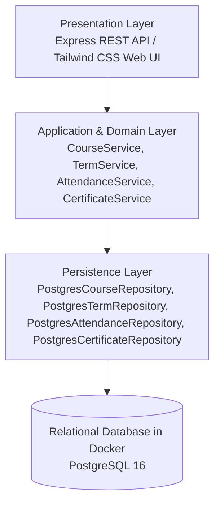
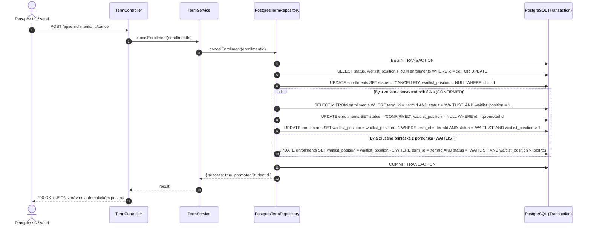
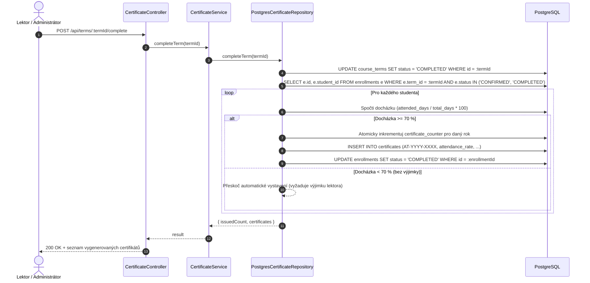

# Informační systém pro vzdělávací centrum (Akademie Trutnov)

> **Předmět:** Pokročilé programování (PPRO), ZS 2026/2027  
> **Semestrální projekt:** Zadání C – Kurzy vzdělávacího centra  
> **Klient:** Ing. Lucie Bartošová, Akademie Trutnov  
> **Autor:** Marek Šifalda  
> **Status dokumentu:** Jediný zdroj pravdy (Single Source of Truth – technická a architektonická dokumentace)

---

## Obsah

1. [Kontext a specifikace klienta](#1-kontext-a-specifikace-klienta)
   - 1.1 [Výchozí stav a motivace](#11-výchozí-stav-jak-to-v-akademii-trutnov-funguje-dnes)
   - 1.2 [Funkční požadavky klienta](#12-funkční-požadavky-klienta)
   - 1.3 [Obchodní pravidla a invarianty](#13-obchodní-pravidla-na-čem-klient-trvá)
   - 1.4 [Role uživatelů v systému (Aktéři)](#14-role-uživatelů-v-systému-aktéři)
2. [Otevřené body a Seznam architektonických rozhodnutí (ADR)](#2-otevřené-body-a-seznam-architektonických-rozhodnutí-adr)
   - [ADR-01: Kritéria dokončení kurzu a certifikace](#adr-01-kritéria-dokončení-kurzu-a-certifikace)
   - [ADR-02: Posun z pořadníku při uvolnění místa](#adr-02-posun-z-pořadníku-při-uvolnění-místa)
   - [ADR-03: Souběh termínů téhož kurzu](#adr-03-souběh-termínů-téhož-kurzu)
   - [ADR-04: Přihlášení studenta po zahájení kurzu](#adr-04-přihlášení-studenta-po-zahájení-kurzu)
   - [ADR-05: Více lektorů na termínu a výukové dny](#adr-05-více-lektorů-na-termínu-a-výukové-dny)
   - [ADR-06: Vyhodnocení vhodnosti Strapi CMS jako administrace](#adr-06-vyhodnocení-vhodnosti-strapi-cms-jako-administrace)
3. [Architektura a technický návrh](#3-architektura-a-technický-návrh)
   - 3.1 [Třívrstvá architektura a vrstvy aplikace](#31-vrstvy-aplikace)
   - 3.2 [Sekvenční diagram: Zrušení přihlášky a kaskáda pořadníku (ADR-02)](#32-sekvenční-diagram-zrušení-přihlášky-a-kaskáda-pořadníku-adr-02)
   - 3.3 [Sekvenční diagram: Uzavření termínu a certifikace (ADR-01)](#33-sekvenční-diagram-uzavření-termínu-a-vystavení-osvědčení-adr-01)
4. [Doménový a datový model (English Model & Data Dictionary)](#4-doménový-a-datový-model-english-model--data-dictionary)
   - 4.1 [Mermaid ER Diagram](#41-mermaid-er-diagram)
   - 4.2 [Katalog a specifikace doménových entit](#42-katalog-a-specifikace-doménových-entit)
5. [Infrastruktura a spuštění projektu](#5-infrastruktura-a-spuštění-projektu)
   - 5.1 [Použitý technologický stack](#51-použitý-technologický-stack)
   - 5.2 [Spuštění v Dockeru (doporučeno pro obhajobu)](#52-lokální-spuštění-v-dockeru-doporučeno-pro-obhajobu)
   - 5.3 [Lokální vývojové spuštění (bez Dockeru)](#53-lokální-vývojové-spuštění-bez-dockeru)
   - 5.4 [Kompletní katalog REST API rozhraní a JSON příklady](#54-kompletní-katalog-rest-api-rozhraní-a-json-příklady)
6. [Testovací strategie](#6-testovací-strategie)
   - 6.1 [Přehled doménových unit testů (Node test runner – 20 testů)](#61-přehled-doménových-unit-testů-20-testů)
   - 6.2 [Přehled integračních End-to-End testů (Node test runner – 9 testů)](#62-přehled-integračních-end-to-end-testů-testapi-creation-flowstestts--9-testů)
   - 6.3 [Komplexní testovací sada v Jestu s TypeScript & ESM (71 testů)](#63-komplexní-testovací-sada-v-jestu-testjest--71-testů)
   - 6.4 [Spuštění testů a souhrnný přehled](#64-spuštění-testů-a-souhrnný-přehled)
   - 6.5 [Kvalita kódu, linting a formátování (ESLint + Prettier)](#65-kvalita-kódu-linting-a-formátování-eslint--prettier)
7. [Stav implementace, Roadmapa a Changelog](#7-stav-implementace-roadmapa-a-changelog)
   - 7.1 [Aktuální stav implementace požadavků](#71-aktuální-stav-implementace-požadavků)
   - 7.2 [Historie verzí (Changelog)](#72-historie-verzí-changelog)
   - 7.3 [Roadmapa dalšího rozvoje](#73-roadmapa-dalšího-rozvoje)

---

## 1. Kontext a specifikace klienta

### 1.1 Výchozí stav (Jak to v Akademii Trutnov funguje dnes)

Akademie Trutnov pořádá přibližně 40 rekvalifikačních a firemních kurzů ročně za účasti externích lektorů. Aktuální agenda je vedena manuálně:

- Zájemci se hlásí webovým formulářem do e-mailu, odkud jsou přihlášky ručně přepisovány do excelové tabulky (jedna záložka na kurz).
- Kapacity kurzů jsou hlídány pouze od oka. Pořadník náhradníků je řešen poznámkami tužkou na okraji papíru.
- Když účastník na poslední chvíli odřekne, recepce ztrácí čas zjišťováním, kdo je první na řadě, a hrozí propadnutí místa.
- Osvědčení o absolvování jsou ručně připravována v MS Wordu. Čísla osvědčení jsou odvozována ručním čítáním, což již v minulosti vedlo k vystavení duplicitních čísel certifikátů.

### 1.2 Funkční požadavky klienta

1. **Evidence kurzů (`courses`):** Název, textová anotace, hodinový rozsah, základní cena, příznak akreditace MŠMT/MPSV.
2. **Termíny kurzů (`course_terms`):** Jeden kurz se opakuje vícekrát ročně. Termín má přesné datum od–do, místo konání (učebnu) a kapacitu odvozenou od parametrů učebny.
3. **Lektoři a jejich přiřazení (`lecturers`, `term_lecturers`):** Evidence externích lektorů. Lektor může vést více termínů, na delších kurzech se mohou střídat dva i více lektorů.
4. **Přihlášky studentů na termín (`enrollments`, `students`):** Student se může zapsat na více kurzů, na daném termínu je zapsáno více studentů.
5. **Kapacita a pořadník (Waiting list):**
   - Po naplnění kapacity termínu jsou další zájemci automaticky zařazeni do pořadníku s přesnou evidencí pořadí.
   - Při uvolnění kapacity (zrušení přihlášky) je ihned garantován posun prvního náhradníka v pořadí.
6. **Evidence docházky (`teaching_days`, `attendance`):** Záznam účasti studentů na jednotlivých výukových dnech vícedenních termínů.
7. **Dokončení kurzu a osvědčení (`certificates`):**
   - Uzavření termínu a vygenerování seznamu absolventů.
   - Vystavení osvědčení s garantovaně unikátním evidenčním číslem (`AT-YYYY-XXXX`) a datem vydání (ADR-01).
8. **Analytické přehledy (`analytics`):**
   - Vytížení a procentuální naplněnost termínů.
   - Sumář odučených hodin za jednotlivé lektory.
   - Přehled studentů přihlášených na více než jeden kurz v daném roce.

### 1.3 Obchodní pravidla (Na čem klient trvá)

- **Striktní strop kapacity:** Kapacitu termínu nelze za žádných okolností překročit (žádný overbooking).
- **Integrita pořadníku:** Pořadí zájemců v pořadníku se nesmí přeskakovat.
- **Unikátnost osvědčení:** Číslo osvědčení musí být v rámci celého systému celosvětově unikátní. Již vydané osvědčení je neměnné (auditní stopa).
- **Nemažeme historii:** Zrušená přihláška se fyzicky z databáze nemaže; zůstává dohledatelná ve stavu `CANCELLED` včetně časového razítka a důvodu zrušení.

### 1.4 Role uživatelů v systému (Aktéři)

1. **Recepce & Administrátor:**
   - Spravuje nabídku kurzů a vypisuje termíny s přiřazením učeben.
   - Zapisuje studenty na termíny a řeší případná storna přihlášek.
   - Uzavírá termíny a spouští hromadné generování certifikátů.
2. **Lektor:**
   - Zobrazuje si rozvrh svých výukových dnů.
   - Provádí zápis docházky (prezenční listinu) po skončení každého výukového bloku.
   - Má pravomoc udělit výjimku studentovi s docházkou pod 70 % s povinným písemným odůvodněním.
3. **Vedení vzdělávacího centra (Klient):**
   - Sleduje manažerské výkazy: procentuální vytížení učeben/termínů, odučené hodiny lektorů pro fakturaci a věrnostní přehled studentů.

---

## 2. Otevřené body a Seznam architektonických rozhodnutí (ADR)

Následující přehled dokumentuje klíčová architektonická rozhodnutí řešící protichůdné požadavky klienta:

| #          | Otevřený bod klienta / Rozhodnutí                      | Klíčové dilema                                                | Přijaté architektonické rozhodnutí                                                                                                                                                                                                                                                                            |
| ---------- | ------------------------------------------------------ | ------------------------------------------------------------- | ------------------------------------------------------------------------------------------------------------------------------------------------------------------------------------------------------------------------------------------------------------------------------------------------------------- |
| **ADR-01** | **Kritéria dokončení kurzu a certifikace**             | 70% docházka vs. subjektivní posouzení lektorem               | **Hybridní model s pravidlem 70 % + veto/výjimka lektora:** Systém automaticky kvalifikuje studenta při dosažení alespoň 70% účasti. Lektor má možnost udělit výjimku (s povinným písemným odůvodněním min. 5 znaků) nebo naopak neudělit zápočet z odborných důvodů. Číslo osvědčení má tvar `AT-YYYY-XXXX`. |
| **ADR-02** | **Posun z pořadníku při uvolnění místa**               | Zcela automatický zápis vs. manuální potvrzování              | **Okamžitý transakční posun z pořadníku:** Při zrušení potvrzené přihlášky transakce automaticky povýší prvního čekatele v pořadníku (`waitlist_position = 1`) na potvrzenou účast a posune pořadí ostatních čekatelů o 1 dopředu.                                                                            |
| **ADR-03** | **Souběh termínů téhož kurzu**                         | Možnost podat přihlášku na dva termíny naráz                  | **Zákaz souběhu aktivních přihlášek na stejný kurz:** Student smí mít na stejný kurz pouze jednu platnou (potvrzenou) přihlášku. Je však povoleno být zapsán v pořadníku na jiný termín.                                                                                                                      |
| **ADR-04** | **Přihlášení studenta po zahájení kurzu**              | Pravidlo „nejde to“ vs. neformální výjimky                    | **Řízená výjimka administrátora do 20 % dotace:** Po zahájení kurzu je standardní registrace uzamčena. Dodatečný zápis smí provést pouze recepce/administrátor s označením výjimky, a to maximálně do proběhnutí 20 % hodinové dotace.                                                                        |
| **ADR-05** | **Více lektorů na termínu a výukové dny**              | Střídání lektorů vs. agregace hodin na lektora                | **Rozpad termínu na výukové dny (`TeachingDay`) s vazbou M:N:** Termín se skládá z jednotlivých výukových dnů/bloků, z nichž každý má přiřazeného konkrétního lektora. Přehledy agregují skutečně odučené hodiny přes tyto dílčí bloky.                                                                       |
| **ADR-06** | **Vyhodnocení vhodnosti Strapi CMS jako administrace** | Použít headless CMS Strapi vs. vlastní modulární administraci | **Zamítnuto – Vlastní modulární SPA administrace:** Zhodnocení Strapi ukázalo, že pro potřeby předmětu PPRO a specifikaci Akademie Trutnov je Strapi nevhodné (viz detailní analýza níže).                                                                                                                    |

### ADR-01: Kritéria dokončení kurzu a certifikace

- **Kontext:** Klient požaduje jednoznačná pravidla pro vystavení osvědčení o absolvování kurzu, avšak praxe ukazuje, že striktní procento docházky může poškodit studenty s omluvenou absencí a vyřešeným náhradním úkolem.
- **Rozhodnutí:**
  - Výchozí hranice úspěšného absolvování je stanovena na **70 % docházky** (poměr `attended_days / total_days`).
  - Systém při uzavření termínu automaticky vystaví osvědčení všem studentům splňujícím hranici >= 70 %.
  - Pro studenty pod 70 % má lektor/administrátor možnost vystavit osvědčení na základě **výjimky (`has_waiver = true`)**, která **vyžaduje písemné zdůvodnění o minimální délce 5 znaků** (např. doložení lékařské zprávy, individuální projekt).
  - Každé osvědčení obdrží celosvětově unikátní evidenční kód ve formátu `AT-YYYY-XXXX` generovaný z atomické čítací sekvence v databázi.

### ADR-02: Posun z pořadníku při uvolnění místa

- **Kontext:** V případě odřeknutí účastníka na poslední chvíli docházelo v minulosti k prodlevám a prázdným místům v kurzu.
- **Rozhodnutí:**
  - Systém implementuje **automatický a atomický posun v rámci jediné transakce** (`BEGIN ... COMMIT`).
  - Pokud je zrušena potvrzená přihláška (`CONFIRMED`), transakce okamžitě vybere náhradníka s `waitlist_position = 1`, změní jeho status na `CONFIRMED`, vynuluje jeho pozici a sníží pozice všech zbývajících čekatelů o 1 (`waitlist_position = waitlist_position - 1`).
  - Pokud je zrušena přihláška z pořadníku (`WAITLIST`), transakce posune dopředu pouze zájemce zařazené za zrušenou pozicí.

### ADR-03: Souběh termínů téhož kurzu

- **Kontext:** Klient zaznamenal případy, kdy se jeden student přihlásil na dva termíny stejného rekvalifikačního kurzu naráz, čímž blokoval kapacitu jiným zájemcům.
- **Rozhodnutí:**
  - Student smí mít pro daný kurz pouze **jednu aktivní potvrzenou přihlášku** (`CONFIRMED`).
  - Zápis do pořadníku (`WAITLIST`) na alternativní termín je povolen jako záloha pro případ zrušení hlavního termínu.

### ADR-04: Přihlášení studenta po zahájení kurzu

- **Kontext:** Pozdní zájemci se občas pokoušejí přihlásit na kurz, který již započal.
- **Rozhodnutí:**
  - Veřejná registrace je po datu `start_date` automaticky zablokována.
  - Administrátor/recepce má možnost udělit výjimku pro pozdní zápis maximálně do chvíle, kdy proběhlo **méně než 20 % celkové hodinové dotace kurzu**, aby byla garantována možnost splnit 70% docházku.

### ADR-05: Více lektorů na termínu a výukové dny

- **Kontext:** Delší rekvalifikační kurzy (např. Účetnictví 80 hodin) vyučuje více specialistů (mzdová účetní, daňový poradce).
- **Rozhodnutí:**
  - Termín je modelován jako složený celek: kromě vazby `term_lecturers` (M:N) je rozpadnut na jednotlivé **výukové dny (`TeachingDay`)**.
  - Každý výukový den má přesné datum, hodinový rozsah, téma a konkrétního vyučujícího lektora.
  - Manažerské výkazy hodin lektorů se počítají agregací přes tyto výukové bloky, což zaručuje přesné podklady pro fakturaci.

### ADR-06: Vyhodnocení vhodnosti Strapi CMS jako administrace

Dotaz zadavatele: _„Zkus zjistit, zdali je vhodné použít Strapi jako administraci.“_

1. **Akademický kontext a kritéria předmětu PPRO (FIM UHK):**
   - V předmětu PPRO se hodnotí schopnost studenta navrhnout a implementovat **čistou třívrstvou architekturu** (_Presentation -> Application / Domain -> Persistence_), doménové invarianty, unit testy byznys logiky a transakční integritu.
   - Pokud by byla administrace svěřena Strapi, doménová logika (hlídání kapacit bez overbookingu, kaskádový posun v pořadníku ADR-02, 70% pravidlo ADR-01, sekvenční generování unikátních čísel certifikátů) by se musela lámat do interních pluginů a lifecycle hooků Strapi, čímž by došlo ke smazání hranic třívrstvé architektury.
2. **Databázové schéma a verzované migrace:**
   - Strapi si vynucuje vlastní správu databáze, vytváří desítky systémových tabulek (`strapi_core_store_settings`, `up_users`, `admin_users` apod.) a mění strukturu cizích klíčů a sloupců.
   - Požadavek PPRO striktně stanovuje: _„Řízené verzované migrace (žádné ruční vytváření tabulek mimo migrační skripty)“_. Propojení Strapi s vlastními SQL migracemi by vedlo ke kolizím a nekonzistencím.
3. **Výkon a provozní náročnost:**
   - Strapi vyžaduje vlastní Node.js proces s vysokou spotřebou paměti (300–600 MB RAM jen pro admin), rozsáhlý strom závislostí a zdlouhavý build.
   - V `docker compose up` by to znamenalo buď nahradit celý backend systémem Strapi (což porušuje zadání), nebo provozovat dva nezávislé servery s duplicitním připojením do PostgreSQL.
4. **Závěr:**
   - **Použití Strapi pro hlavní administraci NENÍ vhodné.**
   - Jako optimální řešení je implementováno přehledné, responzivní Web UI ve frameworku **Tailwind CSS** přímo v prezentační vrstvě aplikace, napojené na čisté REST API.

---

## 3. Architektura a technický návrh

Projekt je navržen v souladu s pravidly předmětu **PPRO** jako modulární třívrstvá aplikace s jednosměrnými závislostmi. Veškeré názvy tříd, metod, rozhraní, databázových entit a tabulek jsou **v anglickém jazyce**.



### 3.1 Vrstvy aplikace

1. **Presentation Layer (`src/presentation/`):**
   - Obsluhuje HTTP požadavky, mapuje DTO a zprostředkovává REST rozhraní i webovou administraci v Tailwind CSS.
   - Neobsahuje žádnou doménovou logiku ani přímé SQL dotazy.
2. **Application & Domain Layer (`src/application/`, `src/domain/`):**
   - Zajišťuje byznys logiku: validace kurzů, atomická správa kapacit termínů, čekací listina (ADR-02), výpočet procenta docházky (ADR-01, ADR-05) a vydávání osvědčení.
   - Entitní modely jsou nezávislé na frameworku Express i databázi.
3. **Persistence Layer (`src/infrastructure/`):**
   - Implementuje repozitáře s přístupem do PostgreSQL přes connection pool.
   - Zajišťuje transakční bezpečnost (`BEGIN / COMMIT / ROLLBACK`) při posunech v pořadníku a vydávání certifikátů.

### 3.2 Sekvenční diagram: Zrušení přihlášky a kaskáda pořadníku (ADR-02)



### 3.3 Sekvenční diagram: Uzavření termínu a vystavení osvědčení (ADR-01)



---

## 4. Doménový a datový model (English Model & Data Dictionary)

### 4.1 Mermaid ER Diagram

Kompletní doménový model obsahuje 10 entit a tabulek v anglickém jazyce včetně bohatých relací M:N a 1:N:


### 4.2 Katalog a specifikace doménových entit

| Entita           | Tabulka v DB     | Klíčové atributy & Typy                                                                                                                                                                                                                    | Doménové invarianty a byznys pravidla                                                                                                     |
| ---------------- | ---------------- | ------------------------------------------------------------------------------------------------------------------------------------------------------------------------------------------------------------------------------------------ | ----------------------------------------------------------------------------------------------------------------------------------------- |
| **Course**       | `courses`        | `id` (UUID), `title` (VARCHAR 150), `annotation` (TEXT), `hours` (INT), `price` (NUMERIC 10,2), `is_accredited` (BOOLEAN)                                                                                                                  | Název 3–150 znaků; anotace min. 10 znaků; hodiny kladné celé číslo > 0; cena nezáporná.                                                   |
| **Classroom**    | `classrooms`     | `id` (UUID), `name` (VARCHAR 100), `address` (VARCHAR 255), `capacity` (INT)                                                                                                                                                               | Kapacita učebny > 0; kapacita termínu nesmí překročit kapacitu učebny.                                                                    |
| **Lecturer**     | `lecturers`      | `id` (UUID), `first_name` (VARCHAR 100), `last_name` (VARCHAR 100), `email` (VARCHAR 150 UNIQUE), `phone` (VARCHAR 50), `specialization` (VARCHAR 200)                                                                                     | Unikátní validní e-mail; jméno a příjmení min. 2 znaky.                                                                                   |
| **CourseTerm**   | `course_terms`   | `id` (UUID), `course_id` (UUID FK), `classroom_id` (UUID FK), `start_date` (DATE), `end_date` (DATE), `capacity` (INT), `status` (VARCHAR 30)                                                                                              | `start_date <= end_date`; kapacita > 0; stavy: `PLANNED`, `IN_PROGRESS`, `COMPLETED`, `CANCELLED`.                                        |
| **TermLecturer** | `term_lecturers` | `term_id` (UUID FK), `lecturer_id` (UUID FK), `role` (VARCHAR 50)                                                                                                                                                                          | Vazba M:N pro střídání více lektorů na jednom termínu kurzu.                                                                              |
| **Student**      | `students`       | `id` (UUID), `first_name` (VARCHAR 100), `last_name` (VARCHAR 100), `email` (VARCHAR 150 UNIQUE), `phone` (VARCHAR 50), `organization` (VARCHAR 150)                                                                                       | Unikátní validní e-mail studenta napříč celým systémem.                                                                                   |
| **Enrollment**   | `enrollments`    | `id` (UUID), `term_id` (UUID FK), `student_id` (UUID FK), `submitted_at` (TIMESTAMPTZ), `status` (VARCHAR 30), `waitlist_position` (INT), `note` (TEXT)                                                                                    | Stavy: `CONFIRMED`, `WAITLIST`, `CANCELLED`, `COMPLETED`. Pokud `WAITLIST`, musí mít kladné pořadí. Nemaže se (pouze status `CANCELLED`). |
| **TeachingDay**  | `teaching_days`  | `id` (UUID), `term_id` (UUID FK), `lecturer_id` (UUID FK), `day_date` (DATE), `hours` (INT), `topic` (VARCHAR 255)                                                                                                                         | Hodiny výukového bloku > 0; téma min. 3 znaky; přiřazen vyučující lektor (ADR-05).                                                        |
| **Attendance**   | `attendance`     | `id` (UUID), `teaching_day_id` (UUID FK), `student_id` (UUID FK), `is_present` (BOOLEAN), `note` (VARCHAR 255)                                                                                                                             | Unikátní dvojice `(teaching_day_id, student_id)`; eviduje účast a omluvenky studentů.                                                     |
| **Certificate**  | `certificates`   | `id` (UUID), `enrollment_id` (UUID FK UNIQUE), `student_id` (UUID FK), `term_id` (UUID FK), `certificate_number` (VARCHAR 50 UNIQUE), `issue_date` (DATE), `attendance_rate` (NUMERIC 5,2), `has_waiver` (BOOLEAN), `waiver_reason` (TEXT) | Číslo ve formátu `AT-YYYY-XXXX`. Vyžaduje docházku >= 70 %, nebo `has_waiver = true` s písemným odůvodněním min. 5 znaků (ADR-01).        |

---

## 5. Infrastruktura a spuštění projektu

### 5.1 Použitý technologický stack

- **Běhové prostředí:** Node.js 22 LTS (TypeScript 5.7, ES Modules, `strict` mode)
- **Prezentační vrstva:**
  - **Backend REST API:** Express 4.21 s typovanými kontrolery a routami
  - **Modulární Frontend SPA:** Moderní frontend postavený na **Vite 6** + **TypeScript** + **Tailwind CSS 3.4**:
    - Umístění zdrojových kódů v samostatném adresáři [`frontend/`](frontend/):
      - [`frontend/src/api/`](frontend/src/api/): Typovaný REST API klient (`coursesApi.ts`, `termsApi.ts`, `attendanceApi.ts`, `certificatesApi.ts`, `dictionariesApi.ts`)
      - [`frontend/src/components/`](frontend/src/components/): Znovupoužitelné komponenty (`Header.ts`, `Modal.ts`, `Toast.ts`)
      - [`frontend/src/views/`](frontend/src/views/): Modulární obrazovky (`CoursesView.ts`, `TermsView.ts`, `AttendanceView.ts`, `CertificatesView.ts`, `LecturersView.ts`, `AnalyticsView.ts`)
    - Dark/Light režim s okamžitým přepnutím a perzistencí v `localStorage`
    - Přístupný modální dialog (podpora klávesy ESC, kliknutí na pozadí, focus trapping, animace)
    - Toast notifikační systém (úspěch, chyba, varování, info s automatickým dojezdem)
    - Produkční build přes Vite s automatickým bundle hashováním a minifikací do `public/` servírované Expressem
- **Aplikační vrstva:** Doménové služby ([`CourseService`](src/application/services/CourseService.ts), [`TermService`](src/application/services/TermService.ts), [`AttendanceService`](src/application/services/AttendanceService.ts), [`CertificateService`](src/application/services/CertificateService.ts)), DTOs a striktní validace doménových invariantů
- **Perzistentní vrstva:** PostgreSQL 16 (přes `pg` connection pool), řízené verzované SQL migrace (`migrations/001` až `005`)
- **Kontejnerizace:** Docker & Docker Compose (vícestupňový `Dockerfile` s buildem Vite frontendu a TypeScript backendu)

### 5.2 Lokální spuštění v Dockeru (doporučeno pro obhajobu)

Celý stack (databáze PostgreSQL 16 + automatické migrace + webová aplikace s Tailwind CSS) se spouští jediným příkazem:

```bash
docker compose up --build
```

Aplikace bude následně dostupná:

- **Webový informační systém:** [http://localhost:3000](http://localhost:3000)
- **REST API kurzů:** [http://localhost:3000/api/courses](http://localhost:3000/api/courses)
- **REST API termínů:** [http://localhost:3000/api/terms](http://localhost:3000/api/terms)
- **REST API docházky:** [http://localhost:3000/api/attendance](http://localhost:3000/api/attendance)
- **REST API certifikátů:** [http://localhost:3000/api/certificates](http://localhost:3000/api/certificates)
- **Health check:** [http://localhost:3000/health](http://localhost:3000/health)

Ukončení kontejnerů:

```bash
docker compose down
```

### 5.3 Lokální vývojové spuštění (bez Dockeru)

1. Spusťte PostgreSQL databázi na portu 5432 (dle údajů v `.env` – vzor v `.env.example`).
2. Nainstalujte závislosti a spusťte vývojový režim:

```bash
# 1. Instalace závislostí
npm install

# 2. Aplikace verzovaných SQL migrací do PostgreSQL
npm run migrate

# 3. Zkompilování frontendu (Vite + Tailwind) a backendu (tsc)
npm run build

# 4. Spuštění v hot-reload vývojovém režimu (Express API + statické soubory)
npm run dev

# (Volitelné) Samostatný vývojový Vite HMR dev server pro frontend:
npm run dev:client
```

---

### 5.4 Kompletní katalog REST API rozhraní a JSON příklady

Systém nabízí čisté REST rozhraní s podporou anglických endpointů a zpětnou kompatibilitou pro české aliasy.

#### 1. Kurzy (`courses`)

| Metoda   | Endpoint           | Popis                                                                       |
| -------- | ------------------ | --------------------------------------------------------------------------- |
| `GET`    | `/api/courses`     | Seznam kurzů (volitelné query filtry: `?accredited=true\|false&query=text`) |
| `GET`    | `/api/courses/:id` | Detail vybraného kurzu                                                      |
| `POST`   | `/api/courses`     | Vytvoření nového kurzu s validací polí                                      |
| `PUT`    | `/api/courses/:id` | Aktualizace kurzu                                                           |
| `DELETE` | `/api/courses/:id` | Smazání kurzu                                                               |

**Příklad: Vytvoření kurzu (`POST /api/courses`)**

_Request Payload (JSON):_

```json
{
  "title": "Mzdové účetnictví a personalistika",
  "annotation": "Komplexní rekvalifikační kurz se zaměřením na zákoník práce, odvody a mzdy.",
  "hours": 80,
  "price": 14900,
  "isAccredited": true
}
```

_Response (201 Created):_

```json
{
  "success": true,
  "message": "Course created successfully.",
  "data": {
    "id": "a1b2c3d4-e5f6-7a8b-9c0d-1e2f3a4b5c6d",
    "title": "Mzdové účetnictví a personalistika",
    "annotation": "Komplexní rekvalifikační kurz se zaměřením na zákoník práce, odvody a mzdy.",
    "hours": 80,
    "price": 14900,
    "isAccredited": true,
    "createdAt": "2026-11-04T15:00:00.000Z",
    "updatedAt": "2026-11-04T15:00:00.000Z"
  }
}
```

---

#### 2. Termíny a přihlášky (`terms`, `enrollments`)

| Metoda | Endpoint                      | Popis                                                                           |
| ------ | ----------------------------- | ------------------------------------------------------------------------------- |
| `GET`  | `/api/terms`                  | Seznam termínů (včetně obsazenosti, kapacity a lektorů)                         |
| `GET`  | `/api/terms/:id`              | Detail termínu                                                                  |
| `POST` | `/api/terms`                  | Vypsání nového termínu s učebnou a lektory                                      |
| `GET`  | `/api/terms/:id/enrollments`  | Seznam přihlášených studentů a čekatelů v pořadníku                             |
| `POST` | `/api/terms/:id/enrollments`  | Zápis studenta na termín (potvrzení místa nebo zařazení na waitlist dle ADR-02) |
| `POST` | `/api/enrollments/:id/cancel` | Zrušení přihlášky s okamžitým automatickým posunem náhradníka (ADR-02)          |

**Příklad: Zápis studenta s volnou kapacitou (`POST /api/terms/:id/enrollments`)**

_Request Payload (JSON):_

```json
{
  "firstName": "Jan",
  "lastName": "Novák",
  "email": "jan.novak@example.cz",
  "phone": "+420 777 123 456",
  "organization": "Město Trutnov",
  "note": "Požadavek na fakturaci pro zaměstnavatele"
}
```

_Response (201 Created – Potvrzeno):_

```json
{
  "success": true,
  "message": "Student enrollment confirmed successfully.",
  "data": {
    "id": "e4f5a6b7-c8d9-0e1f-2a3b-4c5d6e7f8a9b",
    "termId": "b2c3d4e5-f6a7-8b9c-0d1e-2f3a4b5c6d7e",
    "studentId": "c3d4e5f6-a7b8-9c0d-1e2f-3a4b5c6d7e8f",
    "status": "CONFIRMED",
    "waitlistPosition": null,
    "submittedAt": "2026-11-04T15:10:00.000Z"
  }
}
```

_Response (201 Created – Po naplnění kapacity zařazeno do pořadníku ADR-02):_

```json
{
  "success": true,
  "message": "Course capacity is full. Student was placed on the waiting list as candidate #1.",
  "data": {
    "id": "f5a6b7c8-d9e0-1f2a-3b4c-5d6e7f8a9b0c",
    "termId": "b2c3d4e5-f6a7-8b9c-0d1e-2f3a4b5c6d7e",
    "studentId": "d4e5f6a7-b8c9-0d1e-2f3a-4b5c6d7e8f9a",
    "status": "WAITLIST",
    "waitlistPosition": 1,
    "submittedAt": "2026-11-04T15:15:00.000Z"
  }
}
```

**Příklad: Storno přihlášky a automatická kaskáda náhradníka (`POST /api/enrollments/:id/cancel`)**

_Response (200 OK – Náhradník #1 okamžitě povýšen):_

```json
{
  "success": true,
  "message": "Enrollment was cancelled. Spot was automatically assigned to the first waitlisted candidate (ADR-02)!",
  "data": {
    "success": true,
    "cancelledEnrollmentId": "e4f5a6b7-c8d9-0e1f-2a3b-4c5d6e7f8a9b",
    "promotedStudentId": "d4e5f6a7-b8c9-0d1e-2f3a-4b5c6d7e8f9a"
  }
}
```

---

#### 3. Evidence docházky (`attendance`)

| Metoda | Endpoint                                | Popis                                                                      |
| ------ | --------------------------------------- | -------------------------------------------------------------------------- |
| `GET`  | `/api/attendance/terms/:termId/days`    | Seznam výukových dnů termínu (ADR-05)                                      |
| `POST` | `/api/attendance/terms/:termId/days`    | Vytvoření výukového dne s lektorem a hodinovým rozsahem                    |
| `GET`  | `/api/attendance/days/:dayId`           | Prezenční listina studentů na vybraném výukovém dni                        |
| `POST` | `/api/attendance/days/:dayId/mark`      | Záznam přítomnosti studenta na výuce                                       |
| `GET`  | `/api/attendance/terms/:termId/summary` | Přehled procentuální docházky studentů a vyhodnocení 70% pravidla (ADR-01) |

**Příklad: Záznam přítomnosti studenta (`POST /api/attendance/days/:dayId/mark`)**

_Request Payload (JSON):_

```json
{
  "studentId": "c3d4e5f6-a7b8-9c0d-1e2f-3a4b5c6d7e8f",
  "isPresent": true,
  "note": "Účast v plném rozsahu"
}
```

_Response (200 OK):_

```json
{
  "success": true,
  "message": "Attendance recorded successfully."
}
```

**Příklad: Souhrn docházky termínu (`GET /api/attendance/terms/:termId/summary`)**

_Response (200 OK):_

```json
{
  "success": true,
  "count": 2,
  "data": [
    {
      "studentId": "c3d4e5f6-a7b8-9c0d-1e2f-3a4b5c6d7e8f",
      "studentName": "Jan Novák",
      "email": "jan.novak@example.cz",
      "totalDays": 10,
      "attendedDays": 8,
      "attendanceRate": 80.0,
      "qualifiesForCertificate": true,
      "certificateNumber": "AT-2026-0001"
    },
    {
      "studentId": "d4e5f6a7-b8c9-0d1e-2f3a-4b5c6d7e8f9a",
      "studentName": "Eva Dvořáková",
      "email": "dvorakova@example.cz",
      "totalDays": 10,
      "attendedDays": 6,
      "attendanceRate": 60.0,
      "qualifiesForCertificate": false,
      "certificateNumber": null
    }
  ]
}
```

---

#### 4. Osvědčení a certifikáty (`certificates`)

| Metoda | Endpoint                      | Popis                                                                              |
| ------ | ----------------------------- | ---------------------------------------------------------------------------------- |
| `POST` | `/api/terms/:termId/complete` | Uzavření termínu a hromadné vystavení osvědčení kvalifikovaným studentům (>= 70 %) |
| `GET`  | `/api/certificates`           | Seznam všech vydaných certifikátů v systému                                        |
| `GET`  | `/api/certificates/:id`       | Detail konkrétního certifikátu                                                     |
| `POST` | `/api/certificates/issue`     | Individuální vystavení certifikátu se schválenou lektorskou výjimkou (ADR-01)      |

**Příklad: Hromadné uzavření termínu (`POST /api/terms/:termId/complete`)**

_Response (200 OK):_

```json
{
  "success": true,
  "message": "Course term completed. Issued 1 certificate(s) for qualifying students.",
  "data": {
    "termId": "b2c3d4e5-f6a7-8b9c-0d1e-2f3a4b5c6d7e",
    "issuedCount": 1,
    "certificates": [
      {
        "id": "7a8b9c0d-1e2f-3a4b-5c6d-7e8f9a0b1c2d",
        "certificateNumber": "AT-2026-0001",
        "studentId": "c3d4e5f6-a7b8-9c0d-1e2f-3a4b5c6d7e8f",
        "issueDate": "2026-11-04",
        "attendanceRate": 80.0,
        "hasWaiver": false
      }
    ]
  }
}
```

**Příklad: Vystavení certifikátu na základě výjimky lektora (`POST /api/certificates/issue`)**

_Request Payload (JSON):_

```json
{
  "enrollmentId": "f5a6b7c8-d9e0-1f2a-3b4c-5d6e7f8a9b0c",
  "hasWaiver": true,
  "waiverReason": "Schválena výjimka lektora z důvodu doložené lékařské zprávy a odevzdání doplňkového projektu."
}
```

_Response (201 Created):_

```json
{
  "success": true,
  "message": "Certificate issued successfully.",
  "data": {
    "id": "8b9c0d1e-2f3a-4b5c-6d7e-8f9a0b1c2d3e",
    "certificateNumber": "AT-2026-0002",
    "studentId": "d4e5f6a7-b8c9-0d1e-2f3a-4b5c6d7e8f9a",
    "issueDate": "2026-11-04",
    "attendanceRate": 60.0,
    "hasWaiver": true,
    "waiverReason": "Schválena výjimka lektora z důvodu doložené lékařské zprávy a odevzdání doplňkového projektu."
  }
}
```

---

#### 5. Číselníky a analytické manažerské výkazy (`analytics`)

| Metoda | Endpoint          | Popis                                                                                        |
| ------ | ----------------- | -------------------------------------------------------------------------------------------- |
| `GET`  | `/api/lecturers`  | Seznam lektorů, jejich specializace a celkový součet odučených hodin                         |
| `GET`  | `/api/classrooms` | Seznam učeben a jejich maximální kapacity                                                    |
| `GET`  | `/api/students`   | Seznam studentů a počet jejich aktivních přihlášek                                           |
| `GET`  | `/api/analytics`  | Manažerské výkazy dle bodu 8 zadání (vytížení kapacit, hodiny lektorů, vícekurzoví studenti) |
| `GET`  | `/health`         | Healthcheck stavu aplikace                                                                   |

**Příklad: Manažerská analytika (`GET /api/analytics`)**

_Response (200 OK):_

```json
{
  "success": true,
  "data": {
    "termOccupancy": [
      {
        "termId": "b2c3d4e5-f6a7-8b9c-0d1e-2f3a4b5c6d7e",
        "courseTitle": "Mzdové účetnictví a personalistika",
        "classroomName": "Počítačová učebna A",
        "capacity": 12,
        "confirmedStudents": 12,
        "occupancyPercentage": 100.0,
        "waitlistStudents": 3
      }
    ],
    "lecturerWorkload": [
      {
        "lecturerId": "e1f2a3b4-c5d6-7e8f-9a0b-1c2d3e4f5a6b",
        "lecturerName": "Ing. Petr Svoboda",
        "specialization": "Účetnictví a daně",
        "assignedTerms": 2,
        "totalTaughtHours": 48
      }
    ],
    "multiCourseStudents": [
      {
        "studentId": "c3d4e5f6-a7b8-9c0d-1e2f-3a4b5c6d7e8f",
        "studentName": "Jan Novák",
        "email": "jan.novak@example.cz",
        "enrolledCoursesCount": 2,
        "enrolledCourses": ["Mzdové účetnictví a personalistika", "Daňový specialista"]
      }
    ]
  }
}
```

_(Poznámka: Pro zpětnou kompatibilitu jsou na serveru zachovány i původní české aliasy jako `/api/kurzy`, `/api/terminy`, `/api/prihlasky`, `/api/osvedceni`, `/api/prehledy`.)_

---

## 6. Testovací strategie

Projekt disponuje ucelenou sadou testů spouštěných nativním Node test runnerem (`node --test`). Testovací strategie kombinuje **20 izolovaných doménových unit testů** ověřujících byznys logiku a invarianty a **9 integračních End-to-End testů** ověřujících reálný průchod API a perzistenci dat.

### 6.1 Přehled doménových unit testů (20 testů)

#### 1. Sada: `CourseService and Course Entity` ([`test/CourseService.test.ts`](test/CourseService.test.ts) – 7 testů)

- `Successfully creates course with valid parameters`: Ověření správné tvorby kurzu se všemi povinnými parametry.
- `Throws error when course title is too short (< 3 characters)`: Invariant minimální délky názvu.
- `Throws error when course hours are non-positive`: Invariant kladné hodinové dotace (> 0).
- `Throws error when course price is negative`: Invariant nezáporné ceny (>= 0).
- `Filters courses by accreditation status and query text`: Filtrování nabídky kurzů dle akreditace a textového vyhledávání.
- `Updates existing course details`: Správná editace parametrů kurzu v aplikační službě.
- `Deletes course and verifies it no longer exists`: Korektní smazání kurzu.

#### 2. Sada: `CourseTerm and Enrollment Entities & Waiting List` ([`test/TermAndEnrollment.test.ts`](test/TermAndEnrollment.test.ts) – 5 testů)

- `Successfully creates valid course term with capacity`: Vytvoření platného termínu s výchozím stavem `PLANNED` a volnými místy.
- `Correctly detects full capacity`: Detekce plné kapacity termínu (`isFull = true`, `availableSpots = 0`).
- `Throws error when end date precedes start date`: Invariant časového intervalu (`startDate <= endDate`).
- `Throws error when term capacity is non-positive`: Validace kladné kapacity termínu (> 0).
- `Waitlisted enrollment requires a positive sequential position number (ADR-02)`: Invariant pořadníku: student na waitlistu musí mít kladné pořadové číslo.

#### 3. Sada: `Attendance and Certificate Entities (ADR-01 & ADR-05)` ([`test/AttendanceAndCertificate.test.ts`](test/AttendanceAndCertificate.test.ts) – 8 testů)

- `Successfully creates valid teaching day`: Vytvoření výukového bloku termínu s lektorem a hodinovou dotací.
- `Throws error for teaching day with non-positive hours or short topic`: Validace hodin a délky tématu výukového dne.
- `Successfully creates attendance record`: Záznam prezence studenta na výukovém dni.
- `Issues certificate automatically when attendance rate >= 70% (ADR-01)`: Automatické vystavení osvědčení při splnění docházkové hranice 70 %.
- `Rejects certificate issuance when attendance rate < 70% without lecturer waiver (ADR-01)`: Striktní odmítnutí certifikátu při docházce pod 70 % bez výjimky.
- `Allows certificate when attendance < 70% with valid lecturer waiver and written justification (ADR-01)`: Úspěšné vystavení certifikátu při docházce pod 70 % na základě odůvodněné výjimky lektora.
- `Rejects certificate waiver if written justification is missing or too short`: Odmítnutí lektorské výjimky při chybějícím nebo příliš stručném odůvodnění (< 5 znaků).
- `Validates certificate numbering format: AT-YYYY-XXXX`: Striktní validace masky evidenčního čísla osvědčení.

### 6.2 Přehled integračních End-to-End testů ([`test/api-creation-flows.test.ts`](test/api-creation-flows.test.ts) – 9 testů)

- `Flow 1: Creating a Course via POST /api/courses`: Vytvoření akreditovaného kurzu přes HTTP API.
- `Flow 1: Creating a Course with price 0 (free workshop)`: Vytvoření bezplatného workshopu s nulovou cenou (ověření validace `>= 0`).
- `Flow 2: Creating a Term via POST /api/terms`: Vypsání termínu s přiřazením učebny a lektorů.
- `Flow 3: Creating a Confirmed Enrollment via POST /api/terms/:id/enrollments`: Úspěšný zápis studenta s potvrzením místa.
- `Flow 3: Creating a Waitlisted Enrollment when capacity is reached (ADR-02)`: Automatické zařazení do pořadníku náhradníků při naplněné kapacitě.
- `Flow 4: Creating a Teaching Day via POST /api/attendance/terms/:termId/days`: Vytvoření výukového dne s lektorem.
- `Flow 5: Recording Attendance via POST /api/attendance/days/:dayId/mark`: Zápis účasti studenta.
- `Flow 6a: Completing Term via POST /api/terms/:termId/complete`: Uzavření termínu a hromadné generování certifikátů.
- `Flow 6b: Issuing Certificate with Lecturer Waiver via POST /api/certificates/issue`: Vystavení certifikátu na výjimku lektora.

### 6.3 Komplexní testovací sada v Jestu ([`test/jest/`](test/jest/) – 71 testů)

Pro hloubkovou automatizovanou verifikaci celého systému byla implementována dedikovaná testovací sada v moderním frameworku **Jest** s plnou podporou **TypeScript** a **ECMAScript Modules (ESM)** prostřednictvím `ts-jest/presets/default-esm`. Testy jsou strukturovány do 5 tematických modulů s přehlednými `describe` a `it` bloky:

#### 1. Sada: `CourseService and Course Entity` ([`test/jest/course.service.test.ts`](test/jest/course.service.test.ts) – 17 testů)

- **Doménové invarianty entity `Course`:**
  - Vytvoření platného kurzu se všemi parametry (název, anotace, hodiny, cena, akreditace).
  - Povolení bezplatných kurzů a workshopů s cenou `0 Kč`.
  - Ořezávání bílých znaků (trimming) v názvu i anotaci.
  - Validace délky názvu (min. 3 znaky, max. 150 znaků).
  - Validace minimální délky anotace (min. 10 znaků).
  - Validace kladné celočíselné hodinové dotace (`hours > 0`, zákaz desetinných čísel a záporných hodnot).
  - Zákaz záporné ceny (`price < 0`).
- **Aplikační služba `CourseService`:**
  - Vytvoření kurzu a návrat kompletního `CourseResponseDto`.
  - Získání kurzu dle ID a vyhození výjimky při neexistujícím ID.
  - Filtrování kurzů dle stavu akreditace (`isAccredited: true/false`).
  - Textové vyhledávání v názvu i anotaci kurzu (včetně kombinace s filtrem akreditace).
  - Aktualizace parametrů existujícího kurzu (`updateCourse`).
  - Zabezpečení proti aktualizaci a smazání neexistujícího kurzu.
  - Smazání kurzu a ověření jeho odstranění.

#### 2. Sada: `CourseTerm and Enrollment Entities & TermService` ([`test/jest/term-and-enrollment.test.ts`](test/jest/term-and-enrollment.test.ts) – 14 testů)

- **Doménová entita `CourseTerm`:**
  - Kalkulace volných míst (`availableSpots`) a výchozí stav `PLANNED`.
  - Detekce plné kapacity termínu (`isFull`).
  - Invariant časového intervalu (zákaz `startDate > endDate`).
  - Invariant kladné kapacity (`capacity > 0`).
  - Povinná vazba na existující kurz (`courseId`).
- **Doménová entita `Enrollment`:**
  - Vytvoření potvrzené přihlášky se stavem `CONFIRMED`.
  - Zařazení do pořadníku (`WAITLIST`) s kladným sekvenčním číslem pozice (ADR-02).
  - Zákaz nekladné nebo chybějící pozice v pořadníku pro stav `WAITLIST`.
  - Validace povinných referencí (`termId`, `studentId`).
- **Aplikační služba `TermService` a workflow pořadníku (ADR-02 & ADR-03):**
  - Validace vstupních parametrů při zakládání termínu a přihlášky studenta.
  - Automatické potvrzování přihlášek do vyčerpání kapacity.
  - Automatické přesouvání zájemců do pořadníku náhradníků po naplnění kapacity termínu (ADR-02).
  - **Transakční postup z pořadníku při stornu:** Při zrušení potvrzeného místa je náhradník na pozici #1 automaticky povýšen na `CONFIRMED` a všem zbývajícím čekatelům je pozice snížena o 1 (ADR-02).
  - **Zákaz souběhu (ADR-03):** Zamezení vícenásobné aktivní registrace jednoho studenta na různé termíny téhož kurzu.

#### 3. Sada: `TeachingDay, Attendance Domain Entities and AttendanceService` ([`test/jest/attendance.test.ts`](test/jest/attendance.test.ts) – 12 testů)

- **Doménová entita `TeachingDay` (ADR-05):**
  - Vytvoření výukového dne s lektorem, hodinovou dotací a probíraným tématem.
  - Trimming tématu a validace minimální délky tématu (min. 3 znaky).
  - Validace kladné celočíselné hodinové dotace (> 0).
  - Povinné datum výukového dne a vazba na termín.
- **Doménová entita `Attendance`:**
  - Záznam docházky studenta (přítomen / nepřítomen / poznámka).
  - Validace referencí na výukový den a studenta.
- **Aplikační služba `AttendanceService` a pravidlo 70 % (ADR-01 & ADR-05):**
  - Validace vstupních parametrů pro zakládání výukových dnů i záznam prezence.
  - Výpočet procentuální docházky studentů na základě proběhlých výukových dnů.
  - Přesné vyhodnocení docházkové podmínky: docházka 100 % a 70 % splňuje kritérium pro osvědčení (`qualifiesForCertificate = true`), docházka 60 % kritérium nesplňuje (`qualifiesForCertificate = false`).

#### 4. Sada: `Certificate Entity and CertificateService` ([`test/jest/certificate.test.ts`](test/jest/certificate.test.ts) – 10 testů)

- **Doménová entita `Certificate` (ADR-01):**
  - Automatické vystavení osvědčení při docházce >= 70 %.
  - Splnění podmínky na přesné hraniční hodnotě 70.0 % docházky bez nutnosti výjimky.
  - Zamítnutí vystavení bez schválené výjimky při docházce pod 70 %.
  - Úspěšné vystavení osvědčení při docházce pod 70 % se schválenou lektorskou výjimkou a písemným odůvodněním.
  - Zamítnutí výjimky při absenci nebo nedostatečné délce odůvodnění (< 5 znaků).
  - Striktní kontrola formátu čísla certifikátu dle masky `AT-YYYY-XXXX` (např. `AT-2026-0042`).
  - Zákaz neplatných formátů a validace rozsahu docházky (0 až 100 %).
- **Aplikační služba `CertificateService`:**
  - Validace vstupních parametrů při vystavování osvědčení.
  - Hromadné uzavření termínu (`completeTerm`) s automatickým vystavením certifikátů všem kvalifikovaným studentům a možností individuálního udělení výjimky pro nekvalifikované.

#### 5. Sada: `Express API Integration and Route Verification` ([`test/jest/api.integration.test.ts`](test/jest/api.integration.test.ts) – 18 testů)

- **Integrační testy přes Supertest:**
  - `GET /health` – dostupnost systému (status 200, status: "UP").
  - `GET /api/courses` & alias `GET /api/kurzy` – katalog kurzů a český alias.
  - `POST /api/courses` – validace chybových odpovědí (HTTP 400 při neplatném názvu, hodinách či záporné ceně).
  - `GET /api/terms` & alias `GET /api/terminy` – seznam vypsaných termínů a 404 pro neexistující ID.
  - `GET /api/certificates` & alias `GET /api/osvedceni` – evidence vydaných osvědčení.
  - `POST /api/certificates/issue` – validace povinných polí přihlášky (HTTP 400).
  - `GET /api/attendance/terms/:termId/days` – výukové dny termínu.
  - `GET /api/attendance/terms/:termId/summary` – souhrnný docházkový výkaz.
  - `GET /api/lecturers` & `GET /api/lektori` – číselník lektorů.
  - `GET /api/classrooms` & `GET /api/ucebny` – číselník učeben s kapacitami.
  - `GET /api/students` & `GET /api/studenti` – adresář studentů.
  - `GET /api/analytics` & `GET /api/prehledy` – analytické ukazatele a statistiky.

---

### 6.4 Spuštění testů a souhrnný přehled

Projekt disponuje dvěma komplementárními testovacími rozhraními:

| Příkaz              | Runner            | Počet testů   | Popis                                                                |
| ------------------- | ----------------- | ------------- | -------------------------------------------------------------------- |
| `npm test`          | Node Test Runner  | 29 testů      | 20 doménových testů + 9 end-to-end integračních testů proti databázi |
| `npm run test:jest` | Jest (TypeScript) | 71 testů      | 53 doménových unit testů + 18 integračních Supertest API testů       |
| **Celkem**          |                   | **100 testů** | **100% úspěšnost (0 chyb, zero failures)**                           |

#### 1. Spuštění sady Jest testů:

```bash
npm run test:jest
```

Výstup Jest test runneru:

```text
PASS test/jest/attendance.test.ts (12 tests passed)
PASS test/jest/term-and-enrollment.test.ts (14 tests passed)
PASS test/jest/course.service.test.ts (17 tests passed)
PASS test/jest/certificate.test.ts (10 tests passed)
PASS test/jest/api.integration.test.ts (18 tests passed)

Test Suites: 5 passed, 5 total
Tests:       71 passed, 71 total
Snapshots:   0 total
Time:        6.834 s
Ran all test suites.
```

#### 2. Spuštění sady Node test runner testů:

```bash
npm test
```

Výstup nativního runneru:

```text
✔ Attendance and Certificate Entities (Unit Tests - ADR-01 & ADR-05) (8 tests passed)
✔ CourseService and Course Entity (Unit Tests) (7 tests passed)
✔ CourseTerm and Enrollment Entities & Waiting List (Unit Tests) (5 tests passed)
✔ End-to-End API Creation Flows (Akademie Trutnov) (9 tests passed)

ℹ tests 29
ℹ suites 4
ℹ pass 29
ℹ fail 0
```

---

### 6.5 Kvalita kódu, linting a formátování (ESLint + Prettier)

Pro udržení vysoké kvality a konzistence kódu napříč celým projektem (backend v `src/`, frontend v `frontend/` i testy v `test/`) jsou integrovány standardní nástroje moderního TypeScript ekosystému:

- **ESLint (Flat Config):** Konfigurační soubor [`eslint.config.js`](eslint.config.js) využívá moderní formát Flat Config s parserem `typescript-eslint`, doporučenými pravidly (`typescript-eslint/recommended`), definicí globálních proměnných pro Node.js i prohlížeč a integrací s Prettierem (`eslint-config-prettier`).
- **Prettier:** Konfigurace v [`.prettierrc.json`](.prettierrc.json) definuje jednotná pravidla (středníky `semi: true`, dvojité uvozovky `singleQuote: false`, 2 mezery odsazení `tabWidth: 2`, `trailingComma: "es5"`, šířka řádku `printWidth: 100`, automatické konce řádků `endOfLine: "auto"`).
- **Ignorované cesty:** Build artefakty a cache složky (`dist/`, `node_modules/`, `public/`, `coverage/`, `.idea/`, `package-lock.json`) jsou vyloučeny v [`eslint.config.js`](eslint.config.js) i v [`.prettierignore`](.prettierignore).

#### Npm skripty pro kontrolu kvality:

| Příkaz                 | Popis                                                                     |
| ---------------------- | ------------------------------------------------------------------------- |
| `npm run lint`         | Spustí statickou analýzu celého projektu přes ESLint                      |
| `npm run lint:fix`     | Provede automatické opravy detekovaných chyb a varování                   |
| `npm run format:check` | Zkontroluje shodu formátování všech souborů s pravidly Prettier           |
| `npm run format`       | Automaticky přeformátuje všechny soubory projektu podle pravidel Prettier |

---

## 7. Stav implementace, Roadmapa a Changelog

### 7.1 Aktuální stav implementace požadavků

- [x] Inicializace Git repozitáře a propojení s GitHub `sifalma1/PPRO2026`
- [x] Vytvoření pravidel vývoje a chování asistenta ([`AGENTS.md`](AGENTS.md))
- [x] Zpracování zadání C a definice architektonických rozhodnutí (ADR-01 až ADR-06) v [`README.md`](README.md)
- [x] Nastavení Git hooku pro kontrolu dokumentace před commitem ([`.githooks/pre-commit`](.githooks/pre-commit))
- [x] Konfigurace kvality kódu a formátování ([`eslint.config.js`](eslint.config.js), [`.prettierrc.json`](.prettierrc.json), skripty `lint`, `lint:fix`, `format`, `format:check`)
- [x] **Fáze 1 & 2 – Správa entit, anglické pojmenování a třívrstvá architektura:**
  - [x] Třívrstvá architektura (_Presentation_, _Application_, _Infrastructure/Persistence_)
  - [x] Přejmenování všech entit, modelů, tabulek a rozhraní do angličtiny napříč celým projektem
  - [x] Databázové schéma a verzované SQL migrace (`001` až `005`)
  - [x] `Dockerfile` a `docker-compose.yml` s PostgreSQL kontejnerem
  - [x] Entita `Course` a katalog kurzů
  - [x] Entita `Classroom` a místa konání s kapacitou
  - [x] Entita `CourseTerm` s vazbou na kurz a učebnu
  - [x] Entita `Lecturer` a přiřazení k termínům (vazba M:N `term_lecturers`)
  - [x] Entita `Student` a `Enrollment` s logikou pořadníku (Waiting list, ADR-02)
  - [x] Automatický transakční posun náhradníka z pořadníku při uvolnění místa
  - [x] Prevence souběhu aktivních přihlášek na stejný kurz (ADR-03)
  - [x] Manažerské přehledy a statistiky dle bodu 8 zadání
- [x] **Fáze 3 – Evidence docházky a Osvědčení (Kompletní dokončení zadání):**
  - [x] Entita `TeachingDay` – rozpad termínu na výukové dny s přiřazeným lektorem (ADR-05)
  - [x] Entita `Attendance` – prezenční listina docházky po jednotlivých výukových dnech
  - [x] Kalkulace docházky a kontrola 70% pravidla pro vystavení osvědčení (ADR-01)
  - [x] Entita `Certificate` s garantovaně unikátním evidenčním číslem `AT-YYYY-XXXX`
  - [x] Možnost lektorské výjimky s písemným odůvodněním pro studenty s docházkou pod 70 %
  - [x] Webové uživatelské rozhraní v **Tailwind CSS**: 6 záložek (Kurzy, Termíny & Pořadník, Evidence docházky, Osvědčení & Absolventi, Lektoři & Učebny, Přehledy & Výkazy) včetně Dark/Light režimu
  - [x] Komplexní sada 20 unit testů v nativním test runneru pokrývající všechna obchodní pravidla (100% úspěšnost)
  - [x] Komplexní testovací sada v **Jestu s TypeScript & ESM** (71 testů pokrývajících doménové entity, služby, čekací listiny, docházková pravidla a Supertest REST API)
- [x] **Zhodnocení a doporučení k administraci Strapi (ADR-06)**

---

### 7.2 Historie verzí (Changelog)

#### Verze 1.5.0 (Aktuální verze – Komplexní automatizované testování v Jestu)

- **Konfigurace testovacího frameworku Jest pro TypeScript a ESM:**
  - Plná integrace `jest`, `ts-jest` a `@types/jest` v režimu ECMAScript Modules (`"type": "module"`).
  - Konfigurace [`jest.config.js`](jest.config.js) s presetetem `ts-jest/presets/default-esm`, `useESM: true` a mapováním modulů `moduleNameMapper` pro `.js` importy.
  - Skript v `package.json`: `"test:jest": "node --experimental-vm-modules node_modules/jest/bin/jest.js"` – spolehlivý multiplatformní běh bez závislosti na externích nástrojích.
- **Vytvoření komplexní sady 71 Jest testů v [`test/jest/`](test/jest/):**
  - [`test/jest/course.service.test.ts`](test/jest/course.service.test.ts) (17 testů): Doménové invarianty `Course` (ceny včetně 0 Kč, délky názvů, hodiny) a kompletní use cases `CourseService`.
  - [`test/jest/term-and-enrollment.test.ts`](test/jest/term-and-enrollment.test.ts) (14 testů): Invarianty termínů, plná kapacita, pořadník `WAITLIST` s automatickým transakčním posunem při stornu (ADR-02) a zákaz souběhu přihlášek (ADR-03).
  - [`test/jest/attendance.test.ts`](test/jest/attendance.test.ts) (12 testů): Výukové dny, prezenční listiny a výpočet 70% docházkového limitu pro osvědčení (ADR-01, ADR-05).
  - [`test/jest/certificate.test.ts`](test/jest/certificate.test.ts) (10 testů): Automatické generování certifikátů, lektorské výjimky s písemným odůvodněním a formát masky `AT-YYYY-XXXX`.
  - [`test/jest/api.integration.test.ts`](test/jest/api.integration.test.ts) (18 testů): Integrační testy Express REST API přes **Supertest** (endpointy `/health`, kurzy, termíny, certifikáty, docházka, číselníky a české aliasy).
- **Výsledek testovací strategie:**
  - 100 automatizovaných testů (29 Node test runner + 71 Jest) prochází na 100 % s nulovým počtem selhání.

#### Verze 1.4.0 (Modulární Frontend SPA s Vite a TypeScriptem)

- **Kompletní refaktoring a modularizace frontendu:**
  - Přechod z monolitického skriptu na moderní modulární architekturu řízenou přes **Vite** a **TypeScript**.
  - Rozpad kódu do vrstev a modulů v adresáři [`frontend/`](frontend/):
    - `api/`: Typovaný REST API klient s centralizovaným ošetřením chyb (`coursesApi`, `termsApi`, `attendanceApi`, `certificatesApi`, `dictionariesApi`).
    - `components/`: Samostatné komponenty (`Header` s tématem a navigací, přístupný `Modal` s ESC/backdrop listenerem a focus managementem, `Toast` notifikační systém).
    - `views/`: Plně izolované pohledy pro každou sekci agendy (`CoursesView`, `TermsView`, `AttendanceView`, `CertificatesView`, `LecturersView`, `AnalyticsView`).
- **UI/UX a Design System:**
  - Moderní Tailwind CSS styl s tmavým a světlým motivem (Dark/Light mode).
  - Vylepšené mikro-interakce: hover stavy, focus ringy, animace fadeIn a scaleIn, chip badges a responzivní zobrazení na mobilních i desktopových zařízeních.
  - Odstranění chyb formulářů (žádné vymazání identifikátorů přes form.reset(), validace polí).
- **Optimalizovaný build proces a Docker:**
  - Skripty `npm run build:client` (Vite bundle) a `npm run build:server` (tsc).
  - Multi-stage Dockerfile aktualizován pro paralelní/spolehlivý build obou částí aplikace do kontejneru.
- **Kvalita kódu, linting a formátování (ESLint + Prettier):**
  - Integrace ESLint 9/10 s Flat Config konfigurací ([`eslint.config.js`](eslint.config.js)) s podporou TypeScriptu a kompatibilitou s Prettierem (`eslint-config-prettier`).
  - Nastavení Prettieru ([`.prettierrc.json`](.prettierrc.json), [`.prettierignore`](.prettierignore)) sjednocující formátovací styl kódu.
  - Zavedení npm skriptů `npm run lint`, `npm run lint:fix`, `npm run format`, `npm run format:check`.
  - 100% úspěšný průchod všech 29 unit a integračních testů, 0 chyb v lintu i formátování.

#### Verze 1.3.0

- **Kompletní dokončení Fáze 3 zadání:**
  - Implementace modulů `TeachingDay`, `Attendance` a `Certificate`.
  - Výpočet procentuální účasti a automatické uzavírání termínů s generováním osvědčení `AT-YYYY-XXXX`.
  - Formulář a transakční podpora pro udělování lektorských výjimek (ADR-01).
- **Sjednocení názvů do angličtiny napříč celým projektem:**
  - Modely, entity, DTOs, služby, repozitáře i PostgreSQL schéma převedeny do angličtiny (`Course`, `CourseTerm`, `Enrollment`, `Classroom`, `Lecturer`, `TeachingDay`, `Attendance`, `Certificate`).
- **Nové stylování administrace v Tailwind CSS:**
  - Plná integrace Tailwind CSS s Dark/Light režimem (přepínač s perzistencí v `localStorage`).
  - Moderní komponenty (chip badges, animované modály, přehledné prezenční listiny a progress bary).
- **Architektonická analýza Strapi (ADR-06):**
  - Důkladné zdůvodnění nevhodnosti Strapi jako core administrace pro PPRO na FIM UHK.
- **Testovací sada:**
  - Rozšíření na 20 unit testů pokrývajících veškerou doménovou logiku (100% pass).

#### Verze 1.2.0

- Dokončení Fáze 2 (Termíny, Učebny, Lektoři, Přihlášky s pořadníkem).
- Implementace atomického kaskádového posunu čekatelů z pořadníku (ADR-02).
- Zákaz souběhu přihlášek na stejný kurz (ADR-03).
- Manažerské přehledy a statistiky dle bodu 8 zadání.

#### Verze 1.1.0

- Zprovoznění třívrstvé architektury a Docker Compose stacku.
- Entita `Course`, migrace `001` a `002`.
- Základní REST API a unit testy.

#### Verze 1.0.0

- Inicializace repozitáře, Git hooky, pravidla asistenta v `AGENTS.md`.
- Analýza požadavků klienta a definice Single Source of Truth v `README.md`.

---

### 7.3 Roadmapa dalšího rozvoje

Po úspěšném dokončení všech akademických požadavků předmětu PPRO jsou navržena následující produkční rozšíření pro další fázi:

1. **Automatické e-mailové notifikace:** Zasílání potvrzení o zápisu, upozornění při posunu z pořadníku (ADR-02) a odeslání certifikátu absolventovi přes SMTP/Nodemailer.
2. **Generování certifikátů do PDF:** Tvorba tiskového PDF osvědčení s grafickou šablonou Akademie Trutnov, QR kódem pro ověření pravosti a digitálním podpisem.
3. **iCalendar export pro lektory:** Možnost synchronizace rozvrhu výukových dnů přímo do kalendářů Google Calendar / Outlook (RFC 5545).
4. **Rozšířená role-based autentizace (RBAC):** Přihlašování přes JWT tokeny s oddělenými právy pro recepci, lektory a studenty.
